<p align="center">
  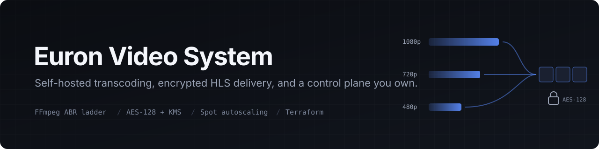
</p>

<p align="center">
  
  <a href="LICENSE"></a>
  
  
  
  
  
  
</p>

<p align="center">
  <a href="https://github.com/euron-sde-team/euron-video-system/stargazers"></a>
  <a href="https://github.com/euron-sde-team/euron-video-system/fork"></a>
  <a href="https://github.com/euron-sde-team/euron-video-system/watchers"></a>
  <br>
  <a href="https://github.com/euron-sde-team/euron-video-system/issues"></a>
  <a href="https://github.com/euron-sde-team/euron-video-system/pulls"></a>
  <a href="https://github.com/euron-sde-team/euron-video-system/commits/main"></a>
  
  <br>
  <a href="#built-by-the-team-behind-euron"></a>
</p>

<p align="center">
  <b><a href="#-quickstart">Quickstart</a></b> ·
  <b><a href="#️-architecture">Architecture</a></b> ·
  <b><a href="#-explore-the-repository">Explore the repo</a></b> ·
  <b><a href="#-api-at-a-glance">API</a></b> ·
  <b><a href="#️-deploy-to-aws">Deploy</a></b> ·
  <b><a href="docs/architecture/security.md">Security</a></b> ·
  <b><a href="#-documentation">Docs</a></b>
</p>

**Euron Video System (EVS)** is an open-source, MIT-licensed project, part of the
open-source initiative of **ENGAGESPHERE TECHNOLOGY PRIVATE LIMITED**. It takes an
uploaded video file and turns it into adaptive, encrypted HLS that only viewers your
platform has authorized can watch. It runs entirely inside your own cloud account.

Transcoding runs on EC2 Spot workers that scale from zero. Every video is encrypted with its
own AES-128 key, wrapped by KMS. Playlists and keys are served behind short-lived, revocable
playback tokens. Around that pipeline sits a full control plane: scoped API keys, playback
policies, signed webhooks, an append-only audit log and usage metering. The whole stack runs
on a laptop against an AWS emulator, and on real AWS from the same Terraform.

<p align="center">
  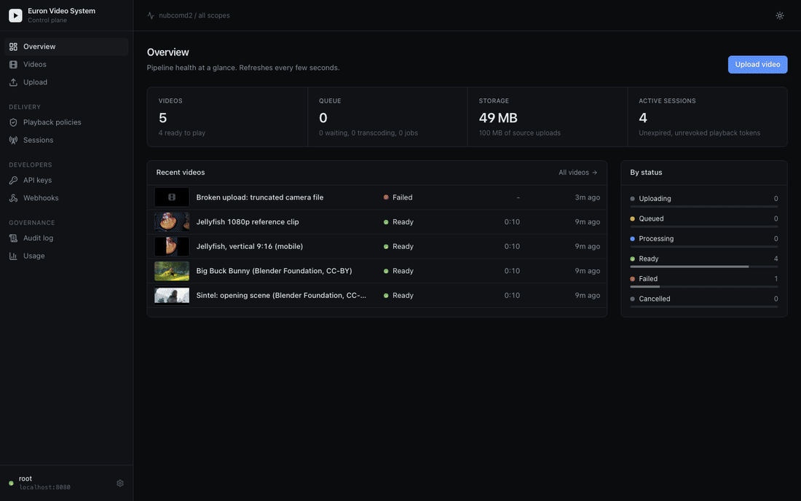
</p>

> [!NOTE]
> Everything in the tour above ran for real: Docker Compose on a laptop against a local AWS
> emulator. The pipeline transcoded, encrypted and KMS-wrapped those clips, and the console
> streamed them back through tokenized playlists. `make demo` reproduces it.

<h3 align="center">Built by the team behind Euron</h3>

<p align="center">Euron Video System comes from the people who build these platforms. If you like how this repository is built, come and see what we build with it.</p>

<p align="center">
  <a href="https://euron.one"><picture><source media="(prefers-color-scheme: dark)" srcset="docs/assets/brand/euron-dark.svg"></picture></a>
  <a href="https://euronsystems.com"><picture><source media="(prefers-color-scheme: dark)" srcset="docs/assets/brand/euron-systems-dark.svg"></picture></a>
  <a href="https://alphaeuron.com"><picture><source media="(prefers-color-scheme: dark)" srcset="docs/assets/brand/alpha-euron-dark.svg"></picture></a>
</p>

<p align="center">
  <a href="https://www.instagram.com/euron_official"></a>
  <a href="https://www.linkedin.com/company/euronone/posts/"></a>
  <a href="https://x.com/euron712"></a>
  <a href="https://www.youtube.com/@Euron-official"></a>
  <a href="https://whatsapp.com/channel/0029VaeeJwq9RZAfPW9P2l07"></a>
</p>

---

## 📚 Table of contents

- [Why EVS](#-why-evs)
- [At a glance](#-at-a-glance)
- [Screenshots](#️-screenshots)
- [Features](#-features)
- [Architecture](#️-architecture)
  - [The life of a video](#the-life-of-a-video)
- [Tech stack](#-tech-stack)
- [Prerequisites](#-prerequisites)
- [Quickstart](#-quickstart)
- [Explore the repository](#-explore-the-repository)
- [Integrate it into your platform](#-integrate-it-into-your-platform)
- [API at a glance](#-api-at-a-glance)
- [Configuration](#️-configuration)
- [Deploy to AWS](#️-deploy-to-aws)
- [Security model](#-security-model)
- [Testing](#-testing)
- [Documentation](#-documentation)
- [Roadmap](#️-roadmap)
- [FAQ](#-faq)
- [Contributing, security and license](#-contributing-security-and-license)

## 💡 Why EVS

Hosted video platforms charge per minute stored and streamed, and they keep your content,
your keys and your viewer data in *their* account. Building it yourself means stitching
together transcoding, packaging, encryption, key custody, autoscaling and an admin surface,
then keeping all of it correct when a Spot instance vanishes mid-encode.

EVS is that stitching, done carefully and tested end to end.

| You get | Because |
| --- | --- |
| 🔐 **Content keys that never leave your account** | Per-video AES-128 keys are wrapped by *your* KMS key, bound to the video id as encryption context, and unwrapped only to serve an authorized playback session. |
| 💸 **Zero idle compute** | The orchestrator launches Spot workers from queue depth. Workers terminate themselves when idle, so no busy worker is ever killed by the scaler. |
| 🛡️ **Correctness under failure** | Postgres is the queue (`FOR UPDATE SKIP LOCKED`). Every write is guarded by ownership, a reaper recovers dead workers, and Spot interruptions hand work back without burning a retry. |
| 🧭 **A control plane, not just a pipeline** | Scoped API keys, playback policies (TTL, origin allowlist, concurrent-session caps), revocable sessions, signed webhooks over a transactional outbox, an append-only audit log, and usage rollups. |
| 💻 **One switch between laptop and cloud** | `make up` runs everything against a local AWS emulator provisioned by the *same* Terraform, and `make up-aws` points the same containers at real AWS. |

## 📊 At a glance

<table>
<tr>
<td align="center" width="16%"><h3>1</h3>command to run it all<br><sub><code>make up</code></sub></td>
<td align="center" width="16%"><h3>10</h3>Terraform modules<br><sub>3 environments</sub></td>
<td align="center" width="16%"><h3>268</h3>automated tests<br><sub>unit · integration · e2e</sub></td>
<td align="center" width="16%"><h3>6</h3>architecture<br>decision records</td>
<td align="center" width="16%"><h3>4</h3>delivery drivers<br><sub>CloudFront · S3 · proxy · public</sub></td>
<td align="center" width="16%"><h3>0</h3>idle workers<br><sub>scales from zero</sub></td>
</tr>
</table>

## 🖼️ Screenshots

<table>
  <tr>
    <td width="50%">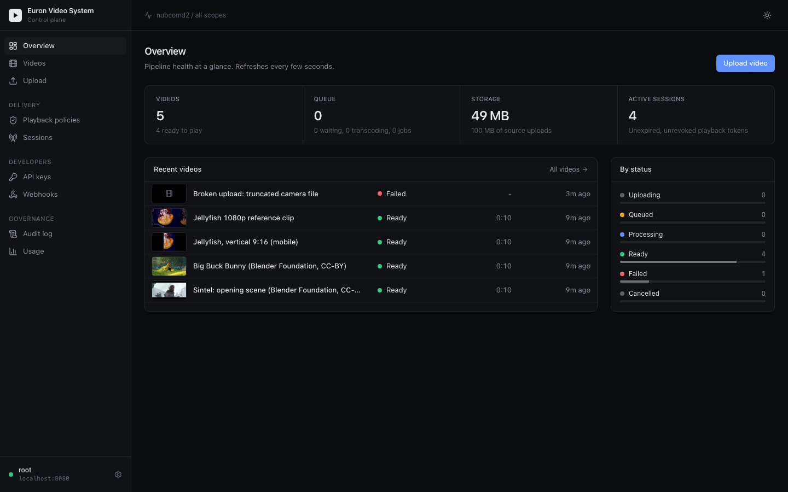<br><sub><b>Overview.</b> Pipeline health, queue depth, storage, active sessions.</sub></td>
    <td width="50%">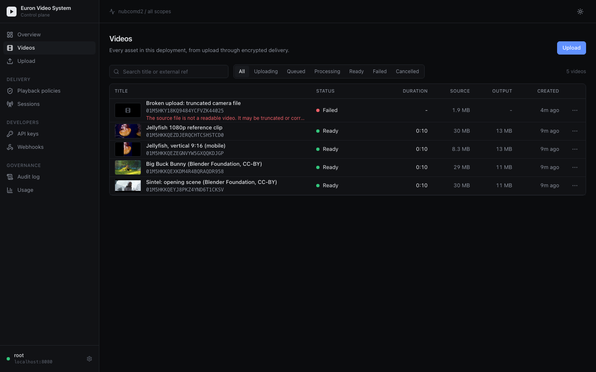<br><sub><b>Videos.</b> Every asset from upload to delivery. Failures carry a client-safe reason.</sub></td>
  </tr>
  <tr>
    <td>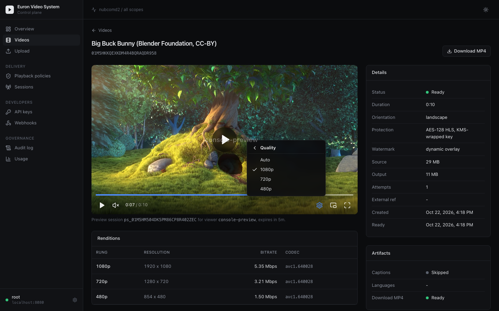<br><sub><b>Player.</b> Manual rendition switching across the ABR ladder.</sub></td>
    <td>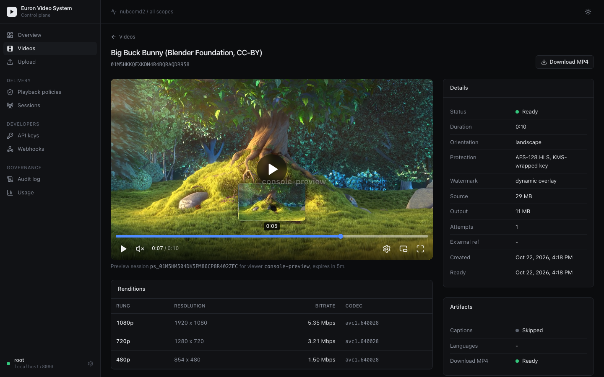<br><sub><b>Scrubbing.</b> Sprite thumbnails from a <code>#xywh</code> WebVTT track.</sub></td>
  </tr>
  <tr>
    <td>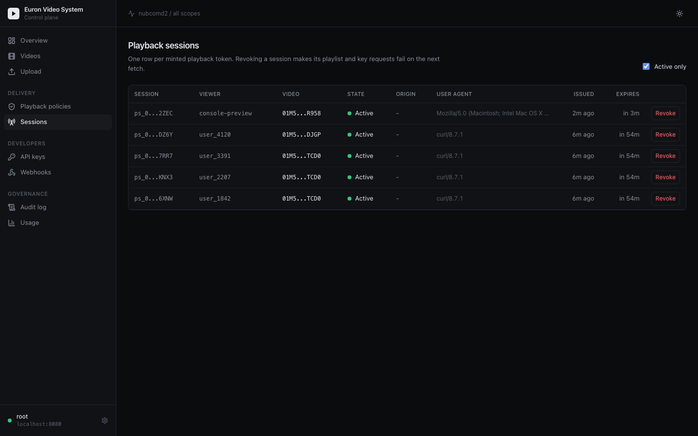<br><sub><b>Sessions.</b> One row per minted token, revocable instantly.</sub></td>
    <td>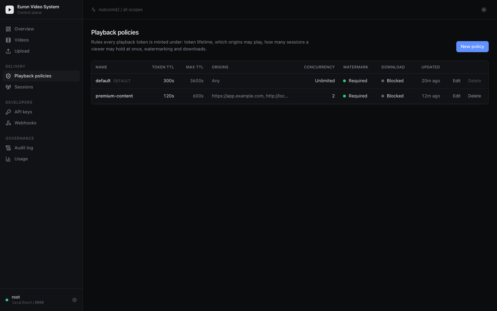<br><sub><b>Playback policies.</b> TTL, origins, concurrency, watermark, downloads.</sub></td>
  </tr>
  <tr>
    <td>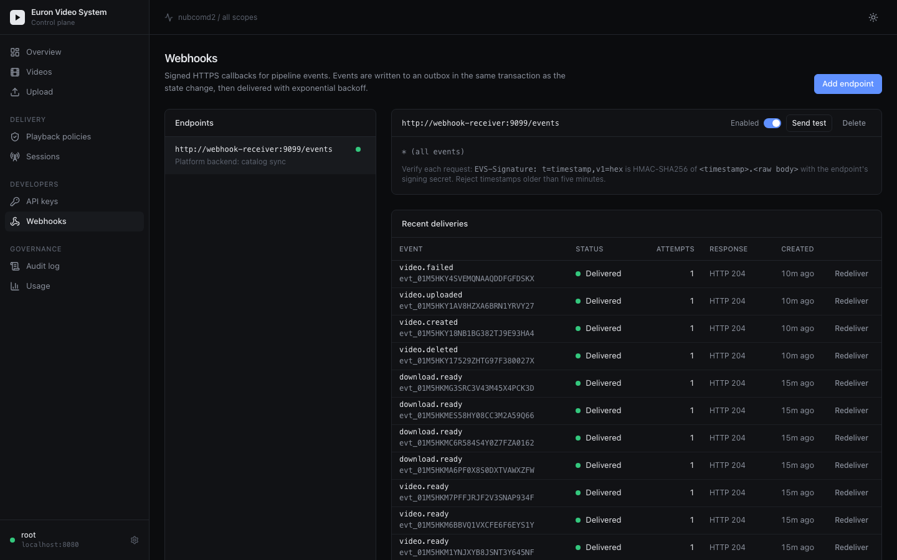<br><sub><b>Webhooks.</b> Signed deliveries from the outbox, with redelivery.</sub></td>
    <td>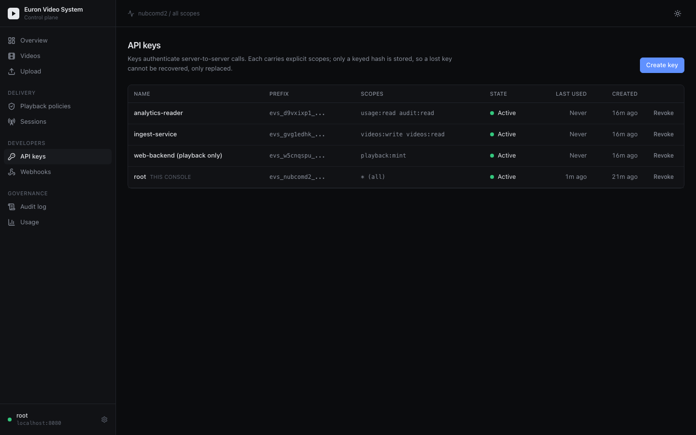<br><sub><b>API keys.</b> Least-privilege scopes per integration.</sub></td>
  </tr>
  <tr>
    <td>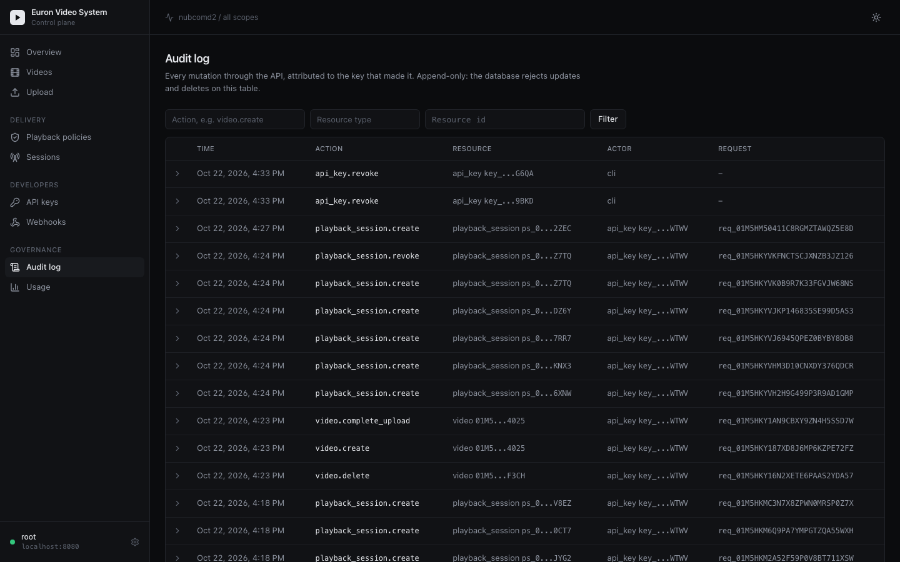<br><sub><b>Audit log.</b> Every mutation, attributed. The database refuses edits.</sub></td>
    <td>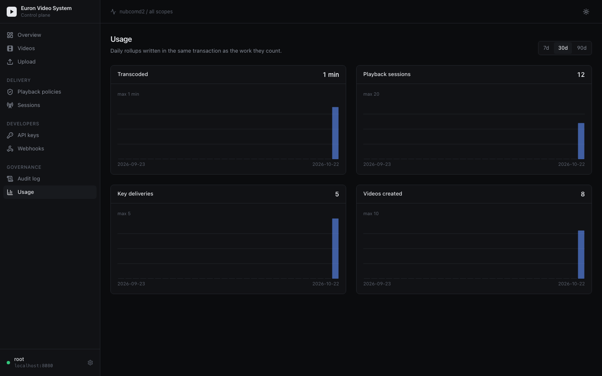<br><sub><b>Usage.</b> Daily rollups written in the same transaction as the work.</sub></td>
  </tr>
</table>

## ✨ Features

<table>
<tr>
<td valign="top" width="50%">

#### 🎬 Media pipeline
- **Single-decode, multi-encode FFmpeg ladder** using capped-CRF x264. Each rung is capped
  to the source's real bitrate with a quality floor, so screen recordings stay sharp.
- **Orientation-aware rungs**: portrait sources get portrait rungs, and nothing is ever upscaled.
- **AES-128 HLS**: MPEG-TS, 4-second segments, one key per video.
- **Poster + sprite thumbnails** with a `#xywh` WebVTT track for seek previews.
- **Captions** with whisper.cpp, run as an independent background job.
- **Downloadable MP4**, re-encoded for size rather than copied from the top rung.
- **Near-static sources** (slides held for minutes) are retimed to a playable frame rate.

</td>
<td valign="top" width="50%">

#### 🔐 Delivery & protection
- **KMS envelope encryption** of content keys. Every other key is HKDF-derived with
  domain separation.
- **Session-bound playback tokens**: HS256 with a `kid` keyring for zero-downtime rotation,
  plus `aud`, `exp` and `jti`.
- **Per-request playlist rewriting**: tokenized key and variant URIs, signed segment URIs.
- **Pluggable delivery drivers**: CloudFront signed URLs, S3 presigned URLs, an
  authenticated proxy, or public (testing only).
- **Dynamic watermark** carrying the viewer identity, and **concurrent-session caps**.

</td>
</tr>
<tr>
<td valign="top">

#### 🧭 Control plane
- **REST API** with an OpenAPI 3.1 spec and interactive docs at `/docs`.
- **API keys** (`evs_<prefix>_<secret>`): stored as a peppered HMAC, carry explicit scopes,
  and can never escalate their own privileges.
- **Webhooks** signed with `EVS-Signature`, written to a transactional outbox, retried with
  exponential backoff, guarded against SSRF.
- **Append-only audit log**, enforced by database triggers.
- **Usage metering**: transcode time, sessions, key deliveries, uploads.

</td>
<td valign="top">

#### 🖥️ Console, player & operations
- **Operator console** for uploads, monitoring, previews, sessions, policies, keys,
  webhooks, audit and usage. Dark and light themes.
- **Embeddable React player**: hls.js plus native HLS on iPhone, quality and speed menus,
  captions, PiP, keyboard shortcuts, thumbnail scrubbing and the moving watermark.
- Prometheus **`/metrics`**, structured JSON logs, request ids, and liveness and readiness probes.
- **CloudWatch dashboard and alarms** provisioned by Terraform.

</td>
</tr>
</table>

## 🏗️ Architecture

<p align="center">
  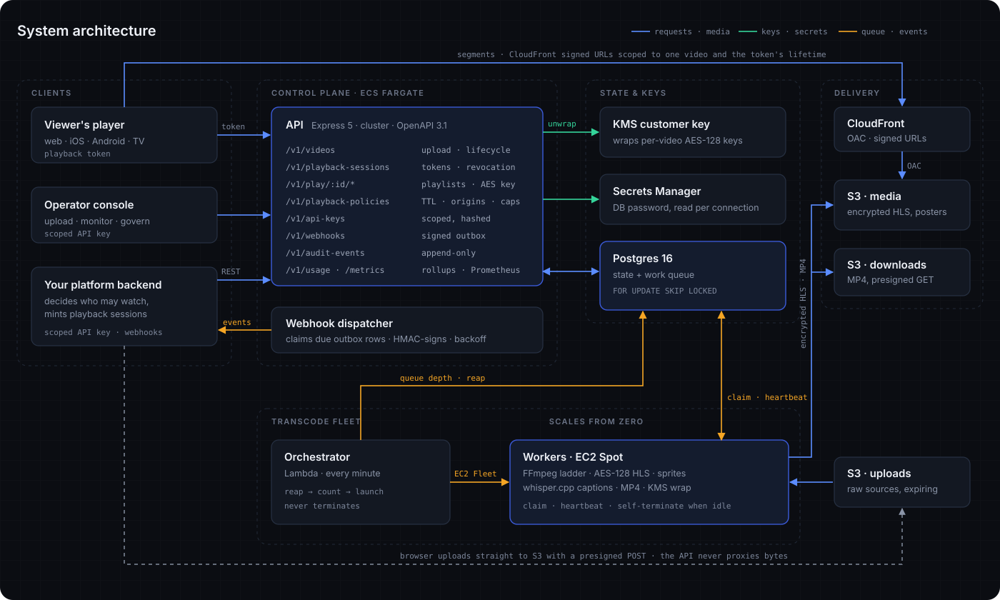
</p>

| Component | Runs as | Responsibility |
| --- | --- | --- |
| [`apps/api`](apps/api) | ECS Fargate (arm64), Node cluster | Control plane, playback authorization, playlist rewriting, key delivery, webhook dispatch |
| [`apps/worker`](apps/worker) | EC2 Spot (Graviton) from a Packer AMI | Claim, transcode, encrypt, package, upload. Captions and MP4 jobs. Self-terminates when idle. |
| [`apps/orchestrator`](apps/orchestrator) | Lambda on EventBridge Scheduler (every minute) | Reap dead claims, size the fleet from queue depth, launch with EC2 Fleet. Never terminates. |
| [`apps/console`](apps/console) | Static SPA (nginx) | Operator UI over the public API |
| Postgres 16 | RDS, private subnets | All state **and** the work queues |
| S3 + CloudFront | Private buckets behind OAC | Raw uploads, encrypted HLS, downloadable MP4s |
| KMS + Secrets Manager | Managed | Content-key wrapping, deployment secrets, rotating DB password |

### The life of a video

<p align="center">
  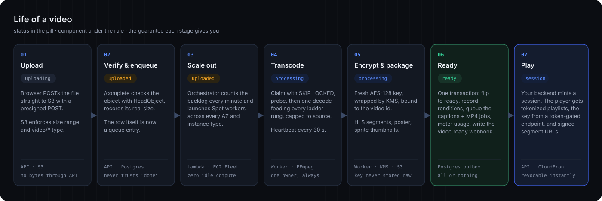
</p>

<details>
<summary><b>Sequence: upload → ready</b> (click to expand)</summary>

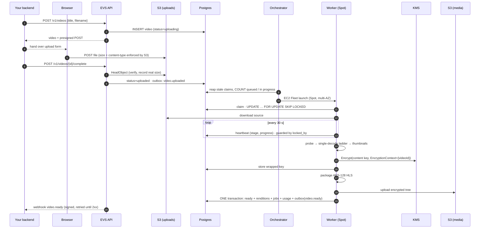
</details>

<details>
<summary><b>Sequence: playback and key delivery</b></summary>

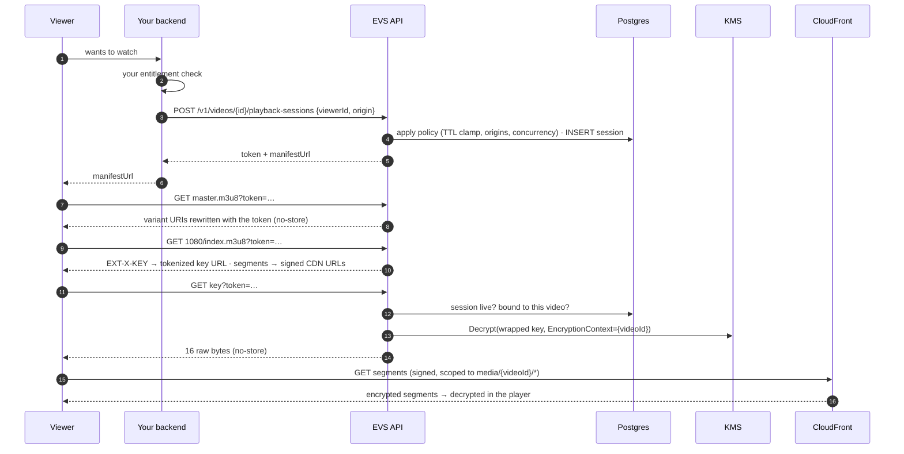
</details>

<details>
<summary><b>State machine: the work queue</b></summary>

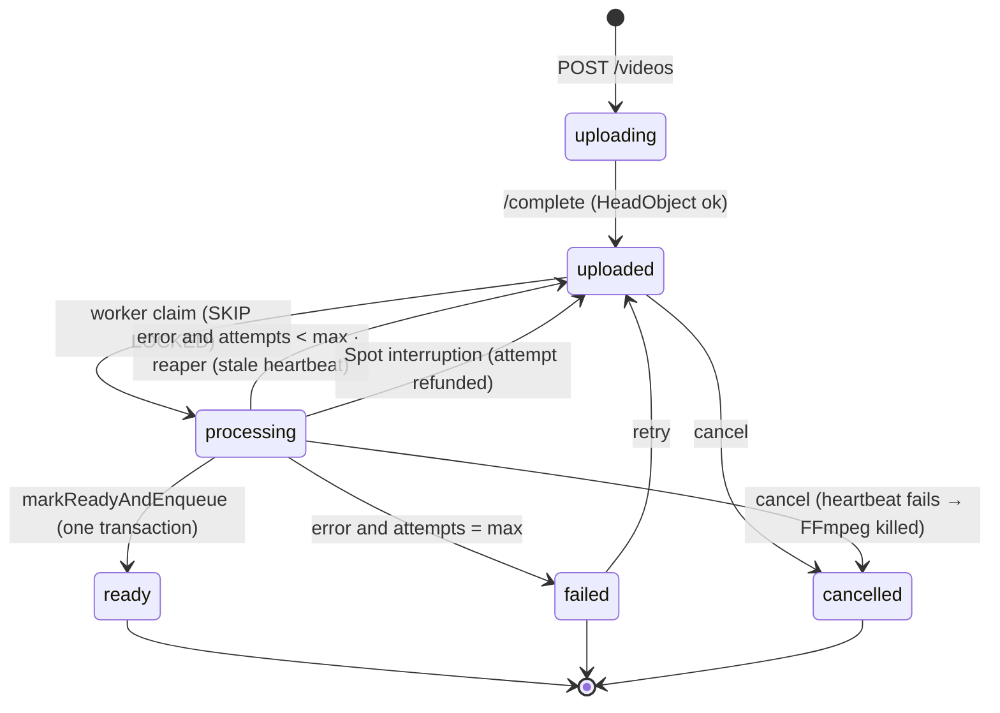

Every arrow out of `processing` is a guarded `UPDATE … WHERE locked_by = $worker AND status = 'processing'`,
so a worker that lost its claim can never overwrite a row another worker now owns. Details are in
[LLD § queue](docs/architecture/LLD.md#queue-state-machine) and [ADR-0001](docs/architecture/adr/0001-postgres-as-the-queue.md).
</details>

<details>
<summary><b>Key hierarchy</b></summary>

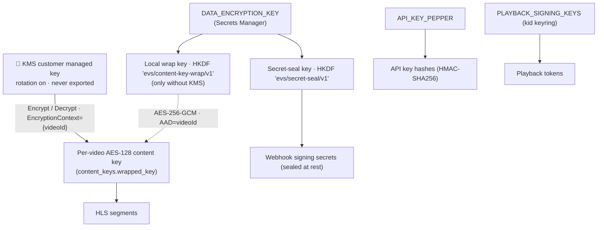
</details>

<details>
<summary><b>Autoscaling: how many workers to launch</b></summary>

Every minute the orchestrator computes, per pool:

```
spare   = max(0, running - in_progress)                # idle or booting workers
desired = ceil(queued / DIVISOR) - spare
launch  = clamp(desired, 0, MAX_WORKERS - running)
```

It launches with **EC2 Fleet (`instant`)** across *every subnet × instance type* pair,
walking a strict preference ladder (`c7g.4xlarge → c7g.2xlarge → … → m7g.xlarge`). One
AZ's Spot pool running dry therefore never stalls the fleet. Workers self-terminate after
`IDLE_GRACE_MS` of finding nothing to claim. An optional second pool runs captions and MP4
jobs on smaller instances. The controller is a pure function, unit-tested in
[`apps/orchestrator/test`](apps/orchestrator/test). See [ADR-0004](docs/architecture/adr/0004-spot-fleet-and-self-terminating-workers.md).
</details>

The full design: **[High-level design](docs/architecture/HLD.md)** · **[Low-level design](docs/architecture/LLD.md)** ·
**[Data model](docs/architecture/data-model.md)** · **[ADRs](docs/architecture/adr/README.md)**.

## 🧰 Tech stack

| Layer | Choices |
| --- | --- |
| **Language** | TypeScript (strict), Node.js 22 LTS, ES modules, pnpm workspaces + Turborepo |
| **API** | Express 5, Zod validation, Kysely (type-safe SQL), jsonwebtoken, prom-client, helmet, express-rate-limit |
| **Media** | FFmpeg 7 (libx264, AAC, HLS muxer), whisper.cpp, hls.js |
| **Data** | PostgreSQL 16, as both the system of record and the work queue |
| **AWS** | S3, CloudFront (OAC + key groups), KMS, Secrets Manager, RDS, ECS Fargate, EC2 Fleet (Spot), Lambda, EventBridge Scheduler, CloudWatch |
| **Frontend** | React 18, TanStack Query 5, React Router 6, Tailwind CSS 3, Vite 5 |
| **Infrastructure** | Terraform (AWS provider 6.x), Packer, Docker multi-stage images, Docker Compose |
| **Local cloud** | [Floci](https://github.com/floci-io/floci), an MIT-licensed AWS emulator |
| **Quality** | Vitest, Supertest, ESLint, Prettier, tflint, checkov, gitleaks, CodeQL, shellcheck |

## 📦 Prerequisites

Pick the row for what you want to do. Everything else is pulled as a container.

| Tool | Version | Try it locally | Develop | Deploy to AWS | Notes |
| --- | --- | :---: | :---: | :---: | --- |
| [Docker](https://docs.docker.com/get-docker/) with Compose v2 | 24+ / Compose 2.20+ | ✅ | ✅ | ✅ | Runs the whole local stack, the emulator and Terraform |
| GNU `make` | any | ✅ | ✅ | ✅ | Preinstalled on macOS and most Linux distros |
| `curl`, `jq`, `openssl`, `xxd` | any | ✅ | ✅ | | Used by the demo and e2e scripts |
| [Node.js](https://nodejs.org/) | 22 LTS | | ✅ | ✅ | `.nvmrc` pins it |
| [pnpm](https://pnpm.io/) | 9.15 | | ✅ | ✅ | `corepack enable` provides the pinned version |
| [FFmpeg](https://ffmpeg.org/) | 7.x | | ✅ | | Only to run the worker or its integration tests outside Docker |
| [Terraform](https://developer.hashicorp.com/terraform/install) | 1.10+ | | optional | ✅ | `make tf-validate` falls back to a container if missing |
| [AWS CLI](https://aws.amazon.com/cli/) | v2 | | | ✅ | Plus credentials for the target account |
| [Packer](https://developer.hashicorp.com/packer/install) | 1.11+ | | | ✅ | Builds the worker AMI |

Hardware for the local stack: about **4 CPU cores and 6 GB of RAM** available to Docker.
The first `make up` builds the worker image (FFmpeg, whisper.cpp and the ~150 MB `base` Whisper speech model; production images default to the more accurate `small`)
and takes a few minutes. Later starts take seconds. Works on macOS (Apple silicon and Intel),
Linux and Windows via WSL 2.

## 🚀 Quickstart

```bash
git clone https://github.com/euron-sde-team/euron-video-system.git
cd euron-video-system

make up      # emulator + Terraform apply + Postgres + migrations + API + 2 workers + console
make demo    # creates an API key and pushes a sample video through the whole pipeline
```

Open **http://localhost:3000**, paste the API key `make demo` printed into **Settings**, and
watch the video move from `uploading` to `ready`. Open it to play the encrypted stream.

<details>
<summary><b>What <code>make up</code> does, step by step</b></summary>

1. **`make env`** writes `deploy/compose/.env` with random, local-only secrets: the data
   encryption key, API key pepper and playback signing keyring.
2. Starts **[Floci](https://github.com/floci-io/floci)**, a local AWS emulator, on `:4566`.
3. Runs **the same Terraform used for AWS** (`infra/terraform/envs/local-floci`) against it.
   That creates the three S3 buckets, the KMS key and the Secrets Manager entries. Set
   `enable_cdn = true` to also exercise the CloudFront module, which the emulator supports at
   the management level.
4. Starts **Postgres** and applies the migrations (`db/migrations`, checksummed and run
   under an advisory lock).
5. Starts the **API** (`:8080`), **two workers**, the **orchestrator** (with a no-op
   launcher, since EC2 is not emulated), the **console** (`:3000`) and a reference
   **webhook receiver**.
</details>

**Local services**

| Service | URL / port | What it is |
| --- | --- | --- |
| Console | http://localhost:3000 | Operator UI |
| API | http://localhost:8080 | REST API · `/docs` interactive reference · `/metrics` |
| AWS emulator | http://localhost:4566 | S3, KMS, Secrets Manager |
| Postgres | `localhost:5432` | user `evs` · database `evs` |
| Workers ×2, orchestrator | n/a | `make logs SERVICE=worker` |
| Webhook receiver | in-network `webhook-receiver:9099` | Verifies signatures from the dispatcher |

> [!TIP]
> **Ports already taken?** Set `EVS_CONSOLE_PORT`, `EVS_API_PORT`, `EVS_PG_PORT` or
> `EVS_FLOCI_PORT` before `make up`. CORS follows the console port automatically.

**Prove the whole chain works:**

```bash
make e2e
```

```text
  PASS uploaded video 01M5HK8F9J5C5JC61FEPE2XPD1
  PASS video ready
  PASS master playlist 200 with token
  PASS master playlist 401 without token
  PASS key endpoint returned exactly 16 bytes
  PASS segment delivered encrypted
  PASS delivered key decrypts the delivered segment into valid H.264 MPEG-TS
  PASS thumbnail sprite VTT served with #xywh cues
  PASS revoked session rejected with 401
e2e: all assertions passed
```

<details>
<summary><b>Run the same containers against real AWS</b></summary>

```bash
# 1. Provision real infrastructure (see "Deploy to AWS")
terraform -chdir=infra/terraform/envs/aws-dev init
terraform -chdir=infra/terraform/envs/aws-dev apply

# 2. Point the local containers at it
cp deploy/compose/.env.aws.example deploy/compose/.env.aws   # bucket names, KMS key, CloudFront ids
AWS_PROFILE=your-profile make up-aws
```

The difference is configuration only: no endpoint override, credentials from your AWS
profile, and segments served through CloudFront signed URLs. Guide:
[docs/guides/local-with-aws.md](docs/guides/local-with-aws.md).
</details>

<details>
<summary><b>Everyday commands</b></summary>

| Command | Does |
| --- | --- |
| `make up` / `make down` | Start / stop the local stack (`down` also deletes volumes) |
| `make logs SERVICE=api` | Tail one service |
| `make key` | Create a root API key (printed once) |
| `make demo` | Key + sample video through the pipeline |
| `make test` · `make test-integration` · `make e2e` | The three test layers |
| `make lint` · `make typecheck` · `make build` | Quality gates |
| `make tf-fmt` · `make tf-validate` | Terraform hygiene, no credentials needed |
| `make sanitize` | Scan for credentials and cloud identifiers |
| `pnpm evs keys:create --name ci --scopes videos:read` | CLI: scoped key |
</details>

## 🧭 Explore the repository

**New here? Follow one video through the code in about 15 minutes.** Each step is a single
file, in the order the video meets it:

| # | Read | You'll learn |
| :-: | --- | --- |
| 1 | [`db/migrations/0001_init.sql`](db/migrations/0001_init.sql) | The whole data model in one screen, and why there's no tenant column |
| 2 | [`apps/api/src/routes`](apps/api/src/routes) | Every endpoint and the scope it requires |
| 3 | [`apps/api/src/services/videos.service.ts`](apps/api/src/services/videos.service.ts) | Create → presigned POST → `/complete` with HeadObject |
| 4 | [`packages/core/src/queue/index.ts`](packages/core/src/queue/index.ts) | `SKIP LOCKED` claims, guarded writes, the atomic ready transaction |
| 5 | [`apps/orchestrator/src/controller.ts`](apps/orchestrator/src/controller.ts) | The scaling decision as a pure function |
| 6 | [`apps/worker/src/pipeline.ts`](apps/worker/src/pipeline.ts) | Probe → ladder → thumbnails → key → package → upload |
| 7 | [`apps/worker/src/encoding/ladder.ts`](apps/worker/src/encoding/ladder.ts) | Cap-to-source with a quality floor, orientation-aware rungs |
| 8 | [`packages/core/src/crypto/index.ts`](packages/core/src/crypto/index.ts) | KMS envelope encryption, encryption-context binding, HKDF |
| 9 | [`apps/api/src/services/playback.service.ts`](apps/api/src/services/playback.service.ts) | Policies, sessions, concurrency caps, tokens |
| 10 | [`apps/api/src/playback`](apps/api/src/playback) | Playlist rewriting and token verification |
| 11 | [`apps/api/src/delivery/index.ts`](apps/api/src/delivery/index.ts) | CloudFront signing with one policy per playlist |
| 12 | [`packages/player/src`](packages/player/src) | How a browser plays it back |

The narrated version, with excerpts, is **[docs/guides/walkthrough.md](docs/guides/walkthrough.md)**.

<details>
<summary><b>Pick a track by role</b></summary>

| If you are… | Start with | Then |
| --- | --- | --- |
| 🛠️ **Backend engineer** | [`packages/core/src/queue`](packages/core/src/queue) | [`apps/api/src/services`](apps/api/src/services) → [`apps/api/test/integration`](apps/api/test/integration) |
| 🎞️ **Video engineer** | [`apps/worker/src/encoding`](apps/worker/src/encoding) | [`apps/worker/test/integration/pipeline.int.test.ts`](apps/worker/test/integration/pipeline.int.test.ts) (encode, encrypt, decrypt) |
| ☁️ **Platform / DevOps** | [`infra/terraform/envs/aws-prod`](infra/terraform/envs/aws-prod) | [`infra/terraform/modules`](infra/terraform/modules) → [`infra/packer`](infra/packer) → [`.github/workflows-full`](.github/workflows-full) |
| 🔒 **Security reviewer** | [docs/architecture/security.md](docs/architecture/security.md) | [threat model](docs/architecture/threat-model.md) → [`packages/core/src/crypto`](packages/core/src/crypto) → [`apps/api/src/webhooks/ssrf.ts`](apps/api/src/webhooks/ssrf.ts) |
| 🎨 **Frontend engineer** | [`packages/player/src`](packages/player/src) | [`apps/console/src/pages`](apps/console/src/pages) → [`apps/console/src/api`](apps/console/src/api) |
| 🧑‍💼 **Evaluating it** | This README + [`make demo`](#-quickstart) | [HLD](docs/architecture/HLD.md) → [ADRs](docs/architecture/adr/README.md) |
</details>

<details>
<summary><b>Where do I find…?</b></summary>

| Looking for | Go to |
| --- | --- |
| Every environment variable, validated | [`packages/core/src/config/index.ts`](packages/core/src/config/index.ts) · [configuration guide](docs/guides/configuration.md) |
| The FFmpeg command lines | [`apps/worker/src/encoding/ffmpeg.ts`](apps/worker/src/encoding/ffmpeg.ts), [`hls.ts`](apps/worker/src/encoding/hls.ts) |
| How a Spot interruption is handled | [`apps/worker/src/index.ts`](apps/worker/src/index.ts) · `releaseClaim` in [queue](packages/core/src/queue/index.ts) |
| Webhook signing and retry schedule | [`apps/api/src/webhooks`](apps/api/src/webhooks) |
| API key format and hashing | [`apps/api/src/services/api-key-format.ts`](apps/api/src/services/api-key-format.ts) |
| The OpenAPI spec | [`docs/api/openapi.yaml`](docs/api/openapi.yaml) |
| IAM policies per component | `main.tf` in each of [`api-service`](infra/terraform/modules/api-service), [`worker-fleet`](infra/terraform/modules/worker-fleet), [`orchestrator`](infra/terraform/modules/orchestrator) |
| Why X was chosen over Y | [`docs/architecture/adr`](docs/architecture/adr/README.md) |
</details>

```
euron-video-system/
├── apps/
│   ├── api/            Control plane + playback API     routes → controllers → services → repositories
│   ├── worker/         Transcode worker                 FFmpeg ladder · AES-128 HLS · thumbnails · captions · MP4
│   ├── orchestrator/   Spot autoscaler                  pure controller · EC2 Fleet launcher · Lambda + local loop
│   └── console/        Operator console                 React · TanStack Query · Tailwind
├── packages/
│   ├── core/           Shared runtime                   validated config · Postgres queue · storage · envelope crypto
│   └── player/         Embeddable player                hls.js · native HLS · sprites · watermark
├── db/migrations/      Forward-only SQL                 checksummed runner with an advisory lock
├── infra/
│   ├── terraform/      10 modules · 3 envs              local-floci · aws-dev · aws-prod
│   ├── packer/         Worker AMI                       Amazon Linux 2023 arm64
│   └── docker/         Images                           multi-stage · non-root · pinned
├── deploy/compose/     Local stack                      base · emulator overlay · real-AWS overlay
├── examples/           Webhook receiver                 reference implementation, contract-tested
├── scripts/            CLI · demo · e2e                 keys, policies, sanitization check
└── docs/               Architecture · guides · API      HLD · LLD · security · threat model · ADRs · OpenAPI
```

## 🔌 Integrate it into your platform

EVS does not know who your users are, and it shouldn't. **Your backend decides who may
watch**, then asks EVS for a playback session.

**1 · Upload** from your backend, with a key scoped to `videos:write`:

```bash
curl -s -X POST "$EVS/v1/videos" -H "Authorization: Bearer $EVS_KEY" \
  -H "Content-Type: application/json" \
  -d '{"title":"Intro to distributed systems","filename":"intro.mp4","externalRef":"lesson_42"}'
```
```jsonc
{
  "video":  { "id": "01J…", "status": "uploading", "title": "Intro to distributed systems", … },
  "upload": { "url": "https://…", "fields": { "key": "uploads/01J…/original.mp4", … }, "expiresAt": "…" }
}
```

The browser POSTs the file straight to `upload.url`, with `upload.fields` and a `video/*`
Content-Type. Then call `POST /v1/videos/{id}/complete`. Subscribe a webhook to
`video.ready` to learn when it's playable.

**2 · Authorize a viewer** after *your* entitlement check, with a key scoped to `playback:mint`:

```bash
curl -s -X POST "$EVS/v1/videos/$VIDEO_ID/playback-sessions" \
  -H "Authorization: Bearer $EVS_PLAYBACK_KEY" -H "Content-Type: application/json" \
  -d '{"viewerId":"user_42","origin":"https://app.example.com"}'
```
```jsonc
{
  "sessionId": "ps_01J…",
  "token": "eyJhbGciOiJIUzI1NiIsImtpZCI6…",
  "expiresAt": "2026-10-22T12:05:00.000Z",
  "manifestUrl": "https://api.example.com/v1/play/01J…/master.m3u8?token=…",
  "thumbnailsUrl": "https://api.example.com/v1/play/01J…/thumbnails.vtt?token=…",
  "posterUrl": "https://…",
  "watermark": { "required": true, "text": "user_42" }
}
```

**3 · Play** with the bundled player, or hand `manifestUrl` to any HLS player (Safari,
hls.js, Video.js, ExoPlayer, AVPlayer):

```tsx
import { EvsPlayer } from "@evs/player";

<EvsPlayer
  manifestUrl={session.manifestUrl}
  thumbnailsUrl={session.thumbnailsUrl}
  posterUrl={session.posterUrl}
  watermarkText={session.watermark.required ? session.watermark.text : undefined}
  onRefreshSession={() => api.mintPlaybackSession(videoId)} // re-mints on 401/403, resumes in place
/>
```

**4 · React to events.** Every delivery is signed. The reference receiver in
[`examples/webhook-receiver`](examples/webhook-receiver/server.mjs) verifies the signature
over the raw body, enforces a 5-minute replay window and deduplicates by event id. A
contract test keeps it in lockstep with the API's signer.

| Event | When |
| --- | --- |
| `video.created` · `video.uploaded` | Row created · upload verified and queued |
| `video.ready` | Playable. Renditions are listed in the payload. |
| `video.failed` | Terminal failure, with a client-safe reason |
| `captions.ready` · `download.ready` | Background artifacts finished |
| `video.cancelled` · `video.deleted` | Lifecycle changes |

## 🔗 API at a glance

The API is documented in **[`docs/api/openapi.yaml`](docs/api/openapi.yaml)** (OpenAPI 3.1).
Every running API also serves an interactive reference at **`GET /docs`**. Two auth modes:

| Caller | Credential | Used for |
| --- | --- | --- |
| Your backend, the console | `Authorization: Bearer evs_…` (scoped API key) | Videos, sessions, policies, keys, webhooks, audit, usage |
| A viewer's player | Playback token (in the URL, so native HLS works) | Playlists, the AES key, thumbnails, poster |

Errors are always `{"error": {"code", "message", "requestId", "details?"}}`, and every
response carries `X-Request-Id`.

## ⚙️ Configuration

Configuration is validated at boot with Zod. A misconfigured service refuses to start and
lists **every** problem at once, and placeholder secrets are rejected in production. These
are the settings you'll touch most:

| Variable | Default | Purpose |
| --- | --- | --- |
| `DATABASE_URL` *or* `DATABASE_SECRET_ARN` + `DB_*` | n/a | Static URL, or the RDS-managed secret read per connection (rotation-safe) |
| `UPLOADS_BUCKET` · `MEDIA_BUCKET` · `DOWNLOADS_BUCKET` | n/a | One bucket per purpose |
| `KMS_KEY_ID` | unset (local wrap) | Customer key that wraps content keys. Always set it in production. |
| `DELIVERY_DRIVER` | `presigned` | `cloudfront-signed` · `presigned` · `proxy` · `public` |
| `PLAYBACK_SIGNING_KEYS` · `PLAYBACK_ACTIVE_KID` | n/a | Token keyring for zero-downtime rotation |
| `API_KEY_PEPPER` · `DATA_ENCRYPTION_KEY` | n/a | 32+ char secrets |
| `LADDER_PRESET` · `LADDER_CRF` · `CAP_TO_SOURCE*` | `medium` · `19` · on | Encoding quality and speed levers, no image rebuild needed |
| `MAX_WORKERS` · `DIVISOR` · `WORKER_INSTANCE_TYPES` | `20` · `1` · Graviton ladder | Fleet sizing |

The full reference, covering about 70 variables grouped by service, is in
**[docs/guides/configuration.md](docs/guides/configuration.md)**.

## ☁️ Deploy to AWS

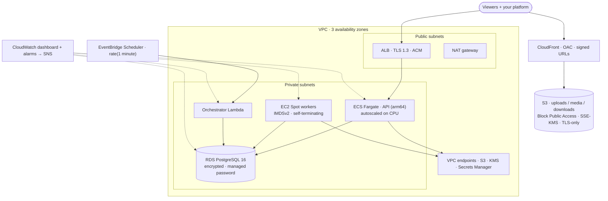

```bash
# 1. Build the worker AMI (once per worker release)
packer init infra/packer && packer build infra/packer/worker.pkr.hcl

# 2. Configure and apply
cd infra/terraform/envs/aws-prod
cp terraform.tfvars.example terraform.tfvars   # name_prefix, domain, ACM cert, AMI id, image tag
terraform init && terraform plan -out tfplan && terraform apply tfplan

# 3. Push the API image to the ECR repository Terraform created, then run the migrate task
```

| Module | Provisions |
| --- | --- |
| [`network`](infra/terraform/modules/network) | VPC, 3-AZ public and private subnets, NAT, S3 gateway + KMS/Secrets Manager interface endpoints |
| [`storage`](infra/terraform/modules/storage) | 3 buckets: Block Public Access, SSE-KMS, lifecycle expiry on uploads, TLS-only policy, browser-upload CORS |
| [`kms`](infra/terraform/modules/kms) | Customer managed key with rotation and a least-privilege key policy |
| [`cdn`](infra/terraform/modules/cdn) | CloudFront with OAC, public key + key group for signed URLs, CORS headers policy |
| [`secrets`](infra/terraform/modules/secrets) | Generated deployment secrets and the CloudFront signing key pair |
| [`database`](infra/terraform/modules/database) | RDS PostgreSQL 16, encrypted, RDS-managed rotating password, backups, Performance Insights |
| [`api-service`](infra/terraform/modules/api-service) | ECR, ECS Fargate (arm64), ALB, autoscaling, read-only root FS, one-off migrate task |
| [`worker-fleet`](infra/terraform/modules/worker-fleet) | Launch template (IMDSv2, shutdown-terminates), least-privilege instance profile with no EC2 API access |
| [`orchestrator`](infra/terraform/modules/orchestrator) | Lambda (arm64, Node 22) in private subnets, EventBridge Scheduler, DLQ |
| [`observability`](infra/terraform/modules/observability) | CloudWatch dashboard, alarms (ALB 5xx, RDS, Lambda errors), SNS topic |

No account id or ARN is hardcoded. Every name derives from `name_prefix`, so one AWS account
can host several isolated deployments. The step-by-step guide is
**[docs/guides/deploy-aws.md](docs/guides/deploy-aws.md)**.

## 🔒 Security model

| Layer | Control |
| --- | --- |
| **Content at rest** | AES-128 per video, key wrapped by KMS with `EncryptionContext={videoId}`, so a wrapped key moved to another video fails to decrypt |
| **Key delivery** | Only to a valid, unexpired, unrevoked session bound to that video. `Cache-Control: no-store`. Each Decrypt is attributable in CloudTrail. |
| **Segments** | Private bucket, CloudFront OAC, signed URLs scoped to `media/{videoId}/*` and the token's lifetime |
| **API access** | Peppered-HMAC API keys, explicit scopes, no self-escalation, per-key rate limits, strict CORS allowlist |
| **Secrets** | Secrets Manager only. The DB password is read per connection, so rotation needs no restart. Webhook secrets are sealed at rest. |
| **Integrity** | Audit log append-only by trigger. Webhooks written in the same transaction as the change they report. |
| **Infrastructure** | Private subnets, IMDSv2, TLS-only bucket policies, non-root containers, least-privilege IAM per component |
| **Supply chain** | Pinned images and lockfile; gitleaks, CodeQL, checkov and tflint workflows provided, plus `make sanitize` locally |

> [!IMPORTANT]
> **What AES-128 does not protect against.** A viewer who is *legitimately authorized* for a
> video can extract that video's key, as with any clear-key scheme, and nothing stops screen
> recording. The viewer watermark deters the latter, and hardware-backed multi-DRM is on the
> roadmap. We call this **access control with encryption, not DRM**. See
> [security.md](docs/architecture/security.md) and the [STRIDE threat model](docs/architecture/threat-model.md).

## ✅ Testing

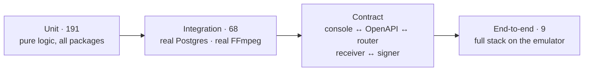

| Layer | What it proves | Run |
| --- | --- | --- |
| **Unit** (191) | Crypto (wrap binding, tamper detection), config validation, ladder math, playlist rewriting, token rotation and revocation, CloudFront policy signing, webhook signatures, SSRF guard, scaling controller, player and console logic | `make test` |
| **Integration** (68) | 25 workers racing for 10 videos with zero double claims · guarded writes after a lost claim · reaper recovery · outbox fan-out · audit immutability · every API route over HTTP · FFmpeg encode → encrypt → **decrypt with the advertised IV** back to valid MPEG-TS | `make test-integration` |
| **Contract** | Console types ⊆ OpenAPI schemas · OpenAPI ≡ router · reference receiver accepts what the dispatcher signs | `make test` |
| **End-to-end** (9) | Docker stack on the emulator: upload → transcode → token-gated playlists and key → **the delivered key decrypts the delivered segment** → revocation → 401 | `make e2e` |

A fast [`checks`](.github/workflows/checks.yml) workflow (lint, typecheck, unit tests) runs on
every push and pull request. The full pipeline, with integration tests on Postgres, image builds,
`terraform validate`, tflint, checkov, gitleaks, CodeQL and the e2e suite, ships ready-made in
[`.github/workflows-full`](.github/workflows-full) for you to enable in a fork. Every gate also
runs locally through `make`.

## 📖 Documentation

| | |
| --- | --- |
| **🏛️ Architecture** | [High-level design](docs/architecture/HLD.md) · [Low-level design](docs/architecture/LLD.md) · [Data model](docs/architecture/data-model.md) · [Decision records](docs/architecture/adr/README.md) |
| **🔒 Security** | [Security architecture](docs/architecture/security.md) · [Threat model (STRIDE)](docs/architecture/threat-model.md) · [Reporting vulnerabilities](SECURITY.md) |
| **🚀 Guides** | [Local quickstart](docs/guides/quickstart-local.md) · [Local with real AWS](docs/guides/local-with-aws.md) · [Deploy to AWS](docs/guides/deploy-aws.md) · [Worker AMI](docs/guides/worker-ami.md) |
| **⚙️ Operate** | [Configuration](docs/guides/configuration.md) · [Webhooks](docs/guides/webhooks.md) · [Operations runbook](docs/guides/operations.md) · [Troubleshooting](docs/guides/troubleshooting.md) |
| **🧭 Learn the code** | [Code walkthrough](docs/guides/walkthrough.md) · [Contributing](CONTRIBUTING.md) |
| **🔗 API** | [OpenAPI 3.1](docs/api/openapi.yaml), served live at `/docs` |

## 🗺️ Roadmap

- [ ] **Multi-DRM**: CMAF cbcs packaging with Widevine, FairPlay and PlayReady license
      proxying behind the same session authorization. The schema already reserves `protection = 'drm_cbcs'`.
- [ ] **Forensic A/B watermarking** to trace a leak to its session (`watermark = 'forensic_ab'`)
- [ ] **Per-segment random IVs** for AES-128
- [ ] **GPU (NVENC) worker pool** as an optional fast lane
- [ ] **Published npm packages**: the player, plus a typed client generated from the OpenAPI spec
- [ ] **Live streaming** ingest (RTMP/SRT → LL-HLS)
- [ ] **Bootstrap key into Secrets Manager**: `evs keys:create --store-secret <arn>`, so the first key on AWS never passes through task logs
- [ ] **Console hosting module** (S3 + CloudFront) in Terraform

Have an idea? [Open a feature request](https://github.com/euron-sde-team/euron-video-system/issues/new/choose).

## ❓ FAQ

<details>
<summary><b>Is AES-128 HLS "DRM"?</b></summary>

No, and we don't call it that. It's access control with encryption: keys are only delivered
to authorized, revocable sessions, and segments are useless without them. Hardware DRM is on
the roadmap. See [ADR-0003](docs/architecture/adr/0003-aes-128-hls-now-multi-drm-later.md).
</details>

<details>
<summary><b>Why Postgres as the queue instead of SQS or Redis?</b></summary>

One source of truth, so a video's queue state *is* its row, and state changes plus their side
effects (jobs, webhooks, usage) commit in one transaction. The workload is long-running
rather than high-throughput. See [ADR-0001](docs/architecture/adr/0001-postgres-as-the-queue.md).
</details>

<details>
<summary><b>Can one deployment serve several customers?</b></summary>

Each deployment serves one organization by design. Isolation is the cloud account
boundary, with its own database, buckets and KMS key, not a `tenant_id` column. Run one
deployment per organization from the same Terraform. See
[ADR-0006](docs/architecture/adr/0006-single-tenant-deployments.md).
</details>

<details>
<summary><b>Does it work outside AWS?</b></summary>

The storage layer is S3-compatible (MinIO and Cloudflare R2 work by configuration) and
delivery drivers are pluggable. The Terraform, Spot orchestration and KMS integration
target AWS. Workers and the API run anywhere Docker runs.
</details>

<details>
<summary><b>What does it cost to run?</b></summary>

With no uploads you pay for the always-on pieces only: RDS, the API tasks, NAT and the load
balancer. Transcode compute is Spot and scales to zero. Delivery is CloudFront egress.
</details>

## 🤝 Contributing, security and license

Contributions are welcome: bug reports, docs fixes, new delivery drivers, encoder
improvements. Read **[CONTRIBUTING.md](CONTRIBUTING.md)** and the
**[Code of Conduct](CODE_OF_CONDUCT.md)** first. Report vulnerabilities privately, as
described in **[SECURITY.md](SECURITY.md)**.

If EVS saves you time, **[⭐ star the repository](https://github.com/euron-sde-team/euron-video-system/stargazers)**.
It helps others find it.

Released under the **[MIT License](LICENSE)**: free to use, modify and distribute, commercially or not.

<p align="center">
  <sub>Open source, built and maintained by <b>ENGAGESPHERE TECHNOLOGY PRIVATE LIMITED</b> as part of its open-source initiative, by the team behind <a href="https://euron.one">Euron</a>, <a href="https://euronsystems.com">Euron Systems</a> and <a href="https://alphaeuron.com">Alpha Euron</a>.</sub><br>
  <sub>Demo footage in the screenshots: <i>Big Buck Bunny</i> and <i>Sintel</i> © Blender Foundation,
  <a href="https://creativecommons.org/licenses/by/3.0/">CC BY 3.0</a>. Sample media is downloaded at demo time and is not part of this repository.</sub>
</p>
