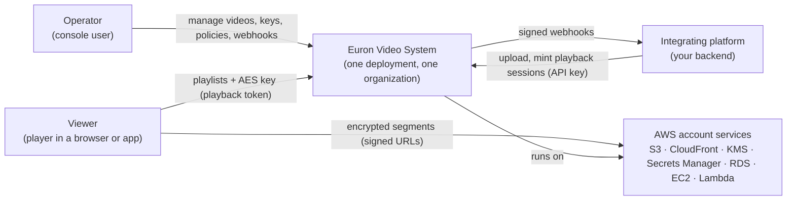
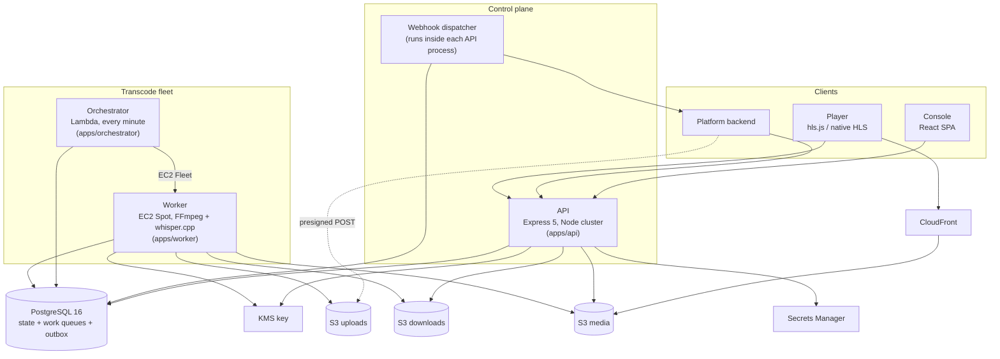
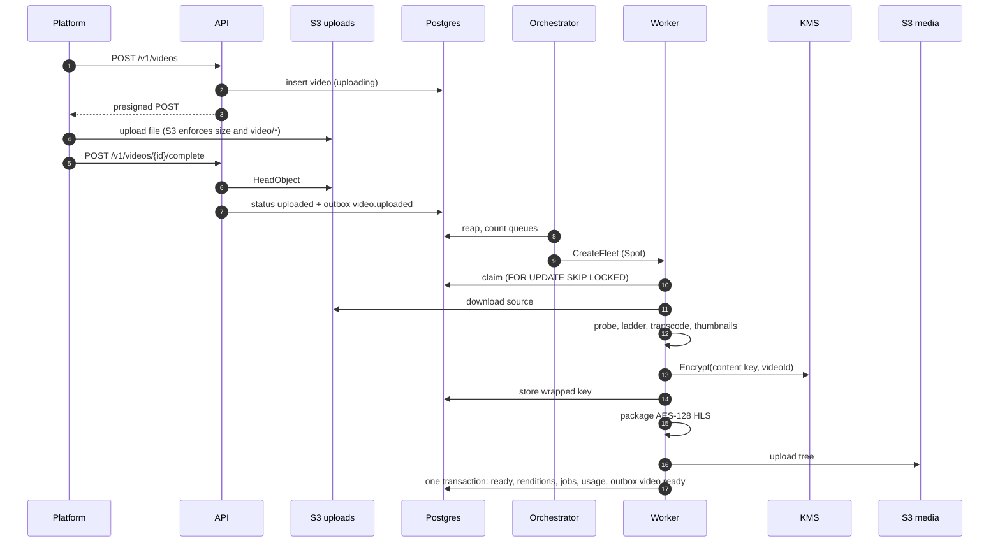
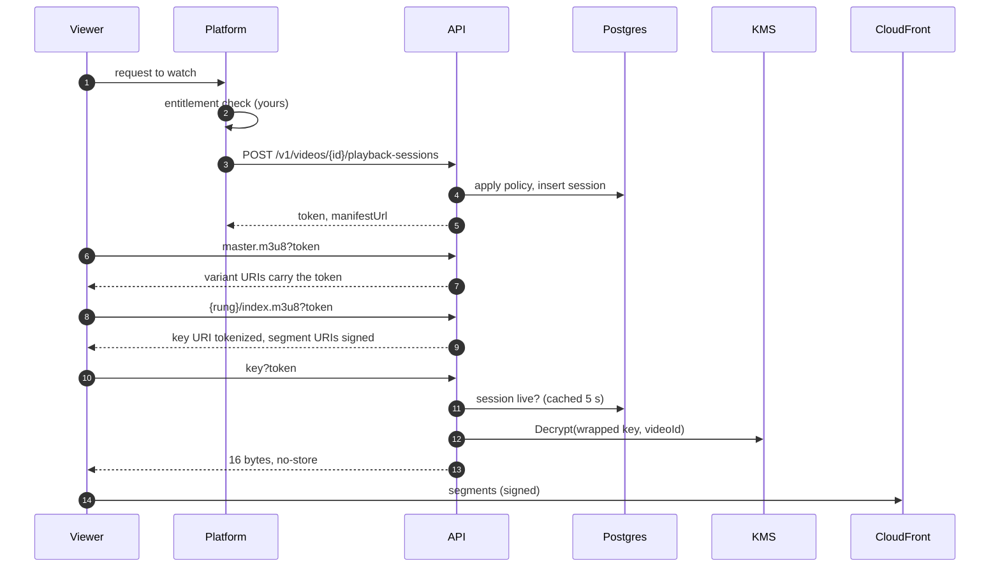
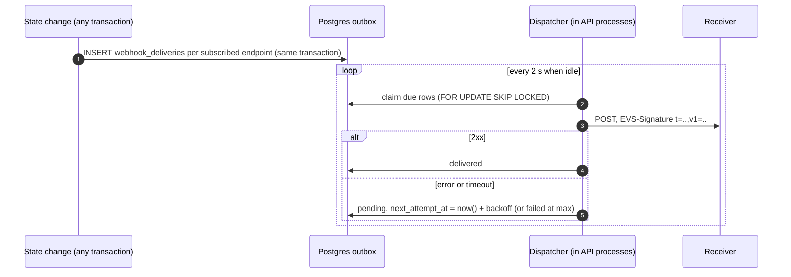
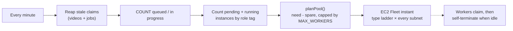
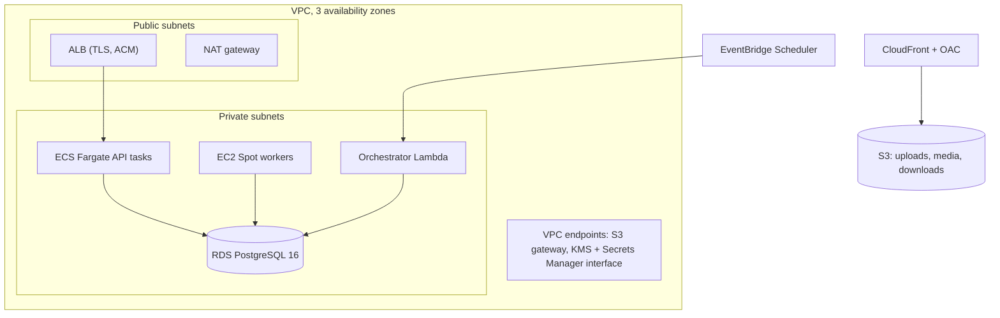
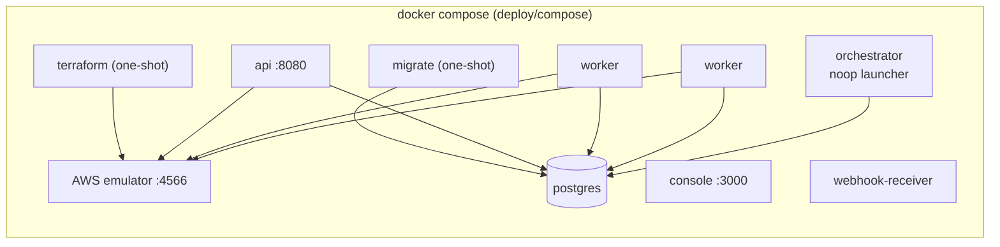

# High-Level Design

This document describes what Euron Video System (EVS) is made of, how the pieces
talk to each other, and how the system behaves under load and failure. The
module-level detail is in the [Low-Level Design](LLD.md), the tables in the
[Data Model](data-model.md), and the reasoning behind each major choice in the
[ADRs](adr/README.md).

- [Goals and non-goals](#goals-and-non-goals)
- [System context](#system-context)
- [Containers](#containers)
- [Component responsibilities](#component-responsibilities)
- [Main flows](#main-flows)
- [Deployment topology](#deployment-topology)
- [Scalability](#scalability)
- [Availability and failure modes](#availability-and-failure-modes)
- [Security summary](#security-summary)
- [Observability](#observability)
- [Key design decisions](#key-design-decisions)

## Goals and non-goals

**Goals**

| # | Goal | How it is met |
| - | ---- | ------------- |
| G1 | Turn an uploaded file into adaptive HLS that plays on every modern browser and device | FFmpeg ABR ladder (up to 1080p), MPEG-TS segments, hls.js plus native Apple HLS |
| G2 | Only viewers authorized by the integrating platform can watch | Per-video AES-128 keys, token-gated key delivery, revocable playback sessions, signed segment URLs |
| G3 | Content keys stay in the operator's own cloud account | KMS envelope encryption with the video id as encryption context |
| G4 | No compute cost when idle; bounded queue latency when busy | Spot workers launched from queue depth, self-terminating when idle |
| G5 | Correct under worker loss, Spot reclaims and retries | Postgres queue with ownership-guarded writes, heartbeats and a reaper |
| G6 | A control plane, not just a pipeline | Scoped API keys, playback policies, webhooks, audit log, usage |
| G7 | Runnable on a laptop without an AWS account | Local AWS emulator provisioned by the same Terraform as production |

**Non-goals**

- **Hardware-backed DRM.** AES-128 HLS is access control with encryption; multi-DRM is
  on the roadmap ([ADR-0003](adr/0003-aes-128-hls-now-multi-drm-later.md)).
- **Multi-tenancy inside one deployment.** One deployment serves one organization
  ([ADR-0006](adr/0006-single-tenant-deployments.md)).
- **End-user identity.** EVS never sees your users; your backend decides who may
  watch and mints a session for an opaque `viewerId`.
- **Live streaming.** Video on demand only.

## System context

C4 level 1: EVS and the actors around it.

## Containers

C4 level 2: the deployable units and their stores.

## Component responsibilities

| Component | Code | Runs as | Owns | Never does |
| --------- | ---- | ------- | ---- | ---------- |
| API | [`apps/api`](../../apps/api) | ECS Fargate tasks, Node cluster per task | Authentication, authorization, video lifecycle, playback sessions, playlist rewriting, key delivery, audit, usage, webhook dispatch | Transcode, proxy upload bytes |
| Worker | [`apps/worker`](../../apps/worker) | EC2 Spot instances from a Packer AMI (or containers locally) | Claim, probe, transcode, thumbnails, generate and wrap the content key, package HLS, upload; captions and MP4 jobs | Decide scaling, unwrap keys |
| Orchestrator | [`apps/orchestrator`](../../apps/orchestrator) | Lambda on EventBridge Scheduler (or a loop locally) | Reap stale claims, count backlog and workers, launch Spot capacity | Terminate instances |
| Console | [`apps/console`](../../apps/console) | Static SPA behind nginx | Operator UI over the public API | Hold any credential other than the key pasted into it |
| Player | [`packages/player`](../../packages/player) | Inside the integrator's web app | Playback, quality and caption menus, thumbnail scrub, watermark, session refresh | Fetch keys outside the playlist flow |
| Shared runtime | [`packages/core`](../../packages/core) | Library | Config validation, DB pool, queue SQL, storage, envelope crypto, errors, logging | |

## Main flows

### Upload to ready

The video is playable at the last step. Captions and the downloadable MP4 are
separate jobs claimed afterwards, so they never delay time-to-watchable.

### Playback and key delivery

### Webhook delivery

### Autoscaling

## Deployment topology

### On AWS

Provisioned by [`infra/terraform/envs/aws-prod`](../../infra/terraform/envs/aws-prod)
from ten modules under [`infra/terraform/modules`](../../infra/terraform/modules). The
worker AMI comes from [`infra/packer/worker.pkr.hcl`](../../infra/packer/worker.pkr.hcl).

### Locally

Differences from AWS are configuration only ([ADR-0005](adr/0005-local-aws-emulation.md)):
`AWS_ENDPOINT_URL` points the SDK at the emulator, workers run as fixed replicas with
`WORKER_PLATFORM=local`, the orchestrator uses the `noop` launcher, and segments are
served by the `proxy` delivery driver because the emulator's CloudFront is
management-plane only.

## Scalability

| Dimension | Scales by | Limit / bottleneck | Notes |
| --------- | --------- | ------------------ | ----- |
| Transcode throughput | More Spot workers (`MAX_WORKERS`, one per queued video by default) | Spot capacity per AZ and type; EC2 account limits | The instance-type ladder across every AZ widens the capacity pool |
| Time to first worker | n/a | Scheduler tick (1 min) + instance boot | Keep headroom or a warm worker if this matters |
| API requests | ECS tasks (CPU target tracking) × cluster workers per task | Postgres connections | Pool sizing: tasks × `CLUSTER_WORKERS` × `PG_POOL_MAX` + workers ≤ RDS `max_connections` |
| Playlist and key requests | Same as API | Revocation lookup is cached 5 s per process; no writes on the hot path except a batched key-delivery counter | Segments never touch the API with the CloudFront driver |
| Segment egress | CloudFront | CDN only | |
| Queue | Single Postgres table per queue | Claim and heartbeat are indexed point updates; partial indexes stay small | Built for long jobs, not 10k jobs per second ([ADR-0001](adr/0001-postgres-as-the-queue.md)) |
| Webhook fan-out | Every API process runs a dispatcher; `SKIP LOCKED` spreads rows | Receiver latency (10 s timeout) | Batches of 10 per claim |
| Rate limits | Per process, in memory | Effective limit grows with instance count | Swap in a shared store if exact global limits are required |

## Availability and failure modes

| Failure | Detection | Effect | Recovery |
| ------- | --------- | ------ | -------- |
| Worker process or instance dies mid-transcode | Heartbeat stops | Video stays `processing` | Reaper requeues after 10 min stale heartbeat (or 6 h absolute); retried up to `max_attempts` (3) |
| Spot interruption notice | IMDSv2 `spot/instance-action` polled every 5 s | Worker stops | Claim released immediately **without** consuming an attempt; next worker resumes |
| Video cancelled or claim stolen during encode | Guarded heartbeat matches 0 rows | Worker aborts | `AbortController` kills FFmpeg; partial output swept later |
| Poison video (always fails) | Error in pipeline | `attempts` grows | Terminal `failed` with a client-safe reason; `video.failed` webhook; pending artifacts resolved to `skipped` |
| API task dies | ALB health check on `/readyz` | In-flight requests fail | ECS replaces the task; in-flight webhook claims reaped after 5 min |
| Database failover (Multi-AZ) | Connection errors | Short write unavailability | Pools reconnect; boot uses exponential-backoff `waitForDatabase` |
| DB password rotation | n/a | None | Password read from Secrets Manager per new connection, cached 60 s |
| KMS throttling or outage | Encrypt / Decrypt errors | New videos fail packaging (retried); key requests fail | Worker retries via `failOrRequeue`; players retry key fetch |
| CloudFront or signing misconfiguration | Player 403s on segments | Playback fails | Switch `DELIVERY_DRIVER` (presigned, proxy) without redeploying the pipeline |
| Webhook receiver down | Non-2xx or timeout | Events delayed | Exponential backoff with jitter up to 1 h, 8 attempts, then `failed` and manual redeliver |
| Orchestrator Lambda errors | CloudWatch alarm, DLQ alarm | No new capacity | Existing workers keep draining; next tick retries |

## Security summary

Per-video AES-128 keys, KMS-wrapped and bound to the video id; key delivery only to a
live session for that video; signed segment URLs; peppered-HMAC API keys with explicit
scopes and no self-escalation; append-only audit by trigger; private subnets, IMDSv2 and
least-privilege IAM per component. Full detail: [security.md](security.md) and the
[threat model](threat-model.md).

## Observability

| Signal | Where | What |
| ------ | ----- | ---- |
| Logs | stdout as JSON in production (winston), CloudWatch Logs on AWS | Request id on every API line; worker logs keyed by video id |
| Metrics | `GET /metrics` (Prometheus) | `evs_api_http_request_duration_seconds`, `evs_api_key_deliveries_total`, `evs_api_playlist_requests_total`, `evs_api_playback_denials_total`, `evs_api_webhook_deliveries_total`, plus process defaults |
| Health | `GET /healthz` (liveness), `GET /readyz` (database round trip) | ALB target health uses `/readyz` |
| Alarms | [`infra/terraform/modules/observability`](../../infra/terraform/modules/observability) | API 5xx, unhealthy targets, API CPU, RDS CPU, orchestrator errors, orchestrator DLQ depth, routed to SNS |
| Audit | `GET /v1/audit-events` | Every control-plane mutation with actor and request id |
| Usage | `GET /v1/usage` | Daily transcode seconds, sessions, key deliveries, uploads |

## Key design decisions

| Decision | ADR |
| -------- | --- |
| Postgres is the work queue, writes guarded by ownership | [ADR-0001](adr/0001-postgres-as-the-queue.md) |
| Self-managed FFmpeg workers instead of a managed transcoder | [ADR-0002](adr/0002-ffmpeg-workers-over-managed-transcoding.md) |
| AES-128 HLS with KMS envelope encryption now, multi-DRM later | [ADR-0003](adr/0003-aes-128-hls-now-multi-drm-later.md) |
| Spot fleet scaled from the queue; workers terminate themselves | [ADR-0004](adr/0004-spot-fleet-and-self-terminating-workers.md) |
| Local AWS emulator, one switch to real AWS | [ADR-0005](adr/0005-local-aws-emulation.md) |
| One deployment serves one organization | [ADR-0006](adr/0006-single-tenant-deployments.md) |
