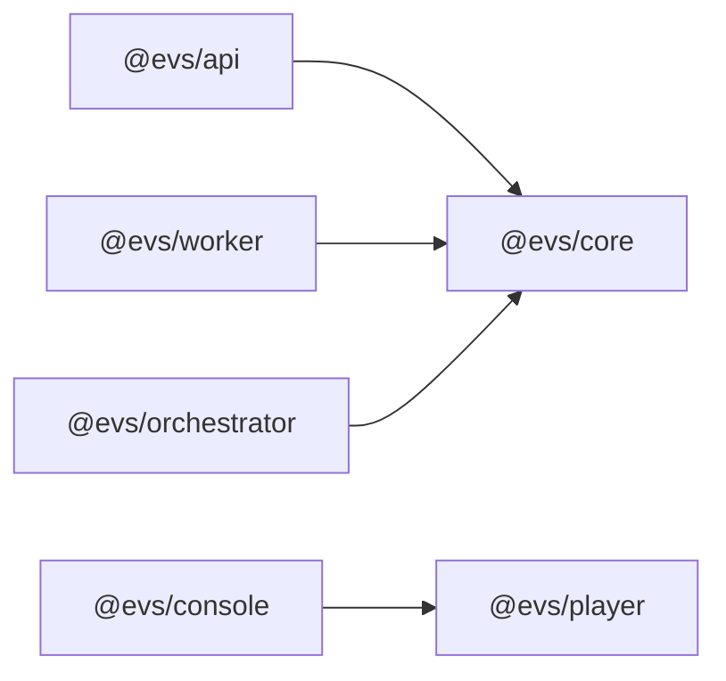
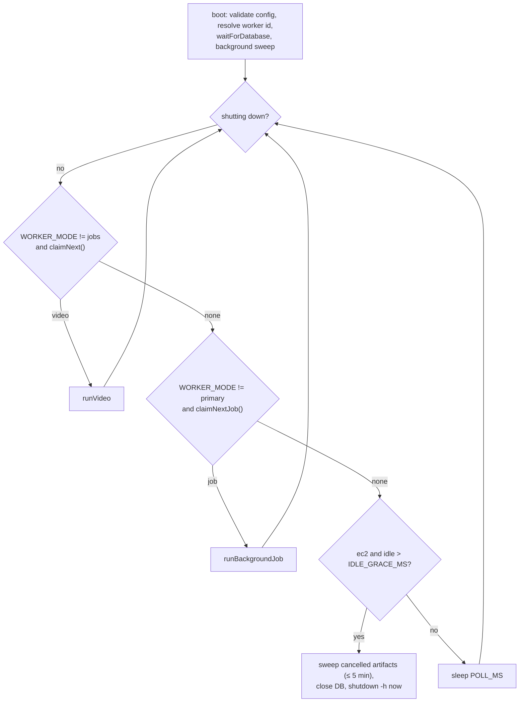
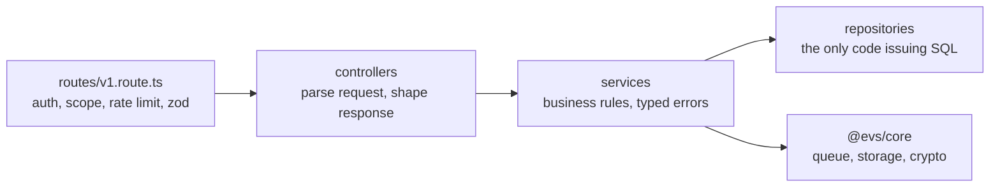
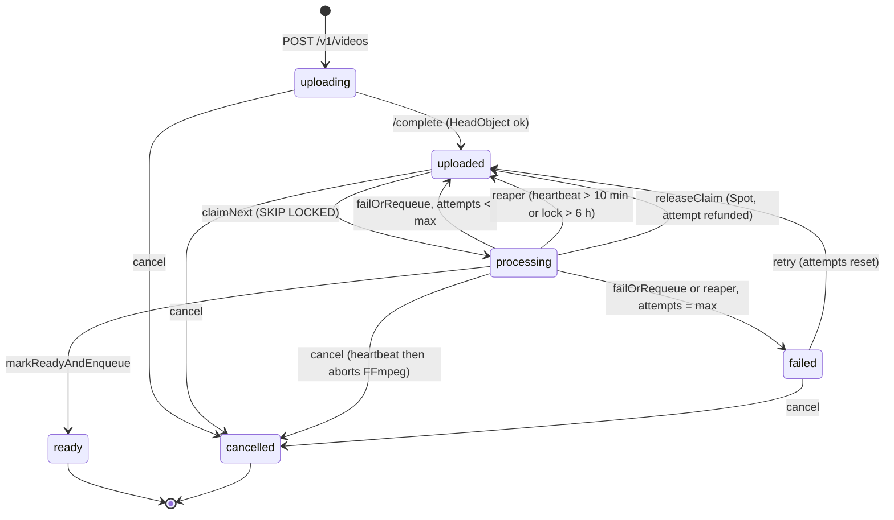
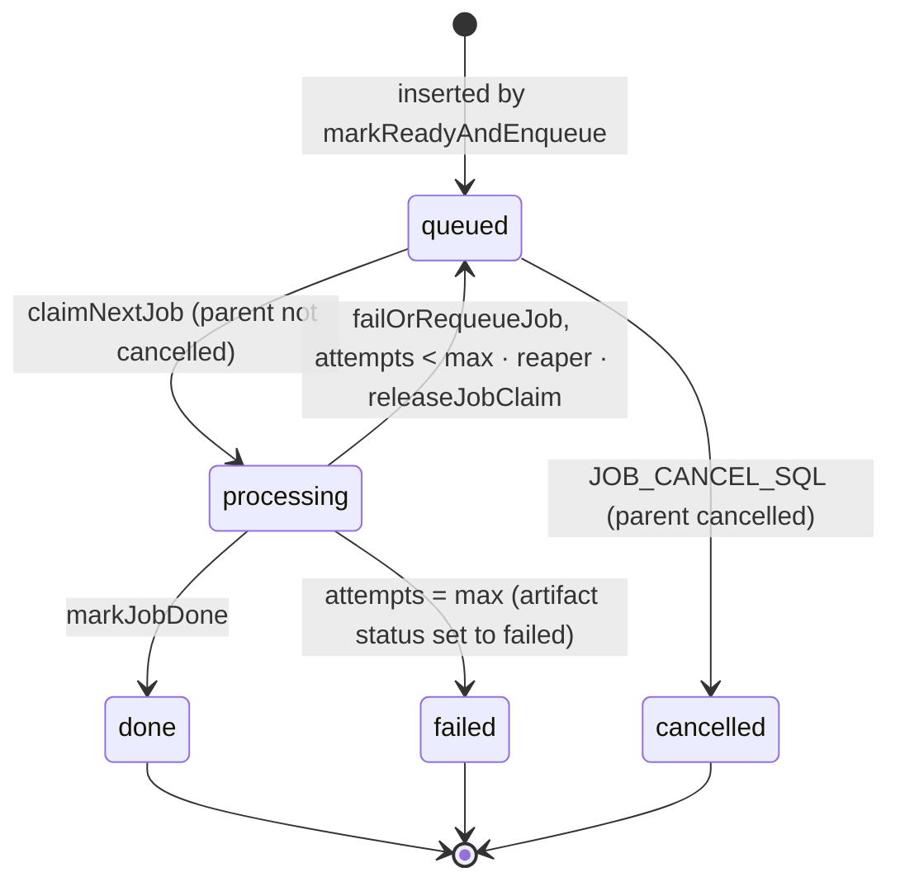

# Low-Level Design

Module-by-module design of Euron Video System. Read the [High-Level Design](HLD.md)
first for the big picture; the tables are in the [Data Model](data-model.md).

- [Monorepo layout](#monorepo-layout)
- [packages/core](#packagescore)
- [apps/worker](#appsworker)
- [apps/orchestrator](#appsorchestrator)
- [apps/api](#appsapi)
- [Queue state machine](#queue-state-machine)
- [Timeouts, limits and retry constants](#timeouts-limits-and-retry-constants)
- [Concurrency and idempotency](#concurrency-and-idempotency)

## Monorepo layout

pnpm workspaces + Turborepo, TypeScript strict, ES modules. `packages/core` is consumed
as TypeScript source (its `exports` map points at `src/*.ts`) and every Node app is
bundled into one self-contained file by esbuild, so runtime images carry no
`node_modules`.



## packages/core

### Configuration ([`config/index.ts`](../../packages/core/src/config/index.ts))

- One Zod schema per runtime: `getCoreConfig`, `getApiConfig`, `getWorkerConfig`,
  `getOrchestratorConfig`. Each is parsed once (memoized) at boot.
- A failed parse throws `ConfigError` listing **every** invalid variable at once.
- Cross-field rules live after the parse: one database mode must be configured,
  `PLAYBACK_ACTIVE_KID` must exist in the keyring, CloudFront settings are required for
  `cloudfront-signed`, `WEBHOOK_ALLOW_PRIVATE_TARGETS` is refused when `EVS_CLOUD=aws`,
  the EC2 launcher requires a launch template and subnets.
- In production, values matching `change-me`, `example`, `placeholder` are rejected for
  secret variables.
- `PLAYBACK_SIGNING_KEYS` (`kid=secret,kid2=secret2`) is parsed into a `Map`; each secret
  must be 32+ characters.

### Database ([`db/index.ts`](../../packages/core/src/db/index.ts), [`db/connection-config.ts`](../../packages/core/src/db/connection-config.ts))

- One lazily-created `pg.Pool` + Kysely instance per process. Defaults: `max` 8 in
  production (10 otherwise), `statement_timeout` 30 s, `idle_in_transaction_session_timeout`
  60 s, `application_name` = service, cluster worker and pid.
- `timestamp without time zone` is parsed as UTC; every entry point sets `TZ=UTC` first.
- `waitForDatabase` retries the first connection 6 times with exponential backoff
  (500 ms base), which rides out an RDS failover at boot.
- **Connection modes.** `resolveConnectionConfig(env)` returns either
  `{ connectionString: DATABASE_URL }` or, when `DATABASE_SECRET_ARN` is set,
  `{ host, port, database, user, ssl, password: () => fetchSecretPassword(arn) }`.
  node-postgres calls the password function for every **new** connection.
  `fetchSecretPassword` caches the password for 60 s, collapses concurrent fetches into
  one in-flight request, and never caches a failure. A rotated RDS password is
  therefore picked up within a minute with no restart. `DB_SSL` is `require` (encrypt,
  no verification) by default or `verify-full` with `DB_SSL_CA_FILE`.

### Queue ([`queue/index.ts`](../../packages/core/src/queue/index.ts), [`queue/sql.ts`](../../packages/core/src/queue/sql.ts))

| Function | SQL shape | Guard |
| -------- | --------- | ----- |
| `claimNext(worker)` | `UPDATE videos ... WHERE id = (SELECT id ... WHERE status='uploaded' ORDER BY created_at FOR UPDATE SKIP LOCKED LIMIT 1) RETURNING *` | n/a (atomic claim) |
| `heartbeat(id, worker, stage, progress)` | `UPDATE ... SET heartbeat_at = now()` | `locked_by = worker AND status = 'processing'`; returns false when 0 rows |
| `setOrientation` | | same guard |
| `releaseClaim` | back to `uploaded`, `attempts - 1` | same guard |
| `markReadyAndEnqueue` | one transaction: flip to `ready`, upsert `video_renditions`, insert `jobs`, upsert `usage_daily`, `emitEvent('video.ready')` | same guard; returns false and writes nothing else when the flip misses |
| `failOrRequeue` | `failed` when `attempts >= max_attempts`, else `uploaded`; terminal failure resolves pending artifacts to `skipped` and emits `video.failed` | same guard |
| `claimNextJob` | same `SKIP LOCKED` pattern on `jobs`, refusing jobs whose video is `cancelled` | n/a |
| `jobHeartbeat` | | guard plus "parent video not cancelled" |
| `markJobDone`, `failOrRequeueJob`, `releaseJobClaim` | | `locked_by` + `processing` |
| `markCaptionsReady`, `markMp4Ready` | flip artifact status + emit `captions.ready` / `download.ready` | n/a |
| `listCancelledPage` | keyset page over `(updated_at, id)` of cancelled videos 15 min to 7 days old | n/a |

`queue/sql.ts` holds `REAP_SQL`, `COUNT_QUEUE_SQL`, `JOB_REAP_SQL`, `JOB_COUNT_SQL`,
`JOB_RECONCILE_SQL` and `JOB_CANCEL_SQL` as plain strings with **no imports**, so the
Lambda can run them on its own per-invocation client without loading the shared pool.

### Events and the outbox ([`queue/events.ts`](../../packages/core/src/queue/events.ts))

`emitEvent(db, type, data)` builds an envelope `{ id: evt_<ulid>, type, createdAt, data }`
and inserts one `webhook_deliveries` row per enabled endpoint subscribed to `type` or `*`,
in a single `INSERT ... SELECT` inside the **caller's** transaction. The delivery id is
`<event id>_<endpoint id>` and `(endpoint_id, event_id)` is unique, so a replayed emit
is a no-op. Event types: `video.created`, `video.uploaded`, `video.ready`, `video.failed`,
`video.cancelled`, `video.deleted`, `captions.ready`, `download.ready`.

### Storage ([`storage/index.ts`](../../packages/core/src/storage/index.ts))

- One S3-compatible implementation for AWS S3, the local emulator, MinIO and R2.
  Credentials come from the default provider chain; no static keys in config.
- **Two clients.** `internal` talks to storage from inside the network.
  `presign` signs URLs a **browser** will use, built against `S3_PUBLIC_ENDPOINT` when
  set. SigV4 signs the host header, so a URL presigned against `http://floci:4566` would
  fail in a browser that must use `http://localhost:4566`.
- Operations: `presignUpload` (presigned POST with `content-length-range` and
  `starts-with $Content-Type video/`), `headSize`, `getText`, `getStream`, `presignGet`
  (optionally `Content-Disposition: attachment`), `downloadToFile`, `uploadFile`,
  `sumPrefix`, `deletePrefix` (batched `DeleteObjects` of 1000), `deleteObject`.
- Adaptive retry mode, 6 attempts, for S3 throttling.

### Crypto ([`crypto/index.ts`](../../packages/core/src/crypto/index.ts), [`crypto/content-key-store.ts`](../../packages/core/src/crypto/content-key-store.ts))

| Primitive | Implementation |
| --------- | -------------- |
| Content key | 16 random bytes + 16-byte key id from `crypto.randomBytes` |
| KMS wrap | `Encrypt` with `EncryptionContext = { videoId }`; unwrap via `Decrypt` with the same context |
| Local wrap (no KMS) | AES-256-GCM, key = HKDF-SHA256(`DATA_ENCRYPTION_KEY`, info `evs/content-key-wrap/v1`), AAD = video id; stored as base64 `iv(12) ‖ tag(16) ‖ ciphertext` |
| Sealed secrets | Same GCM layout, key from HKDF info `evs/secret-seal/v1`, caller-supplied context as AAD (webhook secrets use `webhook:<endpoint id>`) |
| Helpers | `hmacSha256Hex`, `sha256Hex`, `safeEqual` (constant time), `randomToken` |

`contentKeyStore.generateAndStore(videoId)` generates, wraps and upserts on `video_id`.
A re-transcode generates a **new** key and increments `key_version`. The raw key is only
returned to the caller (the packager), never persisted. `load(videoId)` unwraps for the
key endpoint.

## apps/worker

### Main loop ([`src/index.ts`](../../apps/worker/src/index.ts))



- **Claim order.** Videos always come before jobs, so captions and MP4 work never delay
  time-to-watchable. `WORKER_MODE` = `all` (default), `primary` (videos only) or `jobs`.
- **Identity.** `WORKER_PLATFORM=ec2`: the EC2 instance id from IMDSv2 (token TTL 120 s,
  no v1 fallback). `local`: `WORKER_ID` or `local-<hostname>-<pid>`.
- **Spot interruption.** Every 5 s the worker reads `spot/instance-action`; a 200 means a
  notice was issued. The worker then calls `releaseClaim` / `releaseJobClaim` (attempt
  refunded) and exits. SIGTERM and SIGINT take the same path.
- **Idle self-termination.** On `ec2`, after `IDLE_GRACE_MS` (120 s) with nothing to
  claim, the worker runs an awaited cancelled-artifact sweep capped at 5 minutes, then
  `shutdown -h now`. The launch template sets `instance_initiated_shutdown_behavior =
  terminate`, so the instance is destroyed. `WORKER_DRY_RUN_SHUTDOWN=true` logs instead.
  `local` workers never shut down.

### Cooperative cancellation ([`src/heartbeat.ts`](../../apps/worker/src/heartbeat.ts))

The `Heartbeat` class writes `stage` + `progress` every `HEARTBEAT_MS` (30 s) and at
every stage boundary. A heartbeat that **matches 0 rows** (cancelled, reaped, retried
or re-claimed) fires `onLost` exactly once, which aborts an `AbortController`. Every
FFmpeg child process and every S3 transfer takes that signal, and stage boundaries check
`signal.aborted`. A heartbeat that **throws** (a transient DB error) only logs, so a
network blip never kills a healthy encode. Background jobs use the same pattern with
`jobHeartbeat`.

### Pipeline ([`src/pipeline.ts`](../../apps/worker/src/pipeline.ts))

| Stage (`videos.stage`) | Progress | Work |
| ---------------------- | -------- | ---- |
| `transcoding` | 10 | download source, ffprobe, record orientation, select ladder |
| `transcoding` | 60 | single-decode multi-encode transcode done |
| `transcoding` | 68 | poster + sprite thumbnails done |
| `packaging` | 78 → 88 | generate + wrap + store content key, package AES-128 HLS |
| `uploading_output` | 92 | upload the output tree |
| (ready) | 100 | `markReadyAndEnqueue` |

All work happens in `WORK_DIR/<video id>/{src,renditions,output}`, removed in `finally`.
`enqueueCaptions = CAPTIONS_ENABLED && hasAudio && pipeline_config.captions !== false`;
`enqueueDownload = DOWNLOAD_ENABLED && pipeline_config.download !== false`.

### Ladder selection ([`src/encoding/ladder.ts`](../../apps/worker/src/encoding/ladder.ts))

| Table | Rung | Size | videoKbps | maxrateKbps | bufsizeKbps |
| ----- | ---- | ---- | --------: | ----------: | ----------: |
| Landscape (also square) | 1080 | 1920×1080 | 5000 | 5350 | 7500 |
| | 720 | 1280×720 | 3000 | 3210 | 4500 |
| | 480 | 854×480 | 1400 | 1500 | 2100 |
| Vertical (portrait) | 1080 | 1080×1920 | 5000 | 5350 | 7500 |
| | 720 | 720×1280 | 3000 | 3210 | 4500 |
| | 540 | 540×960 | 1600 | 1700 | 2400 |

1. **No upscaling.** Keep rungs whose limiting dimension (height for landscape, width for
   portrait) is ≤ the source's. If none fit, keep the smallest rung.
2. **Cap to source** (when `CAP_TO_SOURCE` and the probed bitrate ≥ 250 kbps):

   ```
   cap    = round(sourceKbps × CAP_TO_SOURCE_FACTOR)            # factor default 1.1
   floor  = round(rung.videoKbps × CAP_TO_SOURCE_FLOOR)         # floor default 0.6
   capped = min(max(cap, floor), rung.videoKbps)                # never raised above the ladder
   maxrate = round(capped × 1.07);  bufsize = round(capped × 1.5)
   ```

   A probed bitrate below 250 kbps is treated as untrusted (a static screen recording) and
   the full ladder is kept. Near-static sources (fps < 10) pass bitrate 0 for the same
   reason.

### Transcode ([`src/encoding/ffmpeg.ts`](../../apps/worker/src/encoding/ffmpeg.ts))

- **One FFmpeg process** decodes once and `split`s into N scale chains, so the source is
  decoded exactly once regardless of rung count. Rotation (90/180/270, from the display
  matrix) is applied as a `transpose` before the split, with `-noautorotate`.
- Per rung: `libx264`, capped CRF (`-crf LADDER_CRF` default 19, `-maxrate`, `-bufsize`),
  `deblock=-1,-1` for text detail, `-preset LADDER_PRESET`, High profile, yuv420p, lanczos
  scaling, `-force_key_frames expr:gte(t,n_forced*4)` so every rung has IDR frames at the
  same 4 s timestamps (clean, switchable segments), `+faststart`.
- Audio is extracted once to AAC 128 kb/s stereo.
- **Near-static fix.** A source under 10 fps (slides held for minutes) is retimed with a
  per-output `-r MIN_OUTPUT_FPS` (24). Without it the HLS output holds ~1 frame per
  segment and MSE players refuse it. Every output is bounded with `-t <duration>`.

### HLS packaging ([`src/encoding/hls.ts`](../../apps/worker/src/encoding/hls.ts))

- Remux only (`-c copy`) each rung MP4 + the audio into MPEG-TS with the HLS muxer:
  `-hls_time 4`, `-hls_playlist_type vod`, `-muxpreload 0 -muxdelay 0`,
  `-hls_key_info_file`.
- The key-info file has two lines: the URI sentinel `EVS_KEY_URI` and the local path of the
  16-byte key. With no third (IV) line, FFmpeg encrypts every segment with an **all-zero IV
  and declares it explicitly** (`#EXT-X-KEY:METHOD=AES-128,URI="EVS_KEY_URI",IV=0x000…0`),
  so players never fall back to the sequence-number IV rule. The key is unique per video,
  so the IV is never reused across keys (see [security.md](security.md#content-encryption)).
- The key and key-info files live in the temp renditions directory with mode `0600`,
  never under the upload tree; the uploader also skips `.key` / `.keyinfo` files.
- `master.m3u8` is synthesized: `BANDWIDTH = maxrateKbps × 1000 + 128000` (with audio),
  `CODECS="avc1.640028,mp4a.40.2"`, and an optional `SUBTITLES` group once captions exist.
  The function is deterministic, so the captions job rebuilds a byte-identical master
  plus the subtitle lines.

### Thumbnails ([`src/encoding/thumbnails.ts`](../../apps/worker/src/encoding/thumbnails.ts))

Poster: one frame at 1 s (0 s for clips ≤ 2 s). Sprites: one frame every 5 s, scaled to
160 px wide, tiled 10×10 per sheet (`sprite_001.jpg`, ...). `thumbnails.vtt` maps each 5 s
cue to `sprite_NNN.jpg#xywh=x,y,w,h`.

### Background jobs ([`src/jobs`](../../apps/worker/src/jobs))

| Job | Steps | Output |
| --- | ----- | ------ |
| `CAPTIONS` | re-download source, extract 16 kHz mono WAV, whisper.cpp with forced language (`CAPTIONS_DEFAULT_LANG` unless `pipeline_config.captionsLang`), write `hls/subs/<lang>.{vtt,m3u8}` with `X-TIMESTAMP-MAP`, rebuild master | `markCaptionsReady` (or `markCaptionsSkipped` with no audio) |
| `DOWNLOAD` | re-download source, encode H.264 capped CRF (CRF 23, maxrate 2800 kb/s; HEVC opt-in) scaled to the top rung | `downloads/<id>.mp4`, `markMp4Ready` |

### Output upload ([`src/upload.ts`](../../apps/worker/src/upload.ts))

- Walks the output tree and uploads 8 files concurrently to `media/<id>/...`.
- Each PUT retries 5 times with exponential backoff (500 ms base) plus jitter; the
  read stream is recreated per attempt. A lost claim is never retried.
- `Cache-Control`: playlists `private, max-age=300` (a captions re-publish propagates
  within minutes); everything else `private, max-age=31536000, immutable`.
- Bytes are summed during upload, so `output_bytes` needs no later LIST.

### Client-safe errors ([`src/public-error.ts`](../../apps/worker/src/public-error.ts))

The full error goes to the worker log. `videos.error` (returned by the API) gets
`toPublicError(err)`: known signatures (corrupt container, no video stream, missing source,
disk full, killed encoder) become one sentence; anything else has absolute paths, memory
addresses and ANSI codes scrubbed and is truncated to 300 characters.

### Cancelled-artifact sweep

At startup (fire and forget) and before idle shutdown (awaited), the worker keyset-pages
through cancelled videos from the last 7 days (older than 15 minutes, so in-flight aborts
have settled) and deletes their media prefix and download object. Raw sources expire via
the uploads bucket lifecycle rule.

## apps/orchestrator

### Controller ([`src/controller.ts`](../../apps/orchestrator/src/controller.ts))

`planPool` is pure:

```
need     = ceil(max(0, queued) / max(1, floor(divisor)))
spare    = max(0, running - inProgress)
toLaunch = max(0, min(need - spare, max(0, maxWorkers - running)))
```

`processing` items are excluded from `need` on purpose: a busy worker that is
momentarily uncounted (still booting, tag not yet visible, Spot-reclaimed before its
claim was reaped) can then neither inflate nor suppress a launch.

### Tick ([`src/tick.ts`](../../apps/orchestrator/src/tick.ts))

1. Open a **fresh** `pg.Client` (resolved by `resolveConnectionConfig`). No module-scope
   pool, because a pool in a frozen Lambda environment leaks connections.
2. `REAP_SQL`, `JOB_REAP_SQL`, `JOB_RECONCILE_SQL`, `JOB_CANCEL_SQL`.
3. `COUNT_QUEUE_SQL`, `JOB_COUNT_SQL`.
4. **Two pools** when `JOBS_LAUNCH_TEMPLATE_NAME` is set: videos drive the primary pool,
   jobs drive the jobs pool, each with its own role tag, instance types and cap. Otherwise
   one pool sized by `videos + jobs`.
5. Launch, log one summary line, close the client.

### Launchers ([`src/launcher.ts`](../../apps/orchestrator/src/launcher.ts), [`src/ec2.ts`](../../apps/orchestrator/src/ec2.ts))

- `Ec2SpotLauncher.countWorkers`: `DescribeInstances` filtered by `tag:role` and state
  `pending` + `running`. Booting instances must count, or every tick relaunches a fleet.
- `Ec2SpotLauncher.launch(n)`: for each instance type in preference order, one
  `CreateFleet` (`Type: instant`, Spot, `SPOT_ALLOCATION_STRATEGY`) for the remaining
  shortfall with overrides = that type × **every** worker subnet. Pools with no capacity
  come back in `Errors`, not exceptions, and the remainder spills to the next type. With
  `ONDEMAND_FALLBACK=true` a final On-Demand fleet covers what Spot could not. Launched
  instances are tagged `role=<pool tag>`.
- `NoopLauncher`: counts 0 and logs what it would launch. Used locally.

### Entry points

| File | Runs | Notes |
| ---- | ---- | ----- |
| [`src/lambda.ts`](../../apps/orchestrator/src/lambda.ts) | EventBridge Scheduler, `rate(1 minute)` | Bundled to CommonJS; Lambda reserved concurrency 1 so ticks never overlap |
| [`src/local.ts`](../../apps/orchestrator/src/local.ts) | Docker Compose | Sequential loop every `ORCHESTRATOR_INTERVAL_MS`; the next tick is scheduled only after the previous one finishes |

## apps/api

### Layering



`createApp()` ([`src/app.ts`](../../apps/api/src/app.ts)) has no side effects, so tests
mount it with supertest. [`src/index.ts`](../../apps/api/src/index.ts) forks
`CLUSTER_WORKERS` processes (0 = one per CPU); each runs the HTTP server, the usage flusher
and, when `WEBHOOK_DISPATCH_ENABLED`, a webhook dispatcher.

### Request handling

| Concern | Implementation |
| ------- | -------------- |
| Request id | Inbound `X-Request-Id` when well formed, else `req_<ulid>`; echoed on every response and recorded in errors and audit events ([`http/request-id.ts`](../../apps/api/src/http/request-id.ts)) |
| Errors | `{"error": {"code", "message", "requestId", "details?"}}`; `AppError` subclasses map to status codes; unknown errors become 500 with the message hidden in production ([`http/error-handler.ts`](../../apps/api/src/http/error-handler.ts)) |
| Validation | Zod schemas for every body and query ([`http/validate.ts`](../../apps/api/src/http/validate.ts)) |
| Proxy trust | `trust proxy` = `TRUST_PROXY_HOPS` (1, the ALB), so `X-Forwarded-For` cannot spoof the client IP |
| Headers | helmet with `default-src 'none'`; cross-origin resource policy for players |
| Rate limits | Fixed 60 s windows, in memory per process: `RATE_LIMIT_PER_MINUTE` (600) per API key on management routes, `PLAYBACK_RATE_LIMIT_PER_MINUTE` (3000) per client IP on `/v1/play` ([`middlewares/rate-limit.middleware.ts`](../../apps/api/src/middlewares/rate-limit.middleware.ts)) |
| CORS | Management: explicit `CORS_ALLOWED_ORIGINS`, no credentials, unlisted origins get no headers. Playback: `*` with no credentials; the real origin check is the policy check at delivery ([`middlewares/cors.middleware.ts`](../../apps/api/src/middlewares/cors.middleware.ts)) |

### API keys ([`services/api-key-format.ts`](../../apps/api/src/services/api-key-format.ts), [`services/api-keys.service.ts`](../../apps/api/src/services/api-keys.service.ts))

- Format `evs_<prefix>_<secret>`: prefix = 8 lowercase alphanumerics (stored, shown),
  secret = 32 random bytes base64url (never stored). Stored: `HMAC-SHA256(API_KEY_PEPPER, full key)`.
- `authenticate`: parse the prefix, look up the row, reject unknown, revoked, expired or
  wrong-secret with the **same** error (no oracle), constant-time hash comparison.
  Verified keys are cached 30 s (max 1000 entries) keyed by the hash; revoking a key
  evicts it from the local cache, so 30 s bounds revocation lag across instances.
  `last_used_at` is bumped at most once a minute.
- Scopes: `videos:read`, `videos:write`, `playback:mint`, `policies:manage`,
  `webhooks:manage`, `keys:manage`, `audit:read`, `usage:read`, `*`.
  `requireScope(...)` checks every required scope. `canGrant` refuses to create a key
  with any scope the creator lacks; only `*` keys can create `*` keys. A key cannot
  revoke itself.

### Playback sessions and tokens ([`services/playback.service.ts`](../../apps/api/src/services/playback.service.ts), [`playback/token.ts`](../../apps/api/src/playback/token.ts), [`playback/concurrency.ts`](../../apps/api/src/playback/concurrency.ts))

Minting (`POST /v1/videos/:id/playback-sessions`):

1. Video must be `ready`. Load its policy (or the default).
2. If the policy lists `allowed_origins`, the request's `origin` must be one of them.
3. `ttl = clamp(ttlSeconds ?? token_ttl_seconds, 10, max_token_ttl_seconds)`.
4. `resolveConcurrencyLimit(activeSessionsOldestFirst, max_concurrent_sessions)`.
   Default policy: always allow, revoking the oldest sessions to keep the newest
   `limit - 1`. A pure function, so the product decision is easy to change.
5. Insert the session (`id` = `ps_<ulid>`, viewer, origin, HMAC'd client IP, user agent).
6. Sign the token: HS256, header `kid` = `PLAYBACK_ACTIVE_KID`, claims
   `{ sub: viewerId, vid: videoId, jti: sessionId, iss, aud: "evs-playback", iat, exp }`.

Verification (`requirePlaybackToken` on every `/v1/play` route):

1. Token from `?token=` (native HLS cannot send headers) or a Bearer header.
2. Look up the secret by `kid`; verify with the algorithm **pinned** to HS256, plus
   `aud` and `iss`.
3. `vid` must equal the path's video id.
4. Session liveness (`not revoked and expires_at > now`) cached **5 s** per process,
   which bounds revocation lag on the hot path.
5. If the browser sent `Origin` and the policy lists origins, it must match.
6. Responses carry `Cache-Control: no-store`.

### Playlist rewriting ([`playback/manifest-rewrite.ts`](../../apps/api/src/playback/manifest-rewrite.ts))

Pure string functions:

| Input | Rewrite |
| ----- | ------- |
| master: variant URI line | tokenized API URL for that variant playlist |
| master: `#EXT-X-MEDIA ... URI="subs/en.m3u8"` | delivery URL |
| variant: `#EXT-X-KEY ... URI="EVS_KEY_URI"` | tokenized `/v1/play/:id/key` URL |
| variant: segment URI line | delivery URL (batch-signed) |
| thumbnails.vtt: `sprite_001.jpg#xywh=...` | absolute signed URL, media fragment preserved |

Proxy paths are validated by `isSafeRelativePath` (no `..`, no absolute paths, no
query or fragment, `[A-Za-z0-9._/-]` only); rung labels must match `^[0-9]{2,4}$`.

### Delivery drivers ([`delivery/index.ts`](../../apps/api/src/delivery/index.ts))

`urlsFor(videoId, relativePaths[], ttlSeconds, token)` returns absolute URLs for a batch.

| Driver | Signing |
| ------ | ------- |
| `cloudfront-signed` | **One custom policy per batch** with resource `${MEDIA_PUBLIC_BASE}/media/<id>/*` and `DateLessThan = now + ttl`, signed with RSA-SHA256 (`Hash-Algorithm=SHA256`); the same `Policy`, `Signature`, `Key-Pair-Id` query is appended to every URL. One signature instead of one per segment. |
| `presigned` | S3 presigned GET per object (local HMAC, no network), TTL = remaining token lifetime |
| `proxy` | `/v1/play/<id>/media/<path>?token=...`; the API streams the object after verifying the token |
| `public` | `${MEDIA_PUBLIC_BASE}/media/<id>/<path>`, unsigned. Testing only. |

### Key endpoint ([`controllers/play.controller.ts`](../../apps/api/src/controllers/play.controller.ts))

`GET /v1/play/:videoId/key` re-checks that the video is still deliverable (a deleted or
cancelled video stops yielding keys even to live sessions), loads and unwraps the content
key, increments the `evs_api_key_deliveries_total` metric and the batched usage counter,
and returns the 16 raw bytes as `application/octet-stream`.

### Webhooks ([`webhooks/dispatcher.ts`](../../apps/api/src/webhooks/dispatcher.ts), [`webhooks/retry.ts`](../../apps/api/src/webhooks/retry.ts), [`webhooks/signature.ts`](../../apps/api/src/webhooks/signature.ts), [`webhooks/ssrf.ts`](../../apps/api/src/webhooks/ssrf.ts))

- **Claim:** up to 10 due `pending` rows with `FOR UPDATE SKIP LOCKED`, set
  `delivering`, `locked_by`, `attempts + 1`. Idle poll every 2 s. Rows stuck in
  `delivering` for 5 minutes are returned to `pending`.
- **Send:** `POST` the stored envelope, `redirect: manual`, timeout `WEBHOOK_TIMEOUT_MS`
  (10 s), headers `EVS-Event-Id`, `EVS-Event-Type`, `EVS-Delivery-Id`,
  `EVS-Signature: t=<unix>,v1=<hex HMAC-SHA256(secret, "<t>.<body>")>`. The signing secret
  is unsealed with context `webhook:<endpoint id>`.
- **Outcome:** 2xx marks `delivered`. Anything else sets `next_attempt_at = now() +
  nextRetryDelay(attempts)` using the **database** clock, or `failed` at `max_attempts` (8).
- **Backoff:** `exp = min(1 h, 30 s × 2^(attempt-1))`, delay uniformly in `[exp/2, exp]`.
- **SSRF guard:** in production the URL must be `https`, and every resolved address is
  checked against loopback, private, link-local (including `169.254.169.254`), CGNAT and
  IPv4-mapped ranges, at registration **and** before each delivery (DNS can change).
  `WEBHOOK_ALLOW_PRIVATE_TARGETS` relaxes this for local demos and is refused on AWS.
- **Test and redeliver** re-arm a delivery keeping its event id, so receivers dedupe.

### Audit and usage ([`services/audit.service.ts`](../../apps/api/src/services/audit.service.ts), [`services/usage.service.ts`](../../apps/api/src/services/usage.service.ts))

- Audit events are written **after** the mutation commits and never fail the request.
  Actor = API key id or `cli`; client IPs are stored as HMAC with a key derived from
  the pepper. Database triggers make the table append-only.
- Usage: `videos_created` on `/complete`, `transcode_seconds` inside the ready transaction,
  `playback_sessions` on mint. Key deliveries are too hot to upsert per request, so they are
  counted in memory and flushed every 10 s (and on shutdown).

## Queue state machine

### Videos



### Jobs (`CAPTIONS`, `DOWNLOAD`)



### The guarded-write invariant

Every write a worker makes to a row it claimed has the form:

```sql
UPDATE videos SET ...
WHERE id = $id AND locked_by = $worker AND status = 'processing'
```

and reports whether it changed a row. Consequences:

- A worker whose claim was reaped, cancelled, retried or re-claimed can never overwrite
  the row; its write matches nothing, and it logs the truth instead of "ready".
- `markReadyAndEnqueue` performs the guarded flip first and only then inserts renditions,
  jobs, usage and the outbox event, in one transaction. Either all of it happens or none.
- Heartbeats use the same guard, which is how cancellation and lost ownership reach a
  running encode within one heartbeat interval.

## Timeouts, limits and retry constants

| Constant | Value | Where |
| -------- | ----- | ----- |
| Worker heartbeat | 30 s (`HEARTBEAT_MS`) | worker |
| Worker poll when idle | 5 s (`POLL_MS`) | worker |
| Idle grace before self-termination | 120 s (`IDLE_GRACE_MS`) | worker (ec2) |
| Spot notice poll | 5 s | worker (ec2) |
| Reaper: stale heartbeat / absolute lock | 10 min / 6 h | `REAP_SQL`, `JOB_REAP_SQL` |
| Video and job `max_attempts` | 3 | schema default |
| Upload PUT retries | 5, 500 ms base, exponential + jitter | worker upload |
| Orchestrator tick | 1 min; Lambda timeout 50 s, reserved concurrency 1 | Terraform |
| Presigned upload POST | 1 h | API |
| Poster URL (management API) | 10 min | API |
| Download MP4 URL | 5 min | API |
| Playback token TTL | policy default 300 s, max 3600 s, floor 10 s | API |
| Session liveness cache | 5 s | API |
| API key cache / `last_used_at` | 30 s / once per minute | API |
| DB password cache | 60 s | core |
| Webhook timeout / batch / idle poll | 10 s / 10 / 2 s | API |
| Webhook backoff | 30 s doubling, capped 1 h, half jitter, 8 attempts | API |
| Stale webhook lock | 5 min | API |
| Usage flush | 10 s | API |
| Rate limits | 600/min per key, 3000/min per IP | API |
| Max upload size / in-flight videos | 20 GiB / 50 | API |
| HLS segment / thumbnail interval | 4 s / 5 s | worker |
| Media `Cache-Control` | playlists 300 s, everything else 1 year immutable | worker |

## Concurrency and idempotency

| Operation | Why it is safe to run concurrently or twice |
| --------- | ------------------------------------------- |
| Video and job claims | `FOR UPDATE SKIP LOCKED` hands each row to exactly one claimant |
| Worker writes after claim | Ownership guard; a lost claim writes nothing |
| Ready transition | Single transaction; the follow-up jobs and events exist only if the flip landed |
| Event emission | `(endpoint_id, event_id)` unique with `ON CONFLICT DO NOTHING` |
| Webhook delivery | Rows claimed with `SKIP LOCKED` across every API process; receivers dedupe on `EVS-Event-Id` (stable across retries and redelivery) |
| Content key upsert | `ON CONFLICT (video_id)`: a retry replaces the key and bumps `key_version`, and re-packages every segment with it |
| Rendition records | `ON CONFLICT (video_id, label) DO UPDATE` |
| Usage counters | `INSERT ... ON CONFLICT (day) DO UPDATE SET x = x + EXCLUDED.x` |
| Migrations | Postgres advisory lock: a second runner waits, then finds nothing to apply |
| Orchestrator ticks | Lambda reserved concurrency 1; the local loop is sequential |
| Artifact sweep | Deleting an already-empty prefix is a no-op |
