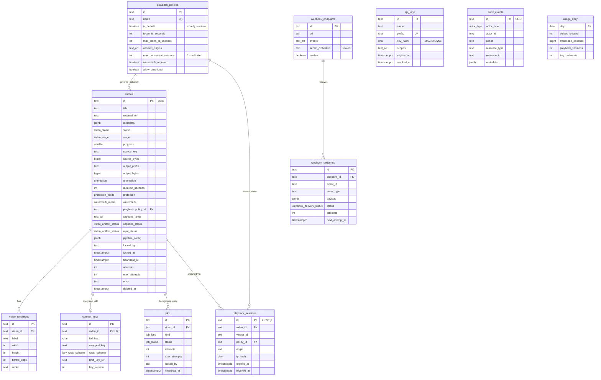

# Data Model

All state lives in one PostgreSQL 16 database, defined by the forward-only migrations in
[`db/migrations`](../../db/migrations). Kysely types for every table are in
[`packages/core/src/db/types.ts`](../../packages/core/src/db/types.ts).

There is **no tenant column** anywhere: one deployment serves one organization
([ADR-0006](adr/0006-single-tenant-deployments.md)).

- [Entity relationships](#entity-relationships)
- [Enums](#enums)
- [Tables](#tables)
- [Indexes and why they exist](#indexes-and-why-they-exist)
- [Triggers](#triggers)
- [Object storage layout](#object-storage-layout)
- [Migration policy](#migration-policy)

## Entity relationships



`api_keys`, `audit_events` and `usage_daily` have no foreign keys: audit rows must outlive
the things they describe, and keys and usage are deployment-wide.

## Enums

| Enum | Values | Notes |
| ---- | ------ | ----- |
| `video_status` | `uploading`, `uploaded`, `processing`, `ready`, `failed`, `cancelled` | `uploaded` = queued; see the [state machine](LLD.md#queue-state-machine) |
| `video_stage` | `transcoding`, `packaging`, `uploading_output` | Only meaningful while `processing` |
| `protection_mode` | `none`, `aes_128`, `drm_cbcs` | `drm_cbcs` reserved for the multi-DRM roadmap |
| `watermark_mode` | `none`, `dynamic_overlay`, `forensic_ab` | `forensic_ab` reserved |
| `orientation` | `landscape`, `portrait`, `square` | Set by the worker from ffprobe (after rotation) |
| `key_wrap_scheme` | `kms`, `local_aes` | `local_aes` only when `KMS_KEY_ID` is unset |
| `video_artifact_status` | `pending`, `processing`, `ready`, `failed`, `skipped` | For captions and the MP4 |
| `job_kind` | `CAPTIONS`, `DOWNLOAD` | |
| `job_status` | `queued`, `processing`, `done`, `failed`, `cancelled` | |
| `webhook_delivery_status` | `pending`, `delivering`, `delivered`, `failed` | |
| `actor_type` | `api_key`, `system`, `cli` | |

## Tables

### `playback_policies`

Rules a playback token is minted under. Seeded with one row, `default`
(id `01JDEFAULTPOLICY0000000000`). Checks keep `token_ttl_seconds` and
`max_token_ttl_seconds` within 10 to 86400 and `max_concurrent_sessions >= 0`. An empty
`allowed_origins` array means any origin. A video with no `playback_policy_id` uses the
default policy.

### `videos`

The catalog **and** the primary work queue. `id` is a ULID that also forms the storage
key segment. `title` is required; `external_ref` and `metadata` belong to the caller.
Storage columns: `source_key` (uploads bucket), `source_bytes` (verified by HeadObject),
`output_prefix` (`media/<id>`), `output_bytes` (summed at upload). `pipeline_config` holds
per-video knobs (`captions`, `captionsLang`, `download`). Queue columns: `locked_by`,
`locked_at` (6 h absolute anchor), `heartbeat_at` (10 min stale anchor), `attempts`,
`max_attempts` (3). `error` holds a client-safe message. `deleted_at` marks a soft delete;
the row is kept for audit and webhook history. `progress` is checked to 0 to 100.

### `video_renditions`

One row per ladder rung written in the ready transaction: label (`1080`, `720`, ...),
dimensions, the rung's maxrate (also the master playlist `BANDWIDTH`) and the codec string.
Unique on `(video_id, label)`; cascades with the video.

### `content_keys`

One per video (`video_id` unique, cascades). `wrapped_key` is the KMS ciphertext (or the
AES-256-GCM sealed form) of the 16-byte content key, base64. `kms_key_ref` records which
KMS key wrapped it. A re-transcode replaces the key and increments `key_version`, setting
`rotated_at`. The plaintext key is never stored.

### `jobs`

Decoupled post-processing (captions and the downloadable MP4), with the same lock and
heartbeat columns as `videos`. Cascades with the video.

### `api_keys`

`prefix` (8 characters, unique) is the lookup handle; `key_hash` is the 64-hex
`HMAC-SHA256(API_KEY_PEPPER, full key)`. `scopes` is a text array (`*` = all).
`created_by` is the creating key id or `cli`. Revocation and expiry are timestamps;
`last_used_at` is bumped at most once a minute.

### `playback_sessions`

One row per minted token; `id` is the JWT `jti`. `ip_hash` is a keyed hash, never the raw
address. Revocation sets `revoked_at` and `revoked_reason` (for example when the
concurrency policy evicts the oldest session). Cascades with the video.

### `webhook_endpoints` and `webhook_deliveries`

Endpoints store `events` (event types or `*`) and the signing secret sealed with
AES-256-GCM (`secret_ciphertext`). Deliveries are the **transactional outbox**: one row per
(endpoint, event), unique on `(endpoint_id, event_id)` so an event is never queued twice
for the same endpoint. Delivery state: `status`, `attempts`, `max_attempts` (8),
`next_attempt_at`, lock columns, `last_status_code`, `last_error`, `delivered_at`.

### `audit_events`

Append-only record of control-plane mutations: actor, action (`video.create`,
`api_key.revoke`, ...), resource type and id, keyed IP hash, request id and safe metadata.
`id` is a ULID, so ids sort by time.

### `usage_daily`

One row per UTC day, incremented with `INSERT ... ON CONFLICT (day) DO UPDATE`:
`videos_created`, `transcode_seconds`, `playback_sessions`, `key_deliveries`.

### `schema_migrations`

Created by the migration runner: `name`, SHA-256 `checksum`, `applied_at`.

## Indexes and why they exist

| Index | Definition | Serves |
| ----- | ---------- | ------ |
| `videos_uploaded_idx` | `(created_at) WHERE status = 'uploaded'` | The claim's oldest-first scan. Partial, so it only contains queued rows and stays tiny however large the catalog grows. |
| `videos_processing_idx` | `(heartbeat_at) WHERE status = 'processing'` | The reaper's stale-heartbeat scan |
| `videos_created_idx` | `(created_at DESC) WHERE deleted_at IS NULL` | Catalog listing, newest first, excluding soft-deleted rows |
| `videos_external_ref_idx` | `(external_ref) WHERE external_ref IS NOT NULL` | Lookups by the caller's own id |
| `jobs_queued_idx` | `(created_at) WHERE status = 'queued'` | Job claims |
| `jobs_video_id_idx` | `(video_id)` | Cancel and reconcile joins |
| `playback_policies_one_default` | unique `(is_default) WHERE is_default` | Guarantees exactly one default policy |
| `playback_sessions_active_idx` | `(viewer_id, expires_at) WHERE revoked_at IS NULL` | Concurrency checks: a viewer's live sessions |
| `playback_sessions_video_idx` | `(video_id, issued_at DESC)` | Sessions for one video |
| `webhook_deliveries_due_idx` | `(next_attempt_at) WHERE status = 'pending'` | The dispatcher's due-rows claim |
| `audit_events_created_idx` | `(created_at DESC)` | Newest-first audit pages |
| `audit_events_resource_idx` | `(resource_type, resource_id)` | "Everything that happened to this resource" |

Unique constraints also create indexes: `api_keys.prefix`, `content_keys.video_id`,
`video_renditions (video_id, label)`, `webhook_deliveries (endpoint_id, event_id)`,
`playback_policies.name`.

## Triggers

`audit_events` is append-only **at the database level**:

```sql
CREATE TRIGGER audit_events_no_update   BEFORE UPDATE OR DELETE ON audit_events
  FOR EACH ROW EXECUTE FUNCTION audit_events_immutable();
CREATE TRIGGER audit_events_no_truncate BEFORE TRUNCATE ON audit_events
  FOR EACH STATEMENT EXECUTE FUNCTION audit_events_immutable();
```

Row triggers do not fire on `TRUNCATE`, hence the second, statement-level trigger. Both
raise `audit_events is append-only`. A superuser can still disable triggers, so ship logs
to an external sink if you need WORM retention ([threat model](threat-model.md)).

## Object storage layout

Three buckets, one purpose each. Key conventions live in
[`packages/core/src/constants.ts`](../../packages/core/src/constants.ts), shared by the
worker (writer) and the API (reader and signer).

```text
<uploads bucket>
└── uploads/<videoId>/original.<ext>          raw source, presigned POST target, lifecycle-expired

<media bucket>
└── media/<videoId>/
    ├── poster.jpg
    ├── thumbnails/
    │   ├── thumbnails.vtt                    #xywh cues → sprite tiles
    │   └── sprite_001.jpg …                  10×10 tiles of 160 px frames, one per 5 s
    └── hls/
        ├── master.m3u8                       synthesized; rewritten per request by the API
        ├── 1080/ 720/ 480/  (540/ portrait)
        │   ├── index.m3u8                    EXT-X-KEY URI = EVS_KEY_URI sentinel
        │   └── seg_000.ts …                  AES-128, 4 s
        └── subs/<lang>.m3u8, <lang>.vtt      added by the CAPTIONS job

<downloads bucket>
└── downloads/<videoId>.mp4                   presigned GET only
```

No content key is ever written to object storage: the key file lives only in the
worker's temp directory, and the uploader refuses `.key` and `.keyinfo` files.

## Migration policy

Applied by [`db/migrate.ts`](../../db/migrate.ts) (`pnpm db:migrate`, or the one-off
migrate task on ECS):

- **Forward-only.** Files `NNNN_description.sql` run in name order, each in its own
  transaction, and are recorded in `schema_migrations`.
- **Checksummed.** Each file's SHA-256 is stored; if an applied file changes, the runner
  refuses to start. Fix forward with a new migration.
- **Concurrency-safe.** A Postgres advisory lock serializes runners, so two tasks booting
  at once cannot double-apply.
- `pnpm db:migrate --status` lists applied and pending files without changing anything.
- After a schema change, update [`packages/core/src/db/types.ts`](../../packages/core/src/db/types.ts)
  (or regenerate with `pnpm db:codegen`).
