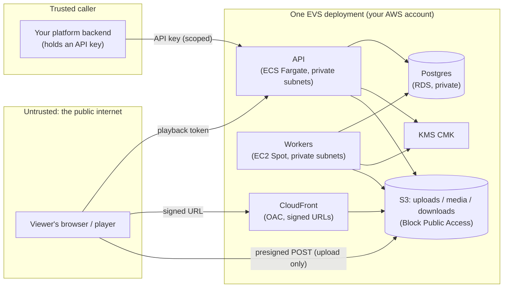
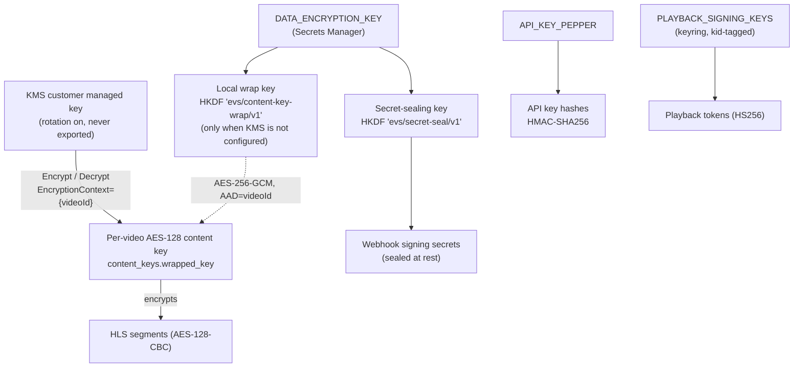

# Security Architecture

This document covers how Euron Video System protects content, credentials and
the control plane, and is explicit about what each layer does **not** protect
against. The STRIDE threat model is in [threat-model.md](threat-model.md).

- [Trust boundaries](#trust-boundaries)
- [Key hierarchy](#key-hierarchy)
- [Content encryption](#content-encryption)
- [Playback authorization](#playback-authorization)
- [Segment delivery](#segment-delivery)
- [Control-plane authentication](#control-plane-authentication)
- [Webhooks](#webhooks)
- [Audit and accountability](#audit-and-accountability)
- [Infrastructure hardening](#infrastructure-hardening)
- [What AES-128 does and does not protect](#what-aes-128-does-and-does-not-protect)
- [Operator checklist](#operator-checklist)

## Trust boundaries



| Boundary | Crossed with | Enforced by |
| -------- | ------------ | ----------- |
| Platform → API | Scoped API key | HMAC-hashed key lookup, scope middleware, rate limits |
| Viewer → API (playlists, key) | Playback token (JWT) | Signature + `kid` keyring, `aud`, `exp`, session revocation check, origin allowlist |
| Viewer → CDN (segments) | Signed URL | CloudFront key group; the bucket is reachable only through OAC |
| Viewer → S3 (upload) | Presigned POST | S3 enforces key, size range and `video/*` content type |
| Services → KMS | IAM role | Key policy + `kms:EncryptionContext:videoId` conditions |

The organization boundary is the deployment itself: see [ADR-0006](adr/0006-single-tenant-deployments.md).

## Key hierarchy



- **No secret serves two purposes.** Sub-keys are derived with HKDF-SHA256
  using distinct, versioned `info` labels.
- **Content keys never exist in plaintext at rest.** The raw key exists only
  in worker memory during packaging, and in API memory while serving one key
  request.
- **Crypto-shredding.** Scheduling the CMK for deletion makes every wrapped
  content key, and so every video, permanently undecryptable.

## Content encryption

| Property | Value |
| -------- | ----- |
| Scheme | HLS `METHOD=AES-128` (AES-128-CBC, full-segment) |
| Key | 128-bit, `crypto.randomBytes`, one per video |
| IV | Constant, declared explicitly in every variant playlist (`IV=0x000…0`, FFmpeg's default when no IV is supplied). The key is unique per video, so an IV is never reused across keys. See the note below. |
| Wrapping | KMS `Encrypt` with `EncryptionContext={videoId}`, or AES-256-GCM with AAD=`videoId` |
| Re-transcode | Generates a new key and increments `key_version`, so the old key protects nothing new |

**IV note.** All segments of one video share one key and one constant IV.
Under CBC this lets an observer tell whether two segments of the *same* video
begin with an identical 16-byte block, which they usually do, since every
segment starts with the same transport-stream table header. That reveals
nothing about the picture or sound, and nothing crosses videos because each
video has its own key. Per-segment random IVs are a planned hardening item;
they need the packager to emit an `EXT-X-KEY` line per segment.

Binding the wrapped key to its video means a wrapped key copied onto another
row fails to decrypt (GCM tag mismatch, or a KMS `InvalidCiphertextException`).
With KMS, every key unwrap is also a CloudTrail `Decrypt` event naming the video.

## Playback authorization

The integrating platform decides **who** may watch, for example after its own
entitlement check. It then asks EVS to mint a session:

```
POST /v1/videos/{id}/playback-sessions   (API key with playback:mint)
{ "viewerId": "user_42", "origin": "https://app.example.com" }
```

EVS applies the video's **playback policy**:

| Policy field | Effect |
| ------------ | ------ |
| `tokenTtlSeconds` / `maxTokenTtlSeconds` | Token lifetime, clamped to [10 s, max] |
| `allowedOrigins` | Mint is refused unless the origin is listed. Delivery requests carrying an `Origin` header are re-checked. |
| `maxConcurrentSessions` | Caps active sessions per viewer. By default the oldest session is revoked to make room. |
| `watermarkRequired` | The player renders a moving overlay with the viewer identity |
| `allowDownload` | Sessions carry a presigned MP4 `downloadUrl` (expiring with the session) only when this is on and the MP4 is ready. Operators with `videos:read` can always fetch it via `GET /v1/videos/{id}/download`. |

The session is a row (`playback_sessions`) whose id is the JWT `jti`. The token is:

```json
{ "alg": "HS256", "kid": "k2026a" }
{ "sub": "user_42", "vid": "01J…", "jti": "ps_01J…", "iss": "evs", "aud": "evs-playback", "exp": 1767225600 }
```

Every playlist and key request verifies the signature (against any `kid` in the
keyring), `aud`, `exp`, that `vid` matches the requested video, and that the
session is not revoked. Revocation checks are cached for a few seconds, so
revoking a session cuts off playback within one playlist refresh.

**Zero-downtime signing-key rotation:** add `k2=…` to `PLAYBACK_SIGNING_KEYS`,
switch `PLAYBACK_ACTIVE_KID=k2`, wait one max TTL, then remove `k1`.

## Segment delivery

Playlists are rewritten per request. Key URIs and variant URIs point back at
the API with the token. Segment URIs are produced by the configured delivery driver:

| Driver | Where | How segments are authorized |
| ------ | ----- | --------------------------- |
| `cloudfront-signed` | AWS (default) | One CloudFront custom policy per playlist, scoped to `media/{videoId}/*` with the token's expiry, then the same signature appended to every segment URL. The bucket only accepts CloudFront via OAC. |
| `presigned` | S3, MinIO, R2, emulator | An S3 presigned GET per object, expiring with the token |
| `proxy` | Anything | The API verifies the token and streams the object |
| `public` | Testing only | Unsigned. Never use it in production. |

Segments are encrypted regardless of driver. Signing adds hotlink and scrape
protection, and stops a leaked playlist from staying useful after the token expires.

## Control-plane authentication

- **API key format:** `evs_<prefix>_<secret>`, where `prefix` is 8 random characters
  and `secret` is 32 bytes of base64url. Only `HMAC-SHA256(API_KEY_PEPPER, key)` is stored.
  The plaintext is shown once.
- **Lookup** is by prefix, then a constant-time comparison of the hash. A
  database dump without the pepper does not allow offline key guessing.
- **Scopes:** `videos:read`, `videos:write`, `playback:mint`, `policies:manage`,
  `webhooks:manage`, `keys:manage`, `audit:read`, `usage:read`, or `*`.
  Give each integration the minimum: a platform backend that only plays video
  needs just `playback:mint`.
- Keys can expire and be revoked one at a time. A key cannot revoke itself, so
  an operator cannot lock themselves out by accident.
- **Rate limits** apply per API key on management routes and per client IP on delivery routes.
- **CORS** on management routes is an explicit allowlist (`CORS_ALLOWED_ORIGINS`)
  without credentials. Delivery routes reflect the playback policy's origins.

## Webhooks

- Every delivery is signed: `EVS-Signature: t=<unix>,v1=<hex HMAC-SHA256(secret, "t.body")>`.
  Receivers should verify the signature and reject timestamps older than 5 minutes (replay protection).
- `EVS-Event-Id` is stable across retries, so receivers can deduplicate.
- Signing secrets are sealed at rest with AES-256-GCM (context = endpoint id) and shown once.
- **Transactional outbox:** events are written in the same transaction as the
  state change they describe. An event is never lost, and never sent for a
  change that rolled back.
- **SSRF guard:** in production, endpoint hostnames resolving to private,
  loopback, link-local or metadata addresses are refused at delivery time.

## Audit and accountability

`audit_events` records every mutating control-plane action: actor (API key id
or CLI), action, resource, request id and a keyed IP hash. The table is
**append-only at the database level**: `UPDATE`, `DELETE` and `TRUNCATE` are
rejected by triggers, not just by convention. Client IPs are stored only as
keyed HMAC-SHA256 hashes, using a key derived from `API_KEY_PEPPER`: stable enough to
correlate one client's requests, useless for recovering the address without the pepper.

## Infrastructure hardening

| Area | Control |
| ---- | ------- |
| Network | API, workers, RDS and Lambda in private subnets. S3 gateway and KMS interface endpoints keep that traffic off the internet. |
| S3 | Block Public Access on every bucket, SSE-KMS, TLS-only bucket policy, raw uploads lifecycle-expired |
| CloudFront | OAC only, TLS 1.2 (2021 policy) minimum, signed URLs required on the media behavior |
| Instances | IMDSv2 required (hop limit 1). Workers hold no EC2 API permissions: idle workers end themselves with an OS shutdown (launch template shutdown behavior = terminate). |
| IAM | One role per component, least privilege, KMS grants conditioned on encryption context |
| Secrets | Secrets Manager only. Nothing secret in task definitions, AMIs or the repository. |
| Database | RDS encrypted at rest, master password managed by RDS in Secrets Manager, deletion protection in production |
| Supply chain | Pinned base images, lockfile installs; gitleaks, CodeQL and checkov workflows provided for forks, plus `make sanitize` locally |
| Containers | Non-root users, minimal runtime images |

## What AES-128 does and does not protect

**It protects against:**
- anyone without a valid, unexpired, unrevoked playback session,
- link sharing (tokens expire quickly, sessions are capped per viewer and can be revoked),
- hotlinking and bulk scraping (segments need signed URLs),
- storage leaks (objects are encrypted, and keys are not in storage),
- database leaks (content keys are wrapped by KMS, and API keys are peppered HMACs).

**It does not protect against:**
- a viewer who is **legitimately authorized** for a video extracting that
  video's key with developer tools. This is inherent to every clear-key scheme.
- screen recording.

Hardware-backed multi-DRM (Widevine L1, FairPlay, PlayReady) is the answer to
the first and is on the roadmap
([ADR-0003](adr/0003-aes-128-hls-now-multi-drm-later.md)). The dynamic
watermark tags any recording with the viewer's identity, which deters the
second. We describe AES-128 as **access control with encryption, not DRM**,
and recommend you do the same.

## Operator checklist

- [ ] `NODE_ENV=production`, and every secret comes from Secrets Manager (the config refuses placeholder values).
- [ ] `DELIVERY_DRIVER=cloudfront-signed`, with the CloudFront private key only in Secrets Manager.
- [ ] `KMS_KEY_ID` set. Never run production on the `local_aes` wrap scheme.
- [ ] `CORS_ALLOWED_ORIGINS` lists only your console origin(s).
- [ ] Every playback policy used in production has `allowedOrigins` set.
- [ ] Integration API keys are scoped to the minimum and have an expiry.
- [ ] Root key from bootstrap is stored in a password manager, then replaced by scoped keys.
- [ ] CloudTrail is on for KMS. Alarms are subscribed to the SNS topic.
- [ ] RDS deletion protection and automated backups are on.
- [ ] Playback signing keys are rotated on a schedule, using the keyring procedure above.
