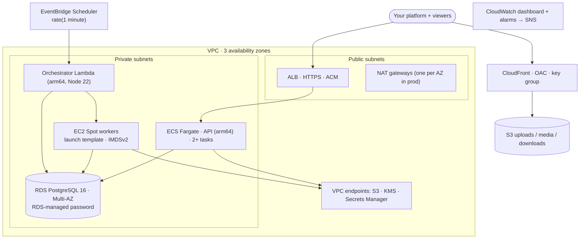

# Deploy to AWS

This guide takes you from an empty AWS account to a production deployment: the API on
ECS Fargate, Spot transcode workers, the orchestrator Lambda, RDS, private S3 behind
CloudFront, and alarms. It uses [`infra/terraform/envs/aws-prod`](../../infra/terraform/envs/aws-prod).
[`aws-dev`](../../infra/terraform/envs/aws-dev) is the same composition at smaller,
cheaper, easier-to-destroy settings.

- [What gets deployed](#what-gets-deployed)
- [Prerequisites](#prerequisites)
- [1. Remote state](#1-remote-state)
- [2. Build the artifacts](#2-build-the-artifacts)
- [3. Configure the environment](#3-configure-the-environment)
- [4. Create the image registry and push the API images](#4-create-the-image-registry-and-push-the-api-images)
- [5. Plan and apply](#5-plan-and-apply)
- [6. Run database migrations](#6-run-database-migrations)
- [7. DNS](#7-dns)
- [8. Create the first API key](#8-create-the-first-api-key)
- [9. Smoke test](#9-smoke-test)
- [Upgrades and rollbacks](#upgrades-and-rollbacks)
- [Teardown](#teardown)
- [Cost shape](#cost-shape)

## What gets deployed



| Module | Purpose |
| --- | --- |
| [`network`](../../infra/terraform/modules/network) | VPC, public and private subnets in 3 AZs, NAT, VPC endpoints, flow logs |
| [`kms`](../../infra/terraform/modules/kms) | Customer managed key with rotation (wraps content keys, encrypts buckets and secrets) |
| [`secrets`](../../infra/terraform/modules/secrets) | Generated deployment secrets and the CloudFront signing key pair |
| [`storage`](../../infra/terraform/modules/storage) | `uploads`, `media`, `downloads` buckets: private, SSE-KMS, TLS-only, lifecycle |
| [`cdn`](../../infra/terraform/modules/cdn) | CloudFront with Origin Access Control and a trusted key group |
| [`database`](../../infra/terraform/modules/database) | RDS PostgreSQL 16 with an RDS-managed, rotating master password |
| [`api-service`](../../infra/terraform/modules/api-service) | ECR, ECS cluster and service, ALB, autoscaling, `migrate` task definition |
| [`worker-fleet`](../../infra/terraform/modules/worker-fleet) | Launch template(s), instance profile, worker log group |
| [`orchestrator`](../../infra/terraform/modules/orchestrator) | Lambda, schedule, dead-letter queue, launch permissions |
| [`observability`](../../infra/terraform/modules/observability) | Dashboard, six alarms, SNS topic |

## Prerequisites

| You need | Details |
| --- | --- |
| An AWS account | A dedicated account per environment is recommended. See [ADR-0006](../architecture/adr/0006-single-tenant-deployments.md). |
| Deploy permissions | Rights to manage VPC/EC2, ECS, ECR, ELB, RDS, S3, CloudFront, KMS, Secrets Manager, IAM roles and policies, Lambda, EventBridge Scheduler, SQS, SNS and CloudWatch. In practice, an administrator role used only by your deploy pipeline. |
| A domain | For the API, for example `api.video.example.com` |
| ACM certificate | For the API domain, **in the deployment region**. For an optional custom media domain, a second certificate **in `us-east-1`** (a CloudFront requirement). |
| Spot vCPU quota | Service Quotas → EC2 → *All Standard (A, C, D, H, I, M, R, T, Z) Spot Instance Requests*. Size it for `max_workers × the largest instance type`, for example 20 × 16 vCPUs for `c7g.4xlarge`. |
| Tools | Terraform 1.10+, AWS CLI v2, Docker with `buildx`, Packer 1.11+, Node 22 + pnpm 9 |

> [!TIP]
> Run `make tf-validate` first. It validates all three environments without credentials
> or a backend.

## 1. Remote state

State contains generated secrets, so keep it in a private, versioned, encrypted bucket.

```bash
cd infra/terraform/envs/aws-prod
cp backend.tf.example backend.tf
```

Edit `backend.tf`, uncomment the block, and set your state bucket:

```hcl
terraform {
  backend "s3" {
    bucket       = "acme-terraform-state"
    key          = "euron-video-system/aws-prod.tfstate"
    region       = "us-east-1"
    encrypt      = true
    use_lockfile = true   # S3-native locking, no DynamoDB table needed
  }
}
```

## 2. Build the artifacts

Terraform consumes two build outputs, so build them before planning:

```bash
corepack enable && pnpm install --frozen-lockfile

# Orchestrator Lambda bundle → apps/orchestrator/dist/lambda (zipped by Terraform)
pnpm --filter @evs/orchestrator build

# Worker bundle → apps/worker/dist, then the worker AMI
pnpm --filter @evs/worker build
packer init infra/packer
packer build -var region=us-east-1 -var name_prefix=evs-prod infra/packer/worker.pkr.hcl
```

Packer prints the new AMI id at the end:

```text
==> Builds finished. The artifacts of successful builds are:
--> amazon-ebs.worker: AMIs were created:
us-east-1: ami-xxxxxxxxxxxxxxxxx   (your new AMI id)
```

Validate the AMI before rolling it out. [worker-ami.md](worker-ami.md) covers what is in
it and how to test it.

## 3. Configure the environment

```bash
cp terraform.tfvars.example terraform.tfvars   # git-ignored
```

| Variable | Required | Meaning |
| --- | :---: | --- |
| `region` | | AWS region, default `us-east-1` |
| `name_prefix` | ✅ | Prefix for every resource name. **Bucket names derive from it and must be globally unique**: use something like `acme-evs-prod`. |
| `api_domain` | ✅ | Public API hostname, for example `api.video.example.com`. Becomes `PUBLIC_API_BASE`. |
| `api_certificate_arn` | ✅ | ACM certificate for `api_domain` in the deployment region |
| `console_origins` | | Exact origins allowed to call the API from a browser and to upload. Include your console and any web players. |
| `media_aliases` | | Optional custom CDN domain(s), for example `["media.video.example.com"]` |
| `media_certificate_arn` | | ACM certificate in `us-east-1` for `media_aliases` |
| `worker_ami_id` | ✅ | AMI from step 2 |
| `api_image_tag` | ✅ | Tag of the API image you push in step 4. Tags are immutable, so use a version or git SHA. |
| `max_workers` | | Ceiling on concurrent transcode workers (default 20) |
| `enable_jobs_pool` | | Run captions and MP4 jobs on a separate, smaller instance pool |
| `alarm_email` | | Subscribe an address to the alarm SNS topic |
| `environment`, `extra_tags` | | Tagging |

Prod differs from dev in Multi-AZ RDS on `db.m7g.large`, deletion protection, final
snapshots, one NAT gateway per AZ, two or more API tasks, a 30-day secret recovery window,
and buckets that refuse `force_destroy`.

## 4. Create the image registry and push the API images

The ECS service needs its image to exist, and the registry is created by the same stack.
Create the registry first:

```bash
terraform init
terraform apply -target=module.api.aws_ecr_repository.api
REPO=$(terraform output -raw api_ecr_repository_url)
```

The API ships as **two images from one Dockerfile**. `<tag>` is the runtime target that
serves traffic. `<tag>-tools` carries the migration runner and the `evs` CLI. Both are
arm64, to match the Fargate tasks:

```bash
TAG=0.1.0
aws ecr get-login-password --region us-east-1 | docker login --username AWS --password-stdin "${REPO%/*}"
cd ../../../..   # repository root
docker buildx build --platform linux/arm64 -f infra/docker/api.Dockerfile --target runtime -t "$REPO:$TAG"       --push .
docker buildx build --platform linux/arm64 -f infra/docker/api.Dockerfile --target tools   -t "$REPO:$TAG-tools" --push .
```

> [!NOTE]
> The repository has **immutable tags** and scan-on-push. Re-pushing an existing tag
> fails by design, so every release gets a new tag.

## 5. Plan and apply

```bash
cd infra/terraform/envs/aws-prod
terraform plan -out tfplan
terraform apply tfplan
terraform output
```

The first apply takes roughly 20 to 30 minutes, mostly RDS Multi-AZ and the CloudFront
distribution. The outputs you need next:

| Output | Used for |
| --- | --- |
| `api_alb_dns_name` | DNS record for `api_domain` |
| `ecs_cluster_name`, `migrate_task_definition` | Running migrations and one-off tasks |
| `private_subnet_ids`, `api_task_security_group_id` | `--network-configuration` for one-off tasks |
| `bucket_names`, `kms_key_alias`, `media_public_base`, `cloudfront_key_pair_id`, `api_secret_arn` | Reference, and [local-with-aws.md](local-with-aws.md) |

## 6. Run database migrations

Migrations run as a one-off Fargate task using the `-tools` image. Run them once after the
first apply, and once per release:

```bash
CLUSTER=$(terraform output -raw ecs_cluster_name)
TASKDEF=$(terraform output -raw migrate_task_definition)
SUBNETS=$(terraform output -json private_subnet_ids | jq -r 'join(",")')
SG=$(terraform output -raw api_task_security_group_id)

aws ecs run-task --cluster "$CLUSTER" --task-definition "$TASKDEF" --launch-type FARGATE \
  --network-configuration "awsvpcConfiguration={subnets=[$SUBNETS],securityGroups=[$SG],assignPublicIp=DISABLED}"
```

Follow it in CloudWatch Logs, group `/evs/<name_prefix>/api`, stream prefix `migrate`:

```text
  migrated 0001_init.sql
  migrated 0002_control_plane.sql
```

The runner takes a Postgres advisory lock and verifies checksums, so running it twice is
safe, and an edited migration is refused.

## 7. DNS

Create a record for `api_domain` that points at `api_alb_dns_name`: an alias `A` record in
Route 53, or a `CNAME` elsewhere. If you set `media_aliases`, point those at the CloudFront
distribution domain (the host in `media_public_base`).

```bash
curl -s https://api.video.example.com/readyz
# {"status":"ready","checks":{"database":{"ok":true,"latencyMs":2}}}
```

> [!NOTE]
> The operator console is a static site (`infra/docker/console.Dockerfile` builds an nginx
> image of it), and this Terraform does not host it. Serve it from any static host or
> container platform, and add its origin to `console_origins`.

## 8. Create the first API key

Use the same one-off task definition with a command override that runs the CLI. Keep the
bootstrap key short-lived, because one-off task output lands in CloudWatch Logs:

```bash
aws ecs run-task --cluster "$CLUSTER" --task-definition "$TASKDEF" --launch-type FARGATE \
  --network-configuration "awsvpcConfiguration={subnets=[$SUBNETS],securityGroups=[$SG],assignPublicIp=DISABLED}" \
  --overrides '{"containerOverrides":[{"name":"migrate","command":["pnpm","--silent","evs","keys:create","--name","bootstrap","--scopes","*","--expires-days","1"]}]}'
```

Read the key from the task's log stream, then immediately:

1. Create scoped, long-lived keys over the API, for example one `playback:mint` key for your
   web backend and one `videos:write` key for ingest:
   ```bash
   curl -s -X POST https://api.video.example.com/v1/api-keys \
     -H "Authorization: Bearer $BOOTSTRAP_KEY" -H "Content-Type: application/json" \
     -d '{"name":"web-backend","scopes":["playback:mint"]}'
   ```
2. Revoke the bootstrap key in the console, or with `DELETE /v1/api-keys/{id}` called from
   *another* key, since a key cannot revoke itself.
3. Store the new keys in your own secret manager.

## 9. Smoke test

```bash
EVS_API=https://api.video.example.com EVS_API_KEY=evs_… \
  scripts/demo/upload.sh samples/big-buck-bunny-1080p.mp4 "Production smoke test"
```

Within about two minutes the orchestrator log (`/aws/lambda/<name_prefix>-orchestrator`)
shows a launch, a worker instance tagged with its role appears in EC2, the video reaches
`ready`, and the script prints a playback URL. Segment requests should go to CloudFront
with signed query parameters.

## Upgrades and rollbacks

**API release**

1. Build and push `$REPO:<new-tag>` and `$REPO:<new-tag>-tools` (step 4).
2. Set `api_image_tag = "<new-tag>"`, then `terraform apply`. ECS rolls tasks, and the
   deployment circuit breaker rolls back automatically if new tasks fail health checks.
3. Run the migrate task (step 6).

> [!IMPORTANT]
> Write migrations to be backward compatible (expand, then contract), because old and
> new tasks overlap during a rolling deploy. Never edit an applied migration: add a new one.

To roll back the API, set `api_image_tag` back to the previous tag and apply. Images are
immutable, so the old tag is exactly what ran before.

**Worker release**

1. Build a new AMI (step 2) and [validate it](worker-ami.md#test-an-ami-before-rollout).
2. Set `worker_ami_id` to the new AMI and apply. That creates a new launch template version.
3. Running workers finish their current job and terminate when idle. New launches use the
   new AMI.

To roll back a worker, set `worker_ami_id` to the previous AMI and apply. Keep the last
known-good AMI until the new one has processed real jobs.

**Orchestrator release:** rebuild `apps/orchestrator/dist/lambda` and apply. Terraform
re-zips it when the bundle changes.

## Teardown

Production resources are protected on purpose. To destroy prod:

1. Set `deletion_protection = false` for the `database` and `api` modules in `main.tf`,
   and `force_destroy = true` for `storage`, then apply.
2. Empty the buckets if you want their contents gone (or let `force_destroy` do it).
3. `terraform destroy`.

RDS takes a final snapshot (`skip_final_snapshot = false` in prod). Secrets go into a
30-day recovery window. The KMS key is scheduled for deletion, and deleting it makes every
stored content key, and therefore every video, permanently unrecoverable. `aws-dev` has
none of these protections and destroys in one command.

## Cost shape

| Always on | Scales with use | Scales to zero |
| --- | --- | --- |
| RDS (Multi-AZ in prod) · NAT gateways · ALB · API tasks · VPC interface endpoints · KMS key | S3 storage and requests · CloudFront data transfer · KMS requests (one per key delivery) · CloudWatch logs | Transcode workers (Spot, self-terminating) · Orchestrator Lambda (one short invocation per minute) |

For a cheaper non-production setup, use `aws-dev`: single-AZ `db.t4g.medium`, one NAT
gateway, one API task.

---

Day-2 operations are in [operations.md](operations.md), and failure modes in
[troubleshooting.md](troubleshooting.md).
