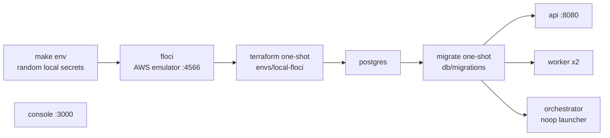

# Local quickstart

Run the whole platform on your laptop against an emulated AWS, with no AWS account and no
cloud cost. Expect about ten minutes the first time (mostly building the worker image) and
seconds after that.

- [Prerequisites](#prerequisites)
- [1. Start the stack](#1-start-the-stack)
- [2. Push a video through the pipeline](#2-push-a-video-through-the-pipeline)
- [3. Open the console](#3-open-the-console)
- [4. Prove it end to end](#4-prove-it-end-to-end)
- [Services and ports](#services-and-ports)
- [Variations](#variations)
- [Running services outside Docker](#running-services-outside-docker)
- [Reset and clean up](#reset-and-clean-up)
- [Common local issues](#common-local-issues)

## Prerequisites

| Tool | Version | Why |
| --- | --- | --- |
| Docker with Compose v2 | Docker 24+, Compose 2.20+ | Runs every service, the AWS emulator and Terraform |
| GNU `make` | any | Entry points (`make help` lists them) |
| `curl`, `jq`, `openssl`, `xxd` | any | Demo and e2e scripts |
| `ffmpeg` | 7.x, optional | Only for `make e2e` (generates a test clip) and the synthetic demo sample |

Give Docker at least **4 CPUs and 6 GB of memory**. Node.js and pnpm are only needed if you
want to [run services outside Docker](#running-services-outside-docker).

## 1. Start the stack

```bash
git clone https://github.com/euron-sde-team/euron-video-system.git
cd euron-video-system
make up
```

`make up` runs these steps in order. Each one maps to a file you can read:



1. **Local secrets.** [`scripts/demo/gen-local-env.sh`](../../scripts/demo/gen-local-env.sh)
   writes `deploy/compose/.env` (mode 600) with fresh random values for
   `EVS_DATA_ENCRYPTION_KEY`, `EVS_API_KEY_PEPPER` and `EVS_PLAYBACK_SIGNING_KEYS`. It never
   overwrites an existing file. Regenerating with `--force` invalidates every API key you
   already created.
2. **AWS emulator.** [Floci](https://github.com/floci-io/floci) starts on port 4566 with
   persistent storage in the `flocidata` volume.
3. **Terraform, for real.** A `hashicorp/terraform` container applies
   [`infra/terraform/envs/local-floci`](../../infra/terraform/envs/local-floci) against the
   emulator. It uses the same `storage`, `kms` and `secrets` modules that production uses,
   and creates the `evs-local-uploads`, `evs-local-media` and `evs-local-downloads` buckets,
   the `alias/evs-local` KMS key and the secrets. The CDN module is behind `enable_cdn`
   (off by default), because the emulator's CloudFront is management-plane only.
4. **Database.** Postgres 16 starts, then the `migrate` one-shot applies
   [`db/migrations`](../../db/migrations).
5. **Services.** The API, two workers, the orchestrator, the console and a reference
   webhook receiver start.

When it finishes:

```text
console http://localhost:3000   api http://localhost:8080   floci http://localhost:4566
```

Check health at any time:

```bash
make ps
curl -s localhost:8080/readyz
# {"status":"ready","checks":{"database":{"ok":true,"latencyMs":1}}}
```

## 2. Push a video through the pipeline

```bash
make demo
```

[`scripts/demo/seed.sh`](../../scripts/demo/seed.sh) creates a root API key with the CLI,
downloads a 10-second *Big Buck Bunny* clip (CC BY 3.0, Blender Foundation) into `samples/`,
and runs [`scripts/demo/upload.sh`](../../scripts/demo/upload.sh). That script does exactly
what an integrator would: create, presigned POST, complete, poll until ready, mint a
playback session.

```text
creating a demo API key
  key: evs_ab12cd34_…   (shown once; paste it into the console Settings screen)
```

> [!TIP]
> No internet, or want something reproducible? `SAMPLE_MODE=--synthetic make demo`
> generates a 60-second FFmpeg test pattern instead of downloading.

Upload your own file with the key from above:

```bash
EVS_API_KEY=evs_… scripts/demo/upload.sh ~/Movies/talk.mp4 "Conference talk"
```

You can create more keys at any time. `make key` prints a new root key, and the same CLI
([`scripts/evs.ts`](../../scripts/evs.ts)) creates scoped ones inside the stack:

```bash
docker compose -f deploy/compose/compose.yaml -f deploy/compose/compose.floci.yaml \
  run --rm -T migrate pnpm --silent evs keys:create --name ci --scopes videos:read
```

Scoped keys can also be created over the API (`POST /v1/api-keys`) or in the console under
**API keys**.

## 3. Open the console

1. Browse to **http://localhost:3000**.
2. On the connect screen, keep the API base `http://localhost:8080` and paste the key.
3. Open **Videos**. The demo video moves `uploading → uploaded → processing → ready`, with
   live stage and progress.
4. Open the video to play it: tokenized playlists, a KMS-unwrapped AES key, and encrypted
   segments, all inside your browser.

The key is stored in your browser's `localStorage` only. Use **Settings** to disconnect.

## 4. Prove it end to end

```bash
make e2e
```

[`scripts/demo/e2e.sh`](../../scripts/demo/e2e.sh) creates a throwaway key, generates a
6-second clip, and asserts the whole chain. That includes decrypting a delivered segment
with the delivered key and the IV the playlist advertises:

```text
  PASS uploaded video 01J…
  PASS video ready
  PASS master playlist 200 with token
  PASS master playlist 401 without token
  PASS key endpoint returned exactly 16 bytes
  PASS segment delivered encrypted
  PASS delivered key decrypts the delivered segment into valid H.264 MPEG-TS
  PASS thumbnail sprite VTT served with #xywh cues
  PASS revoked session rejected with 401
e2e: all assertions passed
```

By default the e2e run tears the stack down (`docker compose down -v`). Set `EVS_E2E_KEEP=1`
to keep it running, and the script revokes its throwaway key on exit.

## Services and ports

| Service | Host address | Override | Notes |
| --- | --- | --- | --- |
| Console | `http://localhost:3000` | `EVS_CONSOLE_PORT` | CORS on the API follows this port automatically |
| API | `http://localhost:8080` | `EVS_API_PORT` | `/docs`, `/metrics`, `/healthz`, `/readyz` |
| Floci (AWS emulator) | `http://localhost:4566` | `EVS_FLOCI_PORT` | Browsers use it for presigned uploads |
| Postgres | `localhost:5432` | `EVS_PG_PORT` | user `evs`, password `evs`, database `evs` |
| Workers, orchestrator | none | `EVS_WORKER_REPLICAS` | `make logs SERVICE=worker` |
| Webhook receiver | in-network only | none | `http://webhook-receiver:9099/events` |

All host ports bind to `127.0.0.1` only.

> [!WARNING]
> The API and Floci ports are part of browser-facing URLs (`PUBLIC_API_BASE` and the
> presigned upload endpoint). If you move `EVS_API_PORT`, also set
> `EVS_PUBLIC_API_BASE=http://localhost:<port>`. Moving `EVS_FLOCI_PORT` also needs
> `S3_PUBLIC_ENDPOINT` in [`compose.floci.yaml`](../../deploy/compose/compose.floci.yaml)
> updated to match.

## Variations

Put these in `deploy/compose/.env` (see
[`deploy/compose/.env.example`](../../deploy/compose/.env.example)) or prefix a command
with them, then re-run `make up`.

| Setting | Effect |
| --- | --- |
| `EVS_DELIVERY_DRIVER=presigned` | Segments come from S3 presigned URLs instead of the API proxy (default `proxy`) |
| `EVS_WORKER_REPLICAS=4` | More local workers |
| `EVS_LADDER_PRESET=medium` | Production encode quality (the local default `veryfast` favours speed) |
| `EVS_CAPTIONS=false` | Builds a slim worker image without whisper.cpp |
| `EVS_WHISPER_MODEL=small` | Larger speech model: better captions, slower |
| `EVS_LOG_LEVEL=debug` | Verbose logs |

### Webhooks against the reference receiver

The stack includes [`examples/webhook-receiver`](../../examples/webhook-receiver/server.mjs),
which verifies every signature.

1. In the console, open **Webhooks → Add endpoint** with URL
   `http://webhook-receiver:9099/events` and events `*`. Copy the signing secret: it is
   shown once.
2. Restart the receiver with the secret:

   ```bash
   EVS_WEBHOOK_SIGNING_SECRET=whsec_… docker compose \
     -f deploy/compose/compose.yaml -f deploy/compose/compose.floci.yaml up -d webhook-receiver
   ```
3. Click **Send test**, or upload a video, then watch it verify:

   ```bash
   docker compose -f deploy/compose/compose.yaml -f deploy/compose/compose.floci.yaml logs -f webhook-receiver
   # {"accepted":true,"type":"video.ready","eventId":"evt_01J…","data":{…}}
   ```

> [!NOTE]
> The API runs with `NODE_ENV=production` locally, so its SSRF guard would normally refuse
> an in-network address. The emulator overlay sets `WEBHOOK_ALLOW_PRIVATE_TARGETS=true`
> for this demo only. Configuration validation **refuses that flag when `EVS_CLOUD=aws`**,
> so it cannot be enabled on a real deployment.

## Running services outside Docker

Useful when you are changing code. Keep the emulator and Postgres in Docker:

```bash
corepack enable && pnpm install        # Node 22, pnpm 9.15 (.nvmrc, packageManager)
make up                                # emulator + Terraform + Postgres (+ the containers)
docker compose -f deploy/compose/compose.yaml -f deploy/compose/compose.floci.yaml stop api worker orchestrator

cp .env.example .env                   # then fill the three secrets with: openssl rand -hex 32
set -a; source .env; set +a
pnpm --filter @evs/api dev             # http://localhost:8080, reloads on change
pnpm --filter @evs/worker dev          # needs ffmpeg on PATH; WORKER_PLATFORM=local
pnpm --filter @evs/orchestrator dev    # LAUNCHER=noop
pnpm --filter @evs/console dev         # http://localhost:5173
```

[`.env.example`](../../.env.example) lists the variables for this mode. The full reference
is [configuration.md](configuration.md).

## Reset and clean up

```bash
make down     # stops everything and deletes the postgres and emulator volumes
make clean    # removes build output, samples/ and .demo/
```

`make down` deletes all data, including videos and API keys. Your `deploy/compose/.env`
secrets are kept.

## Common local issues

| Symptom | Cause | Fix |
| --- | --- | --- |
| `Bind for 127.0.0.1:5432 failed: port is already allocated` | Another Postgres (or app) holds the port | `EVS_PG_PORT=55432 make up` (same for `EVS_API_PORT`, `EVS_CONSOLE_PORT`) |
| The console URL shows a different app | Another dev server listens on `*:3000`, and browsers prefer it over `127.0.0.1:3000` | `EVS_CONSOLE_PORT=3300 make up`, then open `http://localhost:3300` |
| First `make up` takes many minutes | The worker image compiles whisper.cpp and downloads a speech model | One-time cost, layers are cached. Use `EVS_CAPTIONS=false` for a slim image. |
| `run `make env` first` | `deploy/compose/.env` is missing | `make env` |
| Console shows "Could not connect" | Wrong API base or key, or CORS origin mismatch | Check `curl localhost:8080/readyz`, and use the same port you opened the console on |
| Upload fails in the browser with a CORS error | Bucket CORS (from Terraform) allows `localhost:3000` and `localhost:8080` | If the console runs on another port, add it to `cors_origins` in the terraform command in `compose.floci.yaml` |
| Apple silicon: slow or failing builds | Images are multi-arch (arm64 native) | Make sure Docker Desktop is not forcing `linux/amd64` emulation (`DOCKER_DEFAULT_PLATFORM` unset) |
| `make e2e` says `ffmpeg is required` | e2e generates its test clip on the host | Install FFmpeg 7 (`brew install ffmpeg`, `apt-get install ffmpeg`) |

More in [troubleshooting.md](troubleshooting.md).
