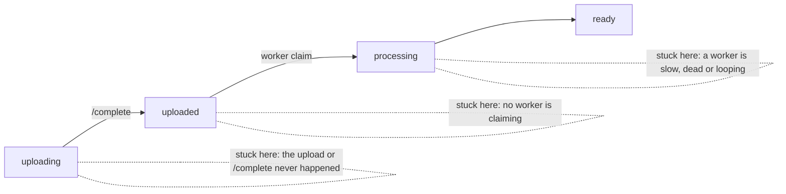

# Troubleshooting

Symptom → cause → fix, grouped by where the problem shows up. Every API error response
includes a `requestId`. Search for it first in the API logs (`/evs/<prefix>/api`, or
`make logs SERVICE=api` locally): it usually names the cause directly.

- [Videos that do not become ready](#videos-that-do-not-become-ready)
- [Failed videos](#failed-videos)
- [Playback](#playback)
- [Console and API access](#console-and-api-access)
- [Webhooks](#webhooks)
- [The transcode fleet](#the-transcode-fleet)
- [Terraform and the local emulator](#terraform-and-the-local-emulator)
- [Local environment](#local-environment)

## Videos that do not become ready

| Symptom | Likely cause | Fix |
| --- | --- | --- |
| Stuck in `uploading` | The browser upload failed, or `/complete` was never called | Check the browser network panel for the presigned POST. Then call `POST /v1/videos/{id}/complete`. |
| `/complete` returns 422 `Upload not found in storage` | The file never reached the uploads bucket (CORS, expired form, wrong bucket) | Re-create the video and upload again. Check the bucket CORS allows your origin (`console_origins`). |
| Upload rejected by S3 with `Policy Condition failed` | File larger than `MAX_UPLOAD_BYTES`, or Content-Type not `video/*` | Send `Content-Type: video/<subtype>` as a form field, or raise `MAX_UPLOAD_BYTES` |
| `POST /v1/videos` returns 429 `Too many videos in flight` | `MAX_IN_FLIGHT` backpressure | Wait for the queue to drain, or raise `MAX_IN_FLIGHT` |
| Stuck in `uploaded` (queued) | No worker is claiming: the fleet is not launching, or workers cannot reach the database | See [the transcode fleet](#the-transcode-fleet) |
| Stuck in `processing`, progress frozen | The worker died (Spot reclaim, crash). The reaper requeues it after 10 minutes without a heartbeat. | Usually nothing: wait for the reaper. If it keeps happening, read the worker logs for that video id. |
| Stuck in `processing` for hours, progress moving | A very long source on a small instance | Expected. The absolute claim timeout is 6 hours. Use larger instance types first in the ladder. |
| `ready`, but captions show `pending` forever | No worker is claiming background jobs (for example, the jobs pool is enabled but cannot launch) | Check `SELECT kind, status, count(*) FROM jobs GROUP BY 1, 2`, then the jobs pool launch template and quotas |

## Failed videos

The `error` field on a failed video is a client-safe summary. The full FFmpeg output is in
the worker log, keyed by video id.

| `error` message | Cause | Fix |
| --- | --- | --- |
| *The source file is not a readable video…* | The container index is missing or the file is truncated (an interrupted upload or recorder) | Re-export or re-upload the source. Check it locally with `ffprobe <file>`. |
| *The source file has no video stream.* | An audio-only or broken file | Upload a file with a video track |
| *The source upload is missing from storage…* | The source object was deleted or expired by the lifecycle rule before transcoding | Upload again |
| *The worker ran out of scratch disk space…* | The source is larger than the worker's scratch volume | Raise `root_volume_gb` in the `worker-fleet` module, or put larger instances first |
| *Transcoding was interrupted by the worker (resource limits).* | FFmpeg was killed (memory) | Put larger instance types first in `worker_instance_types` |
| `max attempts exceeded` | The reaper requeued the video `max_attempts` times without success | Read the worker logs for the earlier attempts, fix the cause, then `POST /v1/videos/{id}/retry` |

## Playback

| Symptom | Cause | Fix |
| --- | --- | --- |
| 401 `Playback token required` | The URL lost its `?token=` (proxies, URL rewriting, copy-paste) | Use `manifestUrl` from the session response unchanged |
| 401 `Invalid playback token` | Expired, malformed, or signed with a `kid` that is no longer in `PLAYBACK_SIGNING_KEYS` | Mint a new session. After a keyring change, follow the [rotation procedure](operations.md#rotating-secrets). |
| 401 `Playback session revoked or expired` | The session was revoked, or its TTL passed during a long viewing | Expected. Players should re-mint (`onRefreshSession` in `@evs/player` does this and resumes in place). |
| 403 `Token is not valid for this video` | A token minted for video A was used on video B | Mint per video |
| 403 `Origin is not allowed by this video's playback policy` | The page's origin is not in the policy's `allowedOrigins` | Add the exact origin (scheme + host + port) to the policy |
| 403 `Concurrent playback session limit reached` | The viewer exceeded the policy's `maxConcurrentSessions` | Expected. Raise the limit, or revoke the viewer's older sessions. |
| 404 `Video not found or not ready` | The video is not `ready`, or was deleted | Check `GET /v1/videos/{id}` |
| The player starts, then fails with a decode or media error | The key response is not 16 raw bytes. Usually a proxy, captive portal or tunnel returned HTML instead of the key, or `PUBLIC_API_BASE` points somewhere the browser cannot reach. | Open the `/key` URL from the variant playlist directly: it must return exactly 16 bytes of `application/octet-stream`. Fix `PUBLIC_API_BASE` or the proxy. |
| Segments return 403 from CloudFront | The signed URL expired, or the CloudFront key pair was replaced and the API still signs with the old one | Re-mint the session. After a key change, force a new API deployment. |
| Playback works on desktop but not on iPhone | iPhone uses native HLS, which needs the token inside the playlist URLs (the API does this) and CORS on the media | Check `console_origins` includes the page origin |
| Poster or thumbnails missing | The video's thumbnails were not generated, or the signed URL expired | Check `GET /v1/play/{id}/thumbnails.vtt?token=…`. Re-mint for fresh URLs. |

## Console and API access

| Symptom | Cause | Fix |
| --- | --- | --- |
| Console says it cannot connect, and the browser shows a CORS error | The console origin is not in `CORS_ALLOWED_ORIGINS` (`console_origins` in Terraform) | Add the exact origin. Locally it follows `EVS_CONSOLE_PORT`. |
| 401 `Missing API key` / `Invalid API key` | No `Authorization: Bearer evs_…` header, a typo, a revoked or expired key, or the pepper was rotated | Create a new key. After a pepper rotation, every key must be reissued. |
| 403 on a management call | The key lacks the scope (for example a `playback:mint` key calling `/v1/videos`) | Use a key with the right scope. `GET /v1/me` shows a key's scopes. |
| 403 `Cannot create a key with scopes you do not hold` | Keys cannot escalate privileges. Only `*` keys can mint `*` keys. | Create it with a key that holds those scopes |
| 409 `A key cannot revoke itself` | Self-revocation is blocked to prevent lockouts | Revoke it from another key, or with `evs keys:revoke` |
| 429 `Rate limit exceeded` | Over `RATE_LIMIT_PER_MINUTE` for the key (or `PLAYBACK_RATE_LIMIT_PER_MINUTE` per IP on `/v1/play`) | Back off, or raise the limits. Limits are counted per API process. |
| API refuses to start, listing `Invalid configuration` | A missing or invalid variable, or a placeholder secret in production | The message lists every problem. See [configuration.md](configuration.md). |

## Webhooks

| Symptom | Cause | Fix |
| --- | --- | --- |
| Deliveries `failed` with `webhook URL resolves to a non-public address` or `must use https` | In production the dispatcher refuses plain HTTP and endpoints that resolve to private, loopback, link-local or metadata addresses (re-checked on every delivery) | Use a publicly routable HTTPS endpoint. `WEBHOOK_ALLOW_PRIVATE_TARGETS` is for local demos and is refused when `EVS_CLOUD=aws`. |
| No deliveries at all | The endpoint is disabled, or not subscribed to that event type | Check `enabled` and `events` (`*` = all). Use **Send test**. |
| The receiver rejects with `signature mismatch` | It verifies a re-serialized body instead of the raw bytes, or uses the wrong secret | HMAC the **raw** request body. Compare with [`examples/webhook-receiver`](../../examples/webhook-receiver/server.mjs). |
| The receiver rejects with `possible replay` | Clock skew over 5 minutes, or a very late retry | Sync the receiver clock (NTP). Accept retries by `EVS-Event-Id` deduplication. |
| The same event arrives twice | Delivery is at-least-once, and retries reuse the event id | Deduplicate on `EVS-Event-Id` |
| 409 `Delivery is in flight; try again shortly` on redeliver | The dispatcher is sending it right now | Retry in a few seconds |

## The transcode fleet

| Symptom | Cause | Fix |
| --- | --- | --- |
| Videos queue, no instances launch, orchestrator logs show capacity errors | No Spot capacity for the configured types in the configured AZs | Add instance types to the ladder, add subnets in more AZs, or enable `ondemand_fallback` |
| Orchestrator logs `MaxSpotInstanceCountExceeded` or vCPU limit errors | Spot vCPU quota too low | Raise the *All Standard Spot Instance Requests* quota |
| Orchestrator errors on `CreateFleet` with an invalid launch template or parameter | The launch template name or version is wrong, or an instance type does not match the AMI architecture (arm64) | Keep `worker_instance_types` all Graviton. Re-apply Terraform. |
| Orchestrator cannot connect to the database | Lambda subnets or security group, or the Secrets Manager endpoint is unreachable | Check the `orchestrator-errors` alarm logs. The Lambda needs the DB security group rule and the VPC endpoints. |
| Instances launch, then terminate within a minute without claiming | Workers cannot reach Postgres or Secrets Manager, or the AMI is broken (for example an empty bundle) | Check `/evs/<prefix>/worker` for that instance. Follow [worker-ami.md § test](worker-ami.md#test-an-ami-before-rollout). |
| Instances stay up although the queue is empty | `WORKER_DRY_RUN_SHUTDOWN=true`, or the shutdown permission is missing | Production user data sets it to `false`. Check the sudoers entry exists in the AMI. |
| Workers claim, then repeatedly lose their claim | The heartbeat cannot reach the database often enough, or the video was cancelled | Check database latency and connection limits (`PG_POOL_MAX` per worker) |

## Terraform and the local emulator

| Symptom | Cause | Fix |
| --- | --- | --- |
| `BucketAlreadyExists` on apply | S3 bucket names are global | Choose a more unique `name_prefix`, for example `acme-evs-prod` |
| `api_image_tag` image not found, ECS tasks fail to start | The image was not pushed before apply | Push `<repo>:<tag>` and `<repo>:<tag>-tools`, then apply again ([deploy-aws.md](deploy-aws.md#4-create-the-image-registry-and-push-the-api-images)) |
| Lambda archive error: source directory not found | The orchestrator bundle was not built | `pnpm --filter @evs/orchestrator build` |
| CloudFront certificate error | The media certificate is not in `us-east-1` | Issue it in `us-east-1` |
| Local `terraform` container fails with `connection refused` to `floci:4566` | The emulator was still starting | `make up` again. The one-shot waits for the emulator, so a persistent failure means Floci crashed: check `docker compose … logs floci`. |
| Local apply errors after an emulator upgrade | Stale state in the `flocidata` volume | `make down` (deletes local volumes), then `make up` |
| `make tf-validate` fails on a fresh clone | Providers not yet downloaded | It runs `init -backend=false` itself, so check network access to the Terraform registry |

## Local environment

| Symptom | Cause | Fix |
| --- | --- | --- |
| `port is already allocated` | Another process holds 3000, 4566, 5432 or 8080 | Set `EVS_CONSOLE_PORT`, `EVS_FLOCI_PORT`, `EVS_PG_PORT` or `EVS_API_PORT` |
| `localhost:3000` shows a different application | Another server listens on all interfaces (`*:3000`) and wins over the stack's `127.0.0.1:3000` | Use `EVS_CONSOLE_PORT=3300`. CORS follows automatically. |
| The first build takes a long time | The worker image compiles whisper.cpp and downloads a speech model | One time only. `EVS_CAPTIONS=false` builds a slim image. |
| `required variable … run make env first` | `deploy/compose/.env` is missing | `make env` |
| All API keys stopped working locally | `deploy/compose/.env` was regenerated with `--force` (a new pepper), or `make down` wiped the database | Create a new key with `make key` |

Still stuck? Open an issue with the `requestId`, the video id, and the relevant log lines.
Never post keys, tokens or signed URLs.
