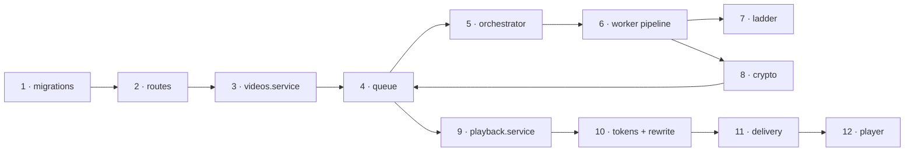

# Code walkthrough: follow one video through the code

A guided tour of the repository in the order a video meets the code. It goes from the
table it lives in, through upload, queueing, autoscaling, transcoding and encryption, to
a viewer's player decrypting it. Each step gives you a real excerpt, a link to the exact
lines, and the one thing worth noticing.

About 15 minutes end to end. Open the links side by side.

- [The map](#the-map)
- [1 · The data model](#1--the-data-model)
- [2 · The routes](#2--the-routes)
- [3 · Create and complete an upload](#3--create-and-complete-an-upload)
- [4 · The queue](#4--the-queue)
- [5 · Deciding how many workers to launch](#5--deciding-how-many-workers-to-launch)
- [6 · The worker pipeline](#6--the-worker-pipeline)
- [7 · The bitrate ladder](#7--the-bitrate-ladder)
- [8 · Envelope encryption](#8--envelope-encryption)
- [9 · Minting a playback session](#9--minting-a-playback-session)
- [10 · Tokens and playlist rewriting](#10--tokens-and-playlist-rewriting)
- [11 · Signed segment delivery](#11--signed-segment-delivery)
- [12 · The player](#12--the-player)
- [Where tests live](#where-tests-live)
- [Make your first change](#make-your-first-change)

## The map



Four packages carry the story:

| Package | Role |
| --- | --- |
| [`packages/core`](../../packages/core) | Shared by everything: config, DB, **queue**, storage, **crypto** |
| [`apps/api`](../../apps/api) | Control plane and playback |
| [`apps/worker`](../../apps/worker) · [`apps/orchestrator`](../../apps/orchestrator) | Transcoding and autoscaling |
| [`packages/player`](../../packages/player) · [`apps/console`](../../apps/console) | The browser side |

## 1 · The data model

**[`db/migrations/0001_init.sql`](../../db/migrations/0001_init.sql#L50-L95)**

```sql
CREATE TABLE videos (
  id                 text PRIMARY KEY,                 -- ULID, also the storage key segment
  title              text NOT NULL,
  external_ref       text,                             -- caller's own id for this asset
  metadata           jsonb NOT NULL DEFAULT '{}'::jsonb,

  status             video_status NOT NULL DEFAULT 'uploading',
  stage              video_stage,
  progress           smallint NOT NULL DEFAULT 0 CHECK (progress BETWEEN 0 AND 100),
  …
CREATE INDEX videos_uploaded_idx   ON videos (created_at)   WHERE status = 'uploaded';
CREATE INDEX videos_processing_idx ON videos (heartbeat_at) WHERE status = 'processing';
```

**Notice:**
- The `videos` row is both the catalog entry **and** the queue entry. Its `locked_by`,
  `heartbeat_at` and `attempts` columns are the queue's claim mechanics.
- The two **partial indexes** keep the claim and reaper queries index-only no matter how
  large the catalog grows.
- There is no `tenant_id`, by design: see [ADR-0006](../architecture/adr/0006-single-tenant-deployments.md).
- [`0002_control_plane.sql`](../../db/migrations/0002_control_plane.sql) adds keys, sessions,
  the webhook outbox, and an audit log that triggers make append-only.

## 2 · The routes

**[`apps/api/src/routes/v1.route.ts`](../../apps/api/src/routes/v1.route.ts#L33-L58)**

```ts
  v1.use("/play/:videoId", playRouter);
  …
  api.post("/videos", requireScope("videos:write"), h(videos.createVideo));
  api.get("/videos", requireScope("videos:read"), h(videos.listVideos));
  …
  api.post("/videos/:id/complete", requireScope("videos:write"), h(videos.completeUpload));
  …
  api.post("/videos/:id/playback-sessions", requireScope("playback:mint"), h(videos.mintPlaybackSession));
```

**Notice:** every management route names its scope inline, so the file is also the
permission matrix. `/v1/play/*` is a separate router, authenticated by playback tokens
rather than API keys. A test ([`openapi-drift.test.ts`](../../apps/api/test/openapi-drift.test.ts))
fails if this router and [`docs/api/openapi.yaml`](../api/openapi.yaml) ever disagree.

## 3 · Create and complete an upload

**[`apps/api/src/services/videos.service.ts`](../../apps/api/src/services/videos.service.ts#L134-L189)**

```ts
    if ((await videosRepository.countInFlight()) >= cfg.MAX_IN_FLIGHT) {
      throw new TooManyRequestsError("Too many videos in flight; retry once some finish processing");
    }

    // The id is generated up front so the storage keys embed it.
    const id = ulid();
    const sourceKey = objectKeys.source(id, ext);
    …
    const upload = await storage.presignUpload(sourceKey, cfg.MAX_UPLOAD_BYTES, expiresSeconds);
    …
    const size = await storage.headSize("uploads", video.source_key);
    if (size === null) throw new UnprocessableError("Upload not found in storage; upload the file before completing");
```

**Notice:**
- The API never handles video bytes. It hands out a presigned POST, and S3 enforces the
  size and content type.
- `/complete` doesn't trust the client's "done": it checks the object with `HeadObject` and
  records the real size.
- Row creation and the `video.created` event share one transaction.

## 4 · The queue

**[`packages/core/src/queue/index.ts`](../../packages/core/src/queue/index.ts#L31-L47)**: the claim:

```ts
export const claimNext = async (workerId: string): Promise<VideoRow | null> => {
  const result = await sql<VideoRow>`
    UPDATE videos SET
      status = 'processing', stage = 'transcoding', progress = 0,
      locked_by = ${workerId}, locked_at = now(), heartbeat_at = now(),
      attempts = attempts + 1, updated_at = now()
    WHERE id = (
      SELECT id FROM videos
      WHERE status = 'uploaded'
      ORDER BY created_at
      FOR UPDATE SKIP LOCKED
      LIMIT 1
    )
    RETURNING *
  `.execute(getDb());
```

…and **[the ready transition](../../packages/core/src/queue/index.ts#L112-L127)**:

```ts
      const flipped = await sql<{ title: string; external_ref: string | null }>`
        UPDATE videos SET
          status = 'ready', stage = NULL, progress = 100,
          …
        WHERE id = ${id} AND locked_by = ${workerId} AND status = 'processing'
        RETURNING title, external_ref
      `.execute(trx);
      const video = flipped.rows[0];
      if (!video) return false;
```

**Notice:**
- `SKIP LOCKED` lets any number of workers claim concurrently without ever getting the
  same row. An integration test races 25 workers for 10 videos to prove it.
- Every later write repeats `locked_by = $worker AND status = 'processing'`. A worker
  that lost its claim (reaped, cancelled, interrupted) writes nothing.
- The ready flip, renditions, follow-up jobs, usage and the `video.ready` webhook all commit
  together. Why Postgres and not a broker: [ADR-0001](../architecture/adr/0001-postgres-as-the-queue.md).

## 5 · Deciding how many workers to launch

**[`apps/orchestrator/src/controller.ts`](../../apps/orchestrator/src/controller.ts#L34-L40)**

```ts
export const planPool = ({ queued, inProgress, running, maxWorkers, divisor }: PoolInput): PoolPlan => {
  const safeDivisor = Math.max(1, Math.floor(divisor));
  const spare = Math.max(0, running - inProgress);
  const need = Math.ceil(Math.max(0, queued) / safeDivisor);
  const toLaunch = Math.max(0, Math.min(need - spare, Math.max(0, maxWorkers - running)));
  return { need, spare, toLaunch };
};
```

**Notice:** the decision is a pure function with no I/O, so it's exhaustively unit-tested.
Its doc comment explains the subtle part: in-progress work is *not* in the numerator,
because counting it would over-launch whenever a busy worker is momentarily invisible. The
launcher ([`ec2.ts`](../../apps/orchestrator/src/ec2.ts)) walks every subnet ×
instance-type pair with EC2 Fleet. The orchestrator never terminates anything: workers
leave on their own when idle.

## 6 · The worker pipeline

**[`apps/worker/src/pipeline.ts`](../../apps/worker/src/pipeline.ts#L126-L153)**

```ts
    await hb.update("packaging", 78);
    if (signal.aborted) throw new OwnershipLostError("primary");
    const key = await contentKeyStore.generateAndStore(video.id);
    await packageHlsAes({
      outputDir,
      videoFiles,
      audioFile,
      key: { keyBytes: key.keyBytes },
      keyUriPlaceholder: HLS_KEY_URI_PLACEHOLDER,
      …
    });
    …
    const { bytes: outputBytes } = await uploadOutputTree(outputDir, prefix, signal);
```

**Notice:**
- The pipeline is probe → ladder → transcode → thumbnails → key → package → upload.
  Each stage is preceded by a heartbeat that doubles as an ownership check. If the claim
  was lost, the `AbortSignal` kills FFmpeg and the upload, so a worker never ships a
  multi-GB tree for a video it no longer owns.
- The key URI baked into the playlists is a placeholder (`EVS_KEY_URI`). The real, tokenized
  URL is injected per viewer at step 10.

## 7 · The bitrate ladder

**[`apps/worker/src/encoding/ladder.ts`](../../apps/worker/src/encoding/ladder.ts#L92-L106)**

```ts
const capToSource = (rungs: Rung[], sourceBitrateKbps: number, opts: CapOptions): Rung[] => {
  if (!opts.enabled || sourceBitrateKbps < MIN_TRUSTED_SOURCE_KBPS) return rungs;
  const cap = Math.round(sourceBitrateKbps * opts.factor);
  return rungs.map((r) => {
    if (r.videoKbps <= cap) return r;
    const floor = Math.round(r.videoKbps * opts.floor);
    const capped = Math.min(Math.max(cap, floor), r.videoKbps);
    if (capped === r.videoKbps) return r;
    return {
      ...r,
      videoKbps: capped,
      maxrateKbps: Math.round(capped * 1.07),
      bufsizeKbps: Math.round(capped * 1.5),
    };
  });
```

**Notice:** encoding a 2 Mbps source into a 5 Mbps 1080p rung wastes CPU, storage and
egress without adding quality, so rungs are capped to the source bitrate. The **floor**
exists because of a real failure: screen recordings probe at a few hundred kbps, and an
unfloored cap encoded 1080p text into a blur. [`selectLadder`](../../apps/worker/src/encoding/ladder.ts#L53-L66)
also picks portrait rungs for vertical sources and never upscales.

## 8 · Envelope encryption

**[`packages/core/src/crypto/index.ts`](../../packages/core/src/crypto/index.ts#L75-L93)**

```ts
  async wrap(videoId: string, keyBytes: Buffer): Promise<WrappedContentKey> {
    const cfg = getCoreConfig();
    const client = getKms();
    if (client && cfg.KMS_KEY_ID) {
      const out = await client.send(
        new EncryptCommand({ KeyId: cfg.KMS_KEY_ID, Plaintext: keyBytes, EncryptionContext: { videoId } })
      );
      …
    }
    // Same binding for the local scheme: the video id is GCM additional data.
    return {
      wrappedKey: gcmSeal(derive("evs/content-key-wrap/v1"), keyBytes, videoId),
      scheme: "local_aes",
      kmsKeyRef: null,
    };
```

**Notice:**
- The raw content key never touches the database. Only the KMS ciphertext does.
- `EncryptionContext: { videoId }` binds each wrapped key to its video. A wrapped key copied
  onto another row fails to decrypt, and every unwrap is attributable to a video in CloudTrail.
- The local fallback mirrors that binding with GCM additional data, under an HKDF-derived key.
  Full model: [security.md](../architecture/security.md#key-hierarchy).

## 9 · Minting a playback session

**[`apps/api/src/services/playback.service.ts`](../../apps/api/src/services/playback.service.ts#L96-L134)**

```ts
    if (policy && policy.allowed_origins.length > 0 && (!origin || !policy.allowed_origins.includes(origin))) {
      throw new ForbiddenError("Origin is not allowed by this video's playback policy");
    }

    const defaultTtl = policy?.token_ttl_seconds ?? 300;
    const maxTtl = policy?.max_token_ttl_seconds ?? 3600;
    const ttl = Math.max(10, Math.min(input.ttlSeconds ?? defaultTtl, maxTtl));
    …
        const limit = policy?.max_concurrent_sessions ?? 0;
        if (limit > 0) {
          const active = await sessionsRepository.activeForViewerForUpdate(input.viewerId, trx);
          const decision = resolveConcurrencyLimit(
```

**Notice:**
- Your backend owns *who* may watch. This step enforces *how*: origin allowlist, TTL clamp
  and concurrent-session cap.
- The active sessions are read `FOR UPDATE`, so two simultaneous mints can't both slip
  under the cap.
- What happens at the cap (evict the oldest session, or refuse the new one) is a product
  decision isolated in [`concurrency.ts`](../../apps/api/src/playback/concurrency.ts).
- Each session is a row whose id becomes the token's `jti`, which is what makes revocation instant.

## 10 · Tokens and playlist rewriting

**[`apps/api/src/playback/token.ts`](../../apps/api/src/playback/token.ts#L55-L72)**

```ts
export const verifyPlaybackToken = (ring: Keyring, token: string): PlaybackClaims => {
  const decoded = jwt.decode(token, { complete: true }) as { header: JwtHeader } | null;
  const kid = decoded?.header?.kid;
  const secret = kid ? ring.keys.get(kid) : undefined;
  if (!secret) throw new UnauthorizedError("Invalid playback token");
  try {
    const claims = jwt.verify(token, secret, {
      algorithms: ["HS256"], // pinned: never let the token choose its own algorithm
      audience: PLAYBACK_AUDIENCE,
      issuer: ring.issuer,
    }) as PlaybackClaims;
```

**[`apps/api/src/playback/manifest-rewrite.ts`](../../apps/api/src/playback/manifest-rewrite.ts#L53-L66)**

```ts
export const rewriteVariant = (
  variant: string,
  build: { keyUrl: string; segmentUrl: (segmentUri: string) => string }
): string =>
  variant
    .split("\n")
    .map((line) => {
      const trimmed = line.trim();
      if (trimmed.startsWith("#")) {
        return trimmed.includes(HLS_KEY_URI_PLACEHOLDER) ? line.replace(HLS_KEY_URI_PLACEHOLDER, build.keyUrl) : line;
      }
      return isUriLine(trimmed) ? build.segmentUrl(trimmed) : line;
    })
    .join("\n");
```

**Notice:**
- The `kid` in the header selects the key from the keyring. That is what allows
  zero-downtime rotation: add a key, switch the active kid, retire the old one.
- The algorithm is pinned to HS256 and never read from the token.
- Native Safari can't attach headers to key or segment requests, so the token travels in
  the playlist URLs. Playlists are therefore rewritten per request and served `no-store`.

## 11 · Signed segment delivery

**[`apps/api/src/delivery/index.ts`](../../apps/api/src/delivery/index.ts#L48-L69)**

```ts
  signingQuery(videoId: string, ttlSeconds: number, nowMs = Date.now()): string {
    const resource = `${this.base}/${objectKeys.outputPrefix(videoId)}/*`;
    const policy = JSON.stringify({
      Statement: [
        { Resource: resource, Condition: { DateLessThan: { "AWS:EpochTime": Math.floor(nowMs / 1000) + ttlSeconds } } },
      ],
    });
    …
  async urlsFor(videoId: string, paths: string[], ttlSeconds: number, _token?: string): Promise<string[]> {
    const query = this.signingQuery(videoId, ttlSeconds);
    const prefix = `${this.base}/${objectKeys.outputPrefix(videoId)}`;
    return paths.map((p) => `${prefix}/${encodePath(p)}?${query}`);
  }
```

**Notice:** a 1-hour video has around 900 segments per rung. Signing each one separately
would cost an RSA operation per segment, per playlist request. Instead, **one custom policy**
with a wildcard over `media/{videoId}/*` is signed once and appended to every segment URL.
The other drivers in this file (presigned, proxy, public) implement the same
`DeliveryDriver` interface, which is how local runs work without CloudFront.

## 12 · The player

**[`packages/player/src/lib.ts`](../../packages/player/src/lib.ts#L48-L51)** and
**[`EvsPlayer.tsx`](../../packages/player/src/EvsPlayer.tsx#L143-L151)**

```ts
export function shouldUseNativeHls(userAgent: string, canPlayType: (mime: string) => string): boolean {
  if (!/iPhone|iPod/.test(userAgent)) return false;
  return canPlayType("application/vnd.apple.mpegurl") !== "";
}
```

```ts
    if (error.isAuth && onRefreshSession && !autoRefreshed.current) {
      autoRefreshed.current = true;
      void refresh();
    }
```

**Notice:**
- Only iPhone and iPod use native HLS, where MSE is unavailable. Everything else, including
  desktop Safari, uses hls.js.
- When a token expires mid-playback, the player asks your app for a fresh session
  (`onRefreshSession`) once, then resumes at the same position.
- Sprite thumbnails, the quality menu and the moving watermark live in
  [`components`](../../packages/player/src/components) and [`hooks`](../../packages/player/src/hooks).

## Where tests live

| What | Where | Kind |
| --- | --- | --- |
| Config, crypto, DB connection resolution | [`packages/core/test`](../../packages/core/test) | unit |
| Queue: concurrency, guarded writes, reaper, outbox, audit immutability | [`packages/core/test/integration`](../../packages/core/test/integration) | integration (Postgres) |
| Tokens, playlist rewriting, delivery signing, API keys, webhooks, SSRF | [`apps/api/test`](../../apps/api/test) | unit |
| Every API route over HTTP | [`apps/api/test/integration`](../../apps/api/test/integration) | integration (Postgres) |
| Contracts: console ↔ OpenAPI, OpenAPI ↔ router, receiver ↔ signer | [`apps/api/test`](../../apps/api/test) (`*-contract`, `openapi-drift`) | contract |
| Ladder, HLS, thumbnails, error scrubbing, upload retries | [`apps/worker/test`](../../apps/worker/test) | unit |
| Real FFmpeg: encode, encrypt, decrypt with the advertised IV | [`apps/worker/test/integration`](../../apps/worker/test/integration) | integration |
| Scaling math · a controller tick against Postgres | [`apps/orchestrator/test`](../../apps/orchestrator/test) | unit · integration |
| Player logic · console logic | [`packages/player/test`](../../packages/player/test) · [`apps/console/test`](../../apps/console/test) | unit |
| The whole stack on the emulator | [`scripts/demo/e2e.sh`](../../scripts/demo/e2e.sh) | end-to-end |

Run them with `make test`, `make test-integration` and `make e2e`.

## Make your first change

A worked example: **add a `language` field to videos**, end to end. The contract tests
catch you if you miss a layer.

| # | Change | File |
| :-: | --- | --- |
| 1 | Add a migration. Never edit an applied one: the runner refuses changed checksums. | `db/migrations/0003_video_language.sql`: `ALTER TABLE videos ADD COLUMN language text;` |
| 2 | Add the column to the Kysely types (or run `pnpm db:codegen` against a migrated database) | [`packages/core/src/db/types.ts`](../../packages/core/src/db/types.ts) |
| 3 | Accept it on create/update and return it | [`apps/api/src/repositories/videos.repository.ts`](../../apps/api/src/repositories/videos.repository.ts) · [`toVideoResponse` in videos.service.ts](../../apps/api/src/services/videos.service.ts#L45) |
| 4 | Document it | [`docs/api/openapi.yaml`](../api/openapi.yaml) (`Video` and `CreateVideoRequest` schemas) |
| 5 | Read it in the console | [`apps/console/src/lib/types.ts`](../../apps/console/src/lib/types.ts) |
| 6 | Prove it | an integration test in [`apps/api/test/integration`](../../apps/api/test/integration). `console-contract.test.ts` fails if step 5 reads a field step 4 doesn't declare. |

```bash
pnpm db:migrate && pnpm typecheck && pnpm test && make test-integration
```

Then open a pull request: see [CONTRIBUTING.md](../../CONTRIBUTING.md).
