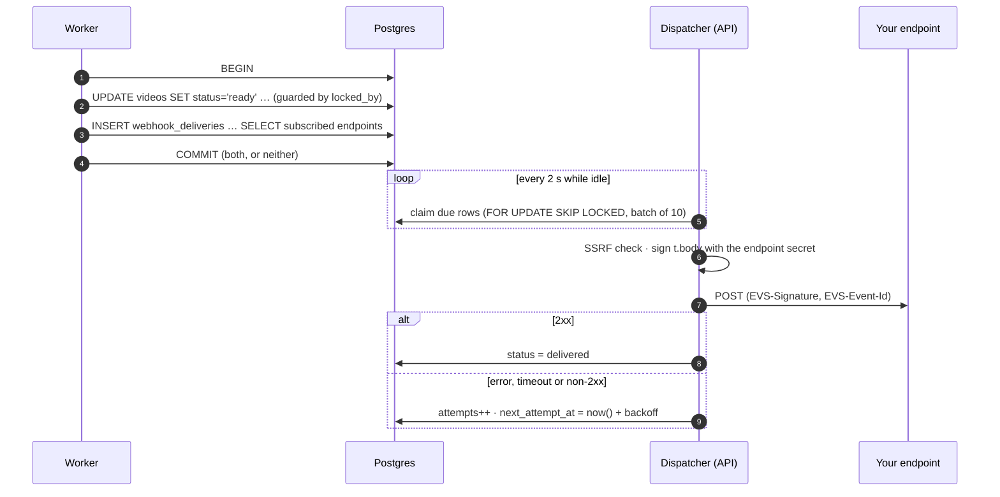

# Webhooks

EVS tells your platform when something happens to a video, such as becoming playable or
failing, by POSTing signed JSON to endpoints you register. This guide covers the events,
the payloads, how to verify a delivery, and the guarantees behind it.

- [Quick start](#quick-start)
- [Events](#events)
- [Payloads](#payloads)
- [Request format](#request-format)
- [Verifying signatures](#verifying-signatures)
- [Delivery guarantees](#delivery-guarantees)
- [Retries and redelivery](#retries-and-redelivery)
- [Network policy (SSRF guard)](#network-policy-ssrf-guard)
- [Testing locally](#testing-locally)

## Quick start

```bash
curl -s -X POST "$EVS/v1/webhooks" -H "Authorization: Bearer $EVS_KEY" \
  -H "Content-Type: application/json" \
  -d '{"url":"https://hooks.example.com/evs","events":["video.ready","video.failed"],"description":"catalog sync"}'
```

The response includes `signingSecret` (`whsec_…`). **It is shown once.** Store it with your
other secrets: you need it to verify every delivery. Subscribe to `"*"` to receive every
event. Registering an endpoint needs the `webhooks:manage` scope.

## Events

| Type | Emitted when | Emitted by |
| --- | --- | --- |
| `video.created` | A video row is created and a presigned upload is issued | API, [`videos.service.ts`](../../apps/api/src/services/videos.service.ts) |
| `video.uploaded` | `/complete` verified the object in storage and queued the video | API |
| `video.ready` | The encrypted HLS tree is uploaded and the video is playable | Worker, [`queue/index.ts`](../../packages/core/src/queue/index.ts) |
| `video.failed` | The video failed terminally (after `max_attempts`) | Worker or reaper path |
| `captions.ready` | The background captions job finished | Worker |
| `download.ready` | The downloadable MP4 is available | Worker |
| `video.cancelled` | A not-yet-ready video was cancelled | API |
| `video.deleted` | A video and its stored objects were deleted | API |
| `webhook.test` | You called `POST /v1/webhooks/{id}/test`. Sent only to that endpoint, ignoring subscriptions. | API |

The subscribable list lives in
[`packages/core/src/queue/events.ts`](../../packages/core/src/queue/events.ts).

## Payloads

Every delivery body is an **envelope**:

```json
{
  "id": "evt_01JEXAMPLE0000000000000000",
  "type": "video.ready",
  "createdAt": "2026-10-22T10:18:44.120Z",
  "data": { }
}
```

`data` per event, exactly as emitted by the code:

| Type | `data` |
| --- | --- |
| `video.created` | `{ "videoId", "title", "externalRef" }` |
| `video.uploaded` | `{ "videoId", "sourceBytes" }` |
| `video.ready` | `{ "videoId", "title", "externalRef", "durationSeconds", "renditions": ["1080", "720", "480"] }` |
| `video.failed` | `{ "videoId", "externalRef", "error" }` (a client-safe reason, never raw worker output) |
| `captions.ready` | `{ "videoId", "languages": ["en"] }` |
| `download.ready` | `{ "videoId" }` |
| `video.cancelled` · `video.deleted` | `{ "videoId", "externalRef" }` |
| `webhook.test` | `{ "endpointId", "message" }` |

A complete `video.ready` delivery:

```json
{
  "id": "evt_01JEXAMPLE0000000000000000",
  "type": "video.ready",
  "createdAt": "2026-10-22T10:18:44.120Z",
  "data": {
    "videoId": "01JEXAMPLEVIDEO00000000000",
    "title": "Intro to distributed systems",
    "externalRef": "lesson_42",
    "durationSeconds": 612,
    "renditions": ["1080", "720", "480"]
  }
}
```

> [!TIP]
> Use `externalRef` (set when you create the video) to map an event straight back to your
> own record, with no lookup.

## Request format

```http
POST /evs HTTP/1.1
Content-Type: application/json
User-Agent: EVS-Webhooks/1
EVS-Event-Id: evt_01JEXAMPLE0000000000000000
EVS-Event-Type: video.ready
EVS-Delivery-Id: evt_01JEXAMPLE0000000000000000_wh_01JEXAMPLEENDPOINT0000000
EVS-Signature: t=1792664324,v1=5f2c0b6a…

{"id":"evt_01JEXAMPLE0000000000000000","type":"video.ready", …}
```

| Header | Meaning |
| --- | --- |
| `EVS-Signature` | `t=<unix seconds>,v1=<hex HMAC-SHA256(secret, "<t>.<raw body>")>` |
| `EVS-Event-Id` | Stable across every retry and redelivery of this event. **Deduplicate on it.** |
| `EVS-Event-Type` | The event type, so you can route before parsing the body |
| `EVS-Delivery-Id` | This event × endpoint pair, useful in support tickets |

Respond with any **2xx** within `WEBHOOK_TIMEOUT_MS` (default 10 s). Anything else is a
failure, and so are redirects: they are not followed, because a redirect could point
anywhere. Do the real work asynchronously, after you respond.

## Verifying signatures

Always verify over the **raw request body**, before parsing JSON. Re-serializing changes
the bytes and the signature will not match. Then reject timestamps outside a 5-minute window,
so a captured request can't be replayed later.

**Node.js.** The full reference receiver, with deduplication, is
[`examples/webhook-receiver/server.mjs`](../../examples/webhook-receiver/server.mjs). A
contract test ([`apps/api/test/webhook-receiver-contract.test.ts`](../../apps/api/test/webhook-receiver-contract.test.ts))
keeps it in lockstep with the API's signer.

```js
import { createHmac, timingSafeEqual } from "node:crypto";

export function verify(secret, rawBody, header, now = Math.floor(Date.now() / 1000)) {
  const parts = Object.fromEntries(header.split(",").map((p) => p.split("=", 2).map((s) => s.trim())));
  const t = Number(parts.t);
  if (!Number.isFinite(t) || !parts.v1) return false;
  if (Math.abs(now - t) > 300) return false; // replay window
  const expected = Buffer.from(createHmac("sha256", secret).update(`${t}.${rawBody}`).digest("hex"));
  const provided = Buffer.from(parts.v1);
  return expected.length === provided.length && timingSafeEqual(expected, provided);
}
```

**Python**

```python
import hashlib, hmac, time

def verify(secret: str, raw_body: bytes, header: str, tolerance: int = 300) -> bool:
    parts = dict(p.strip().split("=", 1) for p in header.split(","))
    try:
        t = int(parts["t"])
    except (KeyError, ValueError):
        return False
    if abs(time.time() - t) > tolerance:
        return False
    expected = hmac.new(secret.encode(), f"{t}.".encode() + raw_body, hashlib.sha256).hexdigest()
    return hmac.compare_digest(expected, parts.get("v1", ""))
```

**Go**

```go
func Verify(secret string, rawBody []byte, header string, now time.Time) bool {
	var t int64
	var v1 string
	for _, part := range strings.Split(header, ",") {
		k, v, ok := strings.Cut(strings.TrimSpace(part), "=")
		if !ok {
			continue
		}
		switch k {
		case "t":
			t, _ = strconv.ParseInt(v, 10, 64)
		case "v1":
			v1 = v
		}
	}
	if t == 0 || v1 == "" || math.Abs(float64(now.Unix()-t)) > 300 {
		return false
	}
	mac := hmac.New(sha256.New, []byte(secret))
	fmt.Fprintf(mac, "%d.", t)
	mac.Write(rawBody)
	return hmac.Equal([]byte(hex.EncodeToString(mac.Sum(nil))), []byte(v1))
}
```

## Delivery guarantees

Events are written to a **transactional outbox**: one `webhook_deliveries` row per
subscribed endpoint, inserted in the **same database transaction** as the state change it
describes. A dispatcher in the API process then delivers them.



What that buys you:

| Guarantee | Mechanism |
| --- | --- |
| **No lost events.** If the state change commits, its events exist. | Same transaction as the change |
| **No phantom events.** A rolled-back change never notifies. | Same transaction as the change |
| **At-least-once delivery** | Retries until 2xx or `max_attempts`. A crashed dispatcher's in-flight rows are reclaimed after 5 minutes. |
| **No double sends between API replicas** | `FOR UPDATE SKIP LOCKED` claims, so each row has one dispatcher at a time |
| **Duplicates are possible** (at-least-once) | Your receiver deduplicates on `EVS-Event-Id` |
| **Ordering is not guaranteed** | Use the envelope's `createdAt`, or re-read the video via the API |

## Retries and redelivery

The retry schedule lives in [`apps/api/src/webhooks/retry.ts`](../../apps/api/src/webhooks/retry.ts).
It's exponential backoff from 30 s, doubling, capped at 1 hour, with jitter: each wait is a
random value between 50% and 100% of the step, so endpoints that failed together don't
retry in lockstep. There are 8 attempts in total.

| Failed attempt | Wait before the next attempt |
| :-: | --- |
| 1 | 15 s to 30 s |
| 2 | 30 s to 1 min |
| 3 | 1 to 2 min |
| 4 | 2 to 4 min |
| 5 | 4 to 8 min |
| 6 | 8 to 16 min |
| 7 | 16 to 32 min |
| 8 | none: the delivery becomes `failed` |

The final attempt therefore happens roughly **32 to 64 minutes** after the first.

**Redeliver** a failed, or even a delivered, event at any time. It keeps the same
`EVS-Event-Id`, so your deduplication still works, and resets the attempt counter:

```bash
curl -s -X POST "$EVS/v1/webhook-deliveries/$DELIVERY_ID/redeliver" -H "Authorization: Bearer $EVS_KEY"
```

Delivery history per endpoint is at `GET /v1/webhooks/{id}/deliveries` and on the console's
**Webhooks** page. Disabling an endpoint (`PATCH … {"enabled": false}`) makes pending
deliveries fail with `endpoint disabled` instead of being sent.

## Network policy (SSRF guard)

A webhook URL is input your server will POST to, so in production EVS refuses targets that
could reach your own network. The guard is in [`apps/api/src/webhooks/ssrf.ts`](../../apps/api/src/webhooks/ssrf.ts).

- `https://` only.
- The hostname must not resolve to a loopback, private (RFC 1918), link-local (including the
  `169.254.169.254` metadata service), CGNAT, multicast, reserved, or IPv6 local/ULA address.
- Checked **at registration and again before every delivery**, because DNS can change in
  between (rebinding).
- Redirects are never followed.

> [!NOTE]
> The local compose stack sets `WEBHOOK_ALLOW_PRIVATE_TARGETS=true` so the API can reach the
> bundled receiver container. Configuration refuses that flag when `EVS_CLOUD=aws`, so it can
> never reach a real deployment.

## Testing locally

The local stack includes the reference receiver at `http://webhook-receiver:9099/events`.

```bash
# 1. Register it and keep the secret
curl -s -X POST localhost:8080/v1/webhooks -H "Authorization: Bearer $EVS_KEY" \
  -H "Content-Type: application/json" \
  -d '{"url":"http://webhook-receiver:9099/events","events":["*"]}' | jq -r .signingSecret > /tmp/whsec

# 2. Restart the receiver with the secret
EVS_WEBHOOK_SIGNING_SECRET="$(cat /tmp/whsec)" docker compose \
  -f deploy/compose/compose.yaml -f deploy/compose/compose.floci.yaml up -d webhook-receiver

# 3. Send a test event and watch it get verified
curl -s -X POST "localhost:8080/v1/webhooks/$WEBHOOK_ID/test" -H "Authorization: Bearer $EVS_KEY"
docker compose -f deploy/compose/compose.yaml -f deploy/compose/compose.floci.yaml logs webhook-receiver
# {"accepted":true,"type":"webhook.test","eventId":"evt_…", …}
```
