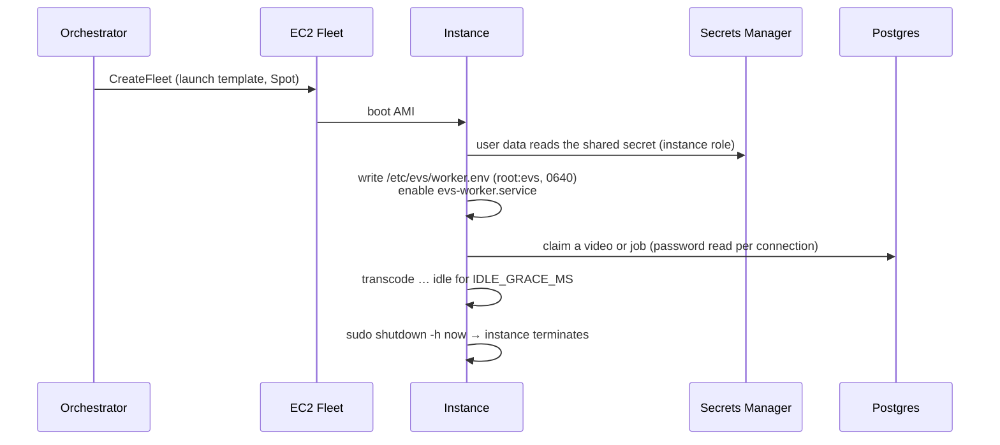

# Worker AMI

Transcode workers boot from an AMI built with Packer from
[`infra/packer/worker.pkr.hcl`](../../infra/packer/worker.pkr.hcl). This page covers what
the image contains, how to build it, how to prove a new image works before it takes
traffic, and how to roll back.

- [What is in the image](#what-is-in-the-image)
- [How a worker boots](#how-a-worker-boots)
- [Build](#build)
- [Test an AMI before rollout](#test-an-ami-before-rollout)
- [Roll out](#roll-out)
- [Roll back](#roll-back)

## What is in the image

| Component | Location | Source |
| --- | --- | --- |
| Amazon Linux 2023, arm64 (Graviton) | base | Latest `al2023-ami-2023.*-kernel-*-arm64` owned by Amazon |
| Node.js 22 | `/usr/bin/node` | distro packages, `node_major` variable |
| FFmpeg + FFprobe (static build) | `/usr/local/bin/ffmpeg`, `/usr/local/bin/ffprobe` | `ffmpeg_version` variable (AL2023 does not package FFmpeg) |
| whisper.cpp `whisper-cli` | `/opt/whisper.cpp/whisper-cli` | built from the pinned `whisper_version` tag |
| Speech model | `/opt/models/ggml-<model>.bin` | `whisper_model`: `tiny`, `base`, `small` (default) or `medium` |
| Worker bundle | `/opt/evs/worker/index.js` | `apps/worker/dist`, a single self-contained file |
| systemd unit | `/etc/systemd/system/evs-worker.service` | [`files/evs-worker.service`](../../infra/packer/files/evs-worker.service) |
| CloudWatch agent | system package | ships `/var/log/evs/worker.log` |
| `evs` service user | `/var/lib/evs` | may run exactly `shutdown -h now` via sudoers, nothing else |

It contains **no secrets and no environment**. The instance reads both from Secrets Manager
at boot. The root volume is encrypted gp3, and IMDSv2 is required with a hop limit of 1.
The build trims compilers and caches at the end ([`files/provision.sh`](../../infra/packer/files/provision.sh)).

## How a worker boots



The service is disabled in the image and enabled by user data **after** the env file
exists. A worker therefore never starts with an incomplete configuration.

## Build

```bash
pnpm install --frozen-lockfile
pnpm --filter @evs/worker build          # → apps/worker/dist/index.js
packer init infra/packer
packer build \
  -var region=us-east-1 \
  -var name_prefix=evs-prod \
  -var whisper_model=small \
  infra/packer/worker.pkr.hcl
```

| Variable | Default | Notes |
| --- | --- | --- |
| `region` | `us-east-1` | Build region (copy the AMI if you deploy elsewhere) |
| `name_prefix` | `evs` | AMI name becomes `<prefix>-worker-<timestamp>` |
| `instance_type` | `c7g.2xlarge` | Build host. whisper.cpp compiles in about two minutes. |
| `subnet_id` | default VPC | A subnet with outbound internet |
| `node_major` | `22` | |
| `whisper_version` | `v1.9.5` | Pinned release tag |
| `whisper_model` | `small` | Larger is more accurate and slower |
| `ffmpeg_version` | `7.1` | Static build version |

The AMI is tagged with `WhisperVersion`, `WhisperModel` and `BuiltAt`, so you can always
tell what a running worker was built from.

## Test an AMI before rollout

An image that boots is not the same as an image that works. Before pointing the fleet at a
new AMI, prove a worker built from it **claims and finishes a job**.

1. **Check the files are real.** Launch the AMI in a worker subnet with the worker instance
   profile, which includes `AmazonSSMManagedInstanceCore` (workers have no SSH by design).
   Connect with `aws ssm start-session --target <instance-id>` and run:

   ```bash
   find /opt/evs /opt/whisper.cpp /usr/local/bin/ffmpeg -type f -size 0   # must print nothing
   ls -la /opt/evs/worker/index.js                                       # non-zero size
   /usr/local/bin/ffmpeg -hide_banner -encoders | grep -E ' libx264 | aac '
   ldd /opt/whisper.cpp/whisper-cli | grep 'not found' || echo "whisper libs ok"
   ```

   A zero-byte bundle is the classic failure mode of images snapshotted without flushing
   writes. The worker would start, find no code, and exit without an error you can see.
2. **Prove it claims.** In `aws-dev`, set `worker_ami_id` to the new AMI and apply, then
   upload a test video (`scripts/demo/upload.sh`). Confirm all three of these:
   - the video's `attempts` goes above 0 and its `stage` advances (`GET /v1/videos/{id}`),
   - the worker log group `/evs/<name_prefix>/worker` shows the claim and `ready`,
   - the video reaches `ready` and plays.
3. **Prove it shuts down.** With an empty queue, the instance terminates itself after
   `IDLE_GRACE_MS` (two minutes by default).

> [!WARNING]
> Do not promote an AMI to production on the strength of "it booted". Promote it once a
> worker built from it has completed a real job in a production-like network: same
> subnets, same security groups, same route to the database.

## Roll out

Set `worker_ami_id` in the environment's `terraform.tfvars` and `terraform apply`. The
launch template gets a new default version, and the orchestrator always launches the
latest one. Workers already running finish their job on the old image and terminate when
idle, so there is no drain step.

## Roll back

Set `worker_ami_id` back to the last known-good AMI and apply. That creates a newer launch
template version pointing at the old image, which is exactly what the orchestrator
launches next.

> [!IMPORTANT]
> Roll back by applying the old AMI id, not by changing the launch template's default
> version by hand. Manual edits drift from Terraform and are overwritten on the next apply.

Keep at least the previous AMI (and its EBS snapshot) until the new one has processed real
work.
