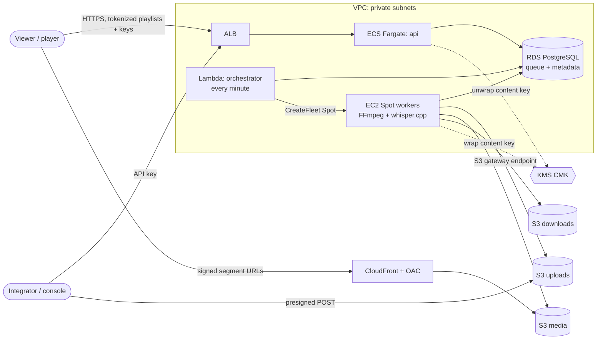

# Infrastructure

Everything needed to run Euron Video System, from a laptop to a multi-AZ AWS
deployment, as code.

```
infra/
├── docker/        Multi-stage, multi-arch images: api (+ tools target), worker, orchestrator, console
├── packer/        Worker AMI (Amazon Linux 2023 arm64: Node 22, FFmpeg, whisper.cpp, systemd unit)
└── terraform/
    ├── modules/   network · kms · storage · cdn · secrets · database · api-service ·
    │              worker-fleet · orchestrator · observability
    └── envs/
        ├── local-floci/   storage + kms + secrets (+ optional cdn) on the Floci emulator
        ├── aws-dev/       full stack, cost-lean (single NAT, single-AZ DB, small ceilings)
        └── aws-prod/      full stack, resilient (NAT per AZ, Multi-AZ DB, deletion protection)
```

## One codebase, two clouds

The modules are the same in every environment. `local-floci` points the AWS
provider at the emulator (`http://floci:4566` inside compose) and turns off
only what an HTTP-only emulator cannot do (TLS-only bucket policies, lifecycle
waits). `make up` applies it automatically before any service starts.

## AWS topology (aws-dev / aws-prod)



## Order of operations (first deploy)

1. `pnpm install && pnpm --filter @evs/worker --filter @evs/orchestrator build`
2. `packer build infra/packer/worker.pkr.hcl` → note the AMI id
3. Request an ACM certificate for your API domain
4. `cp envs/aws-dev/terraform.tfvars.example envs/aws-dev/terraform.tfvars`, fill it in
5. `terraform -chdir=infra/terraform/envs/aws-dev init && terraform -chdir=infra/terraform/envs/aws-dev apply`
6. Push the API images to the `api_ecr_repository_url` output (`<tag>` and `<tag>-tools`)
7. Run the migration task (`migrate_task_definition` output), then point DNS at `api_alb_dns_name`

The full runbook, including image builds and the migration `run-task` command,
is in [docs/guides/deploy-aws.md](../docs/guides/deploy-aws.md).

## Security posture at a glance

| Control | Where |
|---|---|
| No static AWS credentials anywhere (roles + default chain only) | all modules |
| Least-privilege IAM per runtime, KMS scoped by encryption context | api-service, worker-fleet, orchestrator |
| Private subnets for every runtime; no SSH; SSM Session Manager only | network, worker-fleet |
| IMDSv2 required, hop limit 1 | worker-fleet, packer |
| Buckets private, BPA on, TLS-only, OAC for CloudFront | storage, cdn |
| Encryption at rest with a rotating CMK (RDS, S3, EBS, secrets, ECR) | kms + consumers |
| Generated secrets; DB password managed and rotated by RDS | secrets, database |
| Signed media delivery, short-lived | cdn + API |
| Static analysis in CI: `terraform validate`, tflint, checkov | .github/workflows/terraform.yml |
